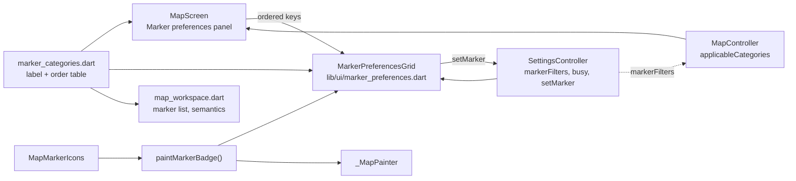
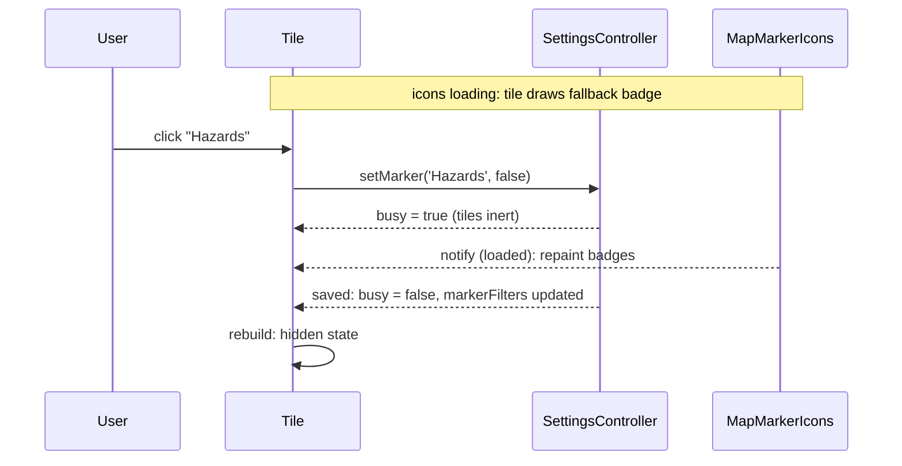

# Design

## Triage

| Trigger | Applies? | Evidence |
|---|---|---|
| T1 Components (new component, or 3+ with directed relationships) | Yes | A new tile grid widget reads `MapController.applicableCategories` (`lib/application/map_controller.dart:76-79`), `SettingsController.settings.markerFilters` and `setMarker` (`lib/application/settings_controller.dart:59`), and `MapMarkerIcons` (`lib/maps/map_marker_icons.dart`). A new label and order table in `lib/domain/` is used by the grid and by `lib/ui/map_workspace.dart`. |
| T2 State (persistent state, caches, 3+ state machine) | No | No new state. Visibility stays in the existing `markerFilters` setting (`lib/domain/settings.dart:98-109`), and the saved keys do not change. The tile's state is derived from that setting each build. |
| T3 Concurrency (background work, workers/isolates, async, retries) | Yes (light) | Tiles render while `MapMarkerIcons.open()` is still loading, which `AppServices.initialize()` starts without awaiting (`lib/application/app_services.dart:236`). A tile click calls the async `setMarker` while a save may already be running. No new async work. |
| T4 Boundaries (data format, migration, shared interface, IPC, external) | Yes | The badge drawing in `_MapPainter._badge` (`lib/ui/map_workspace.dart:676-720`) becomes one shared function used by the map and the tiles. No data format, settings or bundle change. |
| T5 Volume (grows without a fixed bound) | No | At most 19 known keys plus the unknown keys one prepared map carries. Prepared maps are bundled and checked. |
| T6 Risk (security, money, data loss, unrecoverable user data) | No | Display only. The setting writes go through the existing `setMarker` and `save` paths. |

TIER: FULL

## Context

- Marker preferences is built inline in `MapScreen.build` (`lib/ui/map_screen.dart:387-487`): search field, quest name and trader fields, Show all and Hide all buttons that write every applicable key at once (`:424-449`), the Save marker filters switch (`:450-462`), and one `FilterChip` per key labelled with the raw key (`:463-483`). The keys come from `applicableCategories`, which is the prepared map's marker keys plus `CustomPins`, sorted by key (`:307`).
- The panel is a `ListView` inside a `GridPanel` with a fixed height of `430 * scale` (`:387-393`). It scrolls on its own. The test helper `_showMarkerFilter` (`test/maps/map_viewport_test.dart:56-80`) scrolls that inner list until it finds a `FilterChip` by its key text. `test/ui/map_screen_test.dart:172` and `:182` find the chip and the bulk buttons the same way. Floor chips (`'Upper'`) are separate `FilterChip`s in the map workspace and are not touched.
- `markerCategories` (`lib/domain/settings.dart:18-39`) lists the 20 persisted keys, `Labels` included. ADR-0023 gives 19 of them an icon (`Labels` has none and no marker carries it).
- `MapMarkerIcons` exposes `geometry`, `background`, `icon(key)` and `colourFor(key)`, and notifies once when loading ends (`lib/maps/map_marker_icons.dart:126-160`). Its design already named this change as its second consumer (archived `add-map-marker-icons` design, D2).
- `_MapPainter._badge` draws the disc, ring, glyph or centre dot from `markerBadgeStyle` (`lib/ui/map_workspace.dart:676-720`). It keeps reusable `Paint` objects on the painter (`:581-587`).
- Raw keys also reach the player in the visible-markers list subtitle (`lib/ui/map_workspace.dart:148`) and the marker semantics label (`:739`).

## Decisions

### D1: One label and order table in the domain layer

- **Choice:**
  - `lib/domain/marker_categories.dart` holds a `const` ordered list of `(key, label)` records for the 19 icon keys, in group order:
    1. Extracts and transits: `PmcExtracts` "PMC extracts", `ScavExtracts` "Scav extracts", `SharedExtracts` "Shared extracts", `Transits` "Transits".
    2. Quests: `QuestItems` "Quest items", `QuestObjectives` "Quest objectives".
    3. Danger: `Hazards` "Hazards", `HazardZones` "Hazard zones", `BossSpawns` "Bosses", `CultistSpawns` "Cultists".
    4. Spawns: `PmcSpawns` "PMC spawns", `ScavSpawns` "Scav spawns".
    5. Loot: `lootContainers` "Containers", `lootLoose` "Loose loot".
    6. Utility: `locks` "Locks", `Switches` "Switches", `BtrStops` "BTR stops", `stationaryWeapons` "Stationary weapons".
    7. `CustomPins` "Saved pins".
  - Two functions: `markerCategoryLabel(String key)` returns the label, or the key when it has none (used by D4). `markerPreferenceKeys(Iterable<String> keys)` returns only the keys in the table, in table order, so a key the map carries but settings cannot store gets no tile (D5).
  - `markerCategories` in `settings.dart` stays as it is: it is the persisted-key allow-list (with `Labels`), not a display table. A unit test proves the table covers exactly `markerCategories` minus `Labels`, so a key added to one cannot be missed in the other.
- **Rejected:** labels in the icon manifest (`assets/map_markers/manifest.json`). The manifest is the ADR-0023 schema-1 asset contract, checked by the bundle check and loaded asynchronously. Labels there would be missing until the icons load, would need a schema change and a new bundle-check rule, and would be gone whenever the manifest fails, which is exactly when the fallback tiles most need a readable name.
- **Rejected:** a `switch` in the UI file. The visible-markers list and semantics in `map_workspace.dart`, and later `plain-language-pass`, need the same names. One table in `lib/domain/` is the single source.
- **Reversal cost:** low. Internal and `const`.

### D2: One shared badge painter for the map and the tiles

- **Choice:**
  - Move the body of `_MapPainter._badge` into a public function in `lib/maps/map_marker_icons.dart`: `paintMarkerBadge(Canvas canvas, Offset centre, MapMarkerIcons icons, {required String filterKey, required bool selected, required bool highlighted, required bool dimmed, MarkerBadgePaints? paints})`. `MarkerBadgePaints` holds the fill, ring and glyph `Paint` objects, so the map painter keeps reusing one set per paint as it does today, and a tile can pass none.
  - `_MapPainter._badge` becomes a call to it. The map's existing badge tests (`test/ui/map_marker_painting_test.dart`) are the proof that the map output did not change.
  - The tile draws its badge with a small `CustomPainter` that calls `paintMarkerBadge` with `selected: false, highlighted: false` and `dimmed: !shown`, and repaints on `MapMarkerIcons`. Its `shouldRepaint` compares the key, the shown state and the icons instance, since the icons notify only once and a toggle rebuilds the painter rather than notifying it. A hidden tile is therefore drawn at `dimmedMarkerOpacity`, the same 22% as a dimmed map marker.
- **Rejected:** a tile-only widget built from `RawImage` with a `ColorFilter` and a `DecoratedBox` ring. It is a second implementation of the badge that can drift from the map's (ring width, fallback dot, role colour). The spec asks the tile to look like the map's badge, so the code should be the same.
- **Reversal cost:** low. One internal function with two callers.

### D3: A fixed-size tile grid in its own widget

- **Choice:**
  - `lib/ui/marker_preferences.dart` holds `MarkerPreferencesGrid({required AppServices services, required List<String> keys})`. `MapScreen` passes `markerPreferenceKeys(services.maps.applicableCategories)` and keeps the search, quest, bulk and save controls where they are.
  - The grid is a `Wrap` of tiles with a fixed size: 88 × 76 logical pixels, multiplied by the text scale the screen already uses (`scale`, `lib/ui/map_screen.dart:303`). Each tile is a 24 px badge, a check mark in the top-right corner when shown, and the label in at most two lines, centred, ending with an ellipsis. Every tile has the same size whatever its label, so the grid lines up.
  - Each tile is an `InkWell` with `Semantics(toggled: shown, label: label, button: true, excludeSemantics: true)`, so the label text inside is not announced a second time. `onTap` is `null` while `services.settings.busy`, and otherwise calls `services.settings.setMarker(key, !shown)`. `shown` is `markerFilters[key] ?? true`, the same default as the chip (`:470-475`).
  - The tile has the key `ValueKey('marker-tile-<key>')`, so tests can find a tile by its key without depending on the label text.
  - Hidden tiles use `GridColors.muted` for the label. Shown tiles use `GridColors.text`.
- **Rejected:** a `GridView` with a fixed column count. The rail is 30 % of the window and narrows in the compact layout, so a fixed column count either overflows or leaves wide tiles. A `GridView` inside the panel's `ListView` also needs `shrinkWrap`. A `Wrap` of fixed-size tiles fits as many columns as the width allows, with no nested scrolling.
- **Rejected:** keeping `FilterChip` and adding an avatar icon. Chips size to their label, so the grid is not uniform, which the exit criterion asks for.
- **Reversal cost:** low. One widget.

### D4: The labels replace raw keys in the marker list and map semantics

- **Choice:** `lib/ui/map_workspace.dart:148` shows `markerCategoryLabel(marker.filterKey)`, and `:739` builds `'${marker.marker.name}, ${markerCategoryLabel(marker.marker.filterKey)}'`. Nothing else in the workspace changes.
- **Rejected:** leaving them for `plain-language-pass`. The label table exists from this change, and leaving two raw-key sites next to it means a second change touching the same lines for the same mapping.
- **Reversal cost:** low.

### D5: Only saveable keys get a tile or a bulk write

- **Choice:**
  - Tiles exist only for keys in the D1 table, which a unit test pins to `markerCategories` minus `Labels`. A marker whose key is not in the table (`lib/maps/prepared_map.dart:703` passes an unmapped pack category through as its own key) has no tile and stays drawn, since its filter defaults to shown.
  - Show all and Hide all write the same list the grid shows (`markerPreferenceKeys(...)`), not the raw `applicableCategories` that `lib/ui/map_screen.dart:441` writes today.
  - Why: `setMarker` and `save` write `markerFilters` to the settings row every time, whatever Save marker filters says (that switch only decides whether the next launch restores them, `lib/application/settings_controller.dart:18`). `AppSettings.fromJson` rejects any key outside `markerCategories` (`lib/domain/settings.dart:162-165`), and `AppServices.open` fails on it (`lib/application/app_services.dart:204-209`). So a tile or bulk write for an unknown key would stop the next launch. Today's chips and bulk buttons already have this latent fault; this change removes it.
- **Rejected:** letting `AppSettings.fromJson` drop unknown filter keys. It loosens a settings integrity check to cover a display bug, and a pack key the app cannot name is better caught where it enters than accepted silently.
- **Rejected:** keeping unknown keys toggleable in memory only, never written. It needs a second visibility store beside `markerFilters` with its own owner, for a case no bundled pack has today.
- **Reversal cost:** low. Adding a key to the table and to `markerCategories` makes it toggleable.

## Diagrams (FULL)

Components (T1, T4):

Tile click while icons load and a save runs (T3):

## State & Ownership (FULL)

| State | Owner (sole writer) | Lifetime | Invalidation / rebuild | Authoritative copy |
|---|---|---|---|---|
| Category visibility (`markerFilters`) | `SettingsController` (unchanged) | App session; persisted only when Save marker filters is on (unchanged) | The grid rebuilds on the `SettingsController` notification through the screen's `ListenableBuilder` (`lib/ui/map_screen.dart:300`) | `SettingsController.settings` |
| Tile shown state | None: derived as `markerFilters[key] ?? true` on each build | One build | Every settings notification | `markerFilters` |
| Applicable keys and their order | `MapController` (keys, unchanged); order is a pure function of them | Per prepared map | Map change notifies the screen | `PreparedMap.categories` |
| Badge glyphs and colours | `MapMarkerIcons` (unchanged) | App session | One notification when loading ends; the tile painter repaints on it | `MapMarkerIcons` |
| Labels and order | `const` table | Compile time | n/a | `lib/domain/marker_categories.dart` |

## Failure & Visibility (FULL)

| Component | Fails / dies mid-operation → | Recovery | Retry safe? | Who finds out |
|---|---|---|---|---|
| `MapMarkerIcons` load | Tiles draw the fallback badge for every or the failed key (D2, same as the map) | None needed; the next launch loads again | n/a | Log, once per failure (existing); the player sees fallback dots on map and tiles alike |
| `setMarker` save | Existing behaviour: `SettingsController` keeps the previous settings and sets `error`, which the Map workspace already shows (`lib/ui/map_screen.dart:339-343`). The tile stays in its old state, since it is derived | The player clicks again | Yes: it writes one boolean | The player, through the error line and the unchanged tile |
| Unknown key in a prepared map | No tile and no bulk write (D5); its markers stay drawn and the visible-markers list shows the raw key (D4) | Add the key to the D1 table and to `markerCategories` | n/a | The player, as a raw key in the marker list. No offline check catches an unmapped pack category today (ADR-0023 covers icons, not pack keys); the D1 coverage test only keeps the table and `markerCategories` in step |

## Resource Bounds (FULL)

| Queue / buffer / cache / transfer | Bound | At the bound | Timeout | At 10x / 100x |
|---|---|---|---|---|
| Tiles per grid | Keys on one prepared map + `CustomPins`: 19 known today | n/a | n/a | 190 tiles would make the panel scroll in its fixed-height `ListView`, which already scrolls; no bound needed for a bundled pack |
| Paint objects | One `MarkerBadgePaints` per map painter (as now); a tile painter allocates its own three `Paint`s per paint | n/a | n/a | Negligible |

## Flow & State Gaps (FULL)

- **Icons load after the grid is built.** The tile painter listens to `MapMarkerIcons` and repaints. Nothing waits on the icons.
- **Click while a save is running.** Tiles are inert while `settings.busy`, as the chips and bulk buttons were. No queued toggle.
- **Map changes while the grid is shown.** `applicableCategories` changes, the screen rebuilds with the new ordered keys. Keys of other maps keep their saved entries, because Show all and Hide all write only the shown tiles' keys (D5).
- **Unknown key on the next launch.** No tile or bulk action writes it (D5), so the settings row stays loadable.
- **`MapMarkerIcons.disabled()`** (the test default, `lib/application/app_services.dart:59`) means fallback badges in every tile. Tests that check glyphs inject a loaded `MapMarkerIcons` as `test/ui/map_marker_painting_test.dart` does.

## Mechanism Ledger (FULL)

| Mechanism | Built? | Why (harm nobody catches / expensive later) | Evidence that would change the call |
|---|---|---|---|
| Shared `paintMarkerBadge` | Yes | Without it the tile and map badges drift apart and nobody notices until a player compares them | n/a |
| Table-covers-`markerCategories` unit test | Yes | A new key would silently show its raw name; the test is one line and catches it at once | n/a |
| Labels in the manifest | No | See D1 | A need for labels outside the app (bundle tooling, preview sheet) |
| Per-tile tooltip with the raw key | No | Nobody needs the raw key in a raid; diagnostics are change 7's | A support request that needs to match a tile to a key |
| Persisted grid layout or tile order preference | No | Not asked for | A user request |
| Tiles for unknown keys | No | They would write a key the settings loader rejects (D5) | A bundled pack that ships a new category players need to hide before the table names it |
| Debounce of tile clicks | No | `busy` already makes tiles inert during a save | Reports of missed toggles |

## Risks / Trade-offs

- [Existing tests find chips by raw key, and a broad test rewrite can hide a behaviour change] → The test helper `_showMarkerFilter` and the two `map_screen_test.dart` lookups change only their finder to `ValueKey('marker-tile-<key>')`; their assertions stay the same. `test/maps/map_viewport_test.dart:772` builds the expected marker semantics label from the raw key, and passes only because "Hazards" equals its key; it builds the label with `markerCategoryLabel` instead.
- [Fixed tile size clips a long label at a large text scale] → Two lines with an ellipsis, and the tile size scales with `scale`. Small-window plus large-text layouts are not a target configuration.
- [Moving `_badge` changes the map's output by accident] → The existing map badge painting tests run unchanged against the shared function.

## ADRs

- **In force, constraining this change:** ADR-0023 (marker icon set, badge geometry, roles and the fallback the tiles reuse); ADR-0002 (notifiers and composition root: the grid reads `AppServices` controllers and adds no new owner).
- **To record during apply:** none. No decision here binds future changes beyond what ADR-0023 already records.

## Open Questions

- Exact tile size (88 × 76) and check-mark placement may be tuned after the user sees it. That changes neither the specs nor the tasks.
