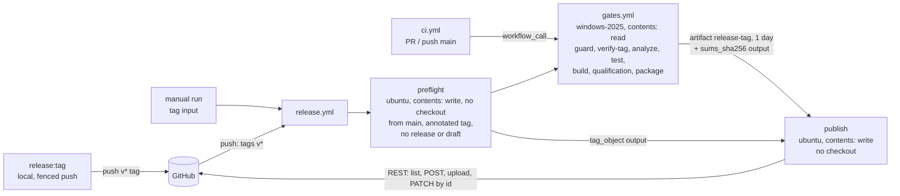
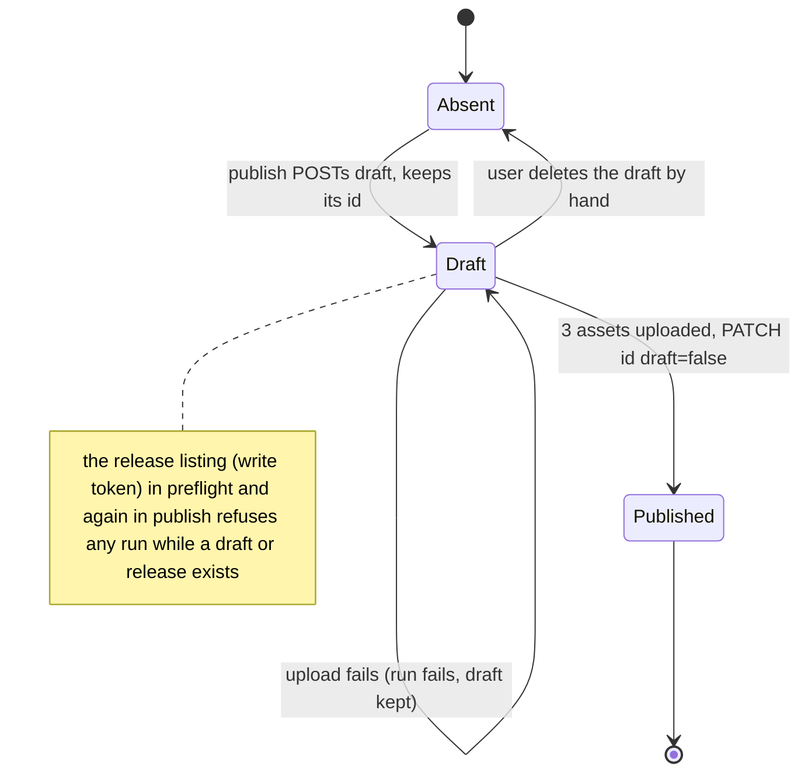
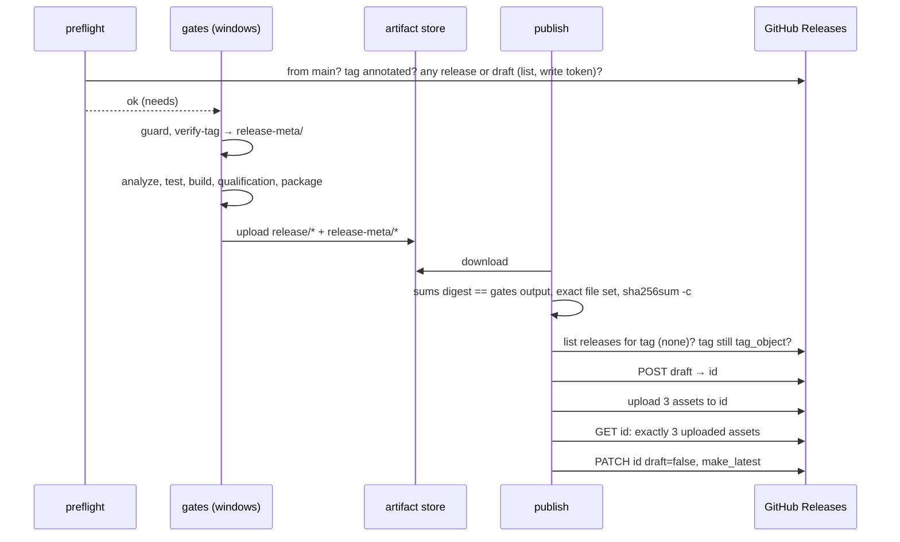

# Design

## Triage

| Trigger | Applies? | Evidence |
|---|---|---|
| T1 Components (new component, or 3+ with directed relationships) | Yes | New `release.yml` (preflight, gates, publish jobs) and a reusable `gates.yml` called by `ci.yml` and `release.yml`; jobs hand files to each other through a workflow artifact |
| T2 State (persistent state, caches, 3+ state machine) | Yes | A GitHub Release moves through absent → draft → published; a leftover draft blocks reruns |
| T3 Concurrency (background work, workers/isolates, async, retries) | Yes | A tag push and a manual run for the same tag can overlap; reruns after a failed upload |
| T4 Boundaries (data format, migration, shared interface, IPC, external) | Yes | GitHub Releases and REST API (external); `release.dart verify-tag`/`notes` output files are a contract between jobs; `release:tag` reads the PR through the API |
| T5 Volume (grows without a fixed bound) | No | One release per tag, three assets per release; artifact retention is bounded (D4) |
| T6 Risk (security, money, data loss, unrecoverable user data) | Yes | The publish job holds `contents: write`; a wrong or partial release is public to every collaborator; Windows-runner minutes are billed for a private repo |

TIER: FULL

## Context

See proposal.md for scope. Current state this design builds on:

- `ci.yml` is one job on `windows-2025` with `contents: read`, a full-history checkout without persisted credentials, the vision-input cache restore and save, `jdx/mise-action`, then `analyze`, `test`, `build:release`, `ci:qualification` (the only setter of `BLACKGRID_NO_GAMES_RUNNING`) and `package:release` (`.github/workflows/ci.yml:16-64`). Concurrency is per PR (cancelling) or per pushed SHA (`ci.yml:11-13`).
- `test/tool/ci/workflow_test.dart:11` hard-codes `.github/workflows/ci.yml`. It asserts the step order, the single no-games setter (`:169-196`), that no other tracked file sets it (`:198`), `contents: read` (`:219`) and SHA pins (`:225`).
- `package:release` writes exactly `Blackgrid-<version>-windows-x64.zip`, `...-setup.exe` and `SHA256SUMS.txt` into `build/release/` and clears that folder on any failure (`tool/release/src/package_step.dart:13,54-55,87-133`; ADR-0025 D3, D5). `build:release` and `package` do not require a branch, so a detached tag checkout works. They do require a clean tree and a stamp for `HEAD` (ADR-0025 D1).
- `release:prepare` regenerates `CHANGELOG.md` with `--tag v<version>` (`tool/release/src/release_steps.dart:119-127`), so the release commit's changelog has a `## v<version>` section, including for a `-beta.N` version. That this holds for prereleases is an **unverified assumption**: no prerelease has been prepared yet. Task 1 proves it with a fixture test.
- `release:tag` accepts only a two-parent merge and compares the release commit's first parent with `HEAD`'s first parent (`tool/release/src/tag_step.dart:57-111`). It confirms the push identity with `PushIdentity.confirm` before any network call (`:40`). The token reaches child processes only through the environment (`push_identity.dart:19`).
- `openspec/specwright.yaml` sets `pr.merge: agent` and `merge_method: squash`. Release PR #61 was merged with a merge commit, but the next one would be squashed.
- Tags on origin: `v0.1.0`, `v0.4.0`, `v0.5.0`. There are no releases. The repository is private and has no branch protection or rulesets (checked through the API on 2026-10-31).

## Decisions

### D1: One reusable gates workflow, called by CI and by the release workflow

- **Choice:** Move the CI job's steps into `.github/workflows/gates.yml` (`on: workflow_call`), with one optional string input, `release_tag` (default empty). `ci.yml` keeps its triggers and concurrency and calls it with no input. `release.yml` calls it with the tag. With `release_tag` set, the job checks out `refs/tags/<tag>` instead of the event's ref, adds the tag-tooling guard and the `verify-tag` step right after the mise install (D3), and uploads the package after the Package step (D4). The gate steps themselves are identical in both modes and have no `if:`. The no-games confirmation stays on the one qualification step, now in `gates.yml`.
- **Rejected:** Copy the gate steps into `release.yml`. The two lists would drift, and the no-games flag would gain a second setter, which the `continuous-integration` spec forbids. Also rejected: a release job that downloads CI's artifact for the tagged commit. A tag can point at a commit whose CI run is gone, expired or was cancelled, and the published bundle would then not come from the run that published it.
- **Reversal cost:** low. Only workflow files and their tests change; the check's name on PRs becomes `ci / <job name>`, and no branch protection references it today.

### D2: Three jobs, write permission only in jobs that run no repository code

- **Choice:** `release.yml` has top-level `permissions: contents: read` and three jobs:
  1. `preflight` (`ubuntu-latest`, no checkout, `permissions: contents: write`) resolves the tag from the event: `github.ref_name` on push, the `tag` input on a manual run. The tag reaches scripts only through `env:` and is never interpolated into one. On a manual run it refuses unless `github.ref` is `refs/heads/main`. For `workflow_dispatch`, GitHub runs `release.yml` and the local `gates.yml` from the ref the user picks, and a branch's unreviewed workflow must not publish. It requires the name to match `^v[0-9]` and the tag to exist on origin (`gh api repos/{repo}/git/ref/tags/<tag>`). That response's `object.type` must be `tag`: this is the authoritative annotated-tag check, independent of how `actions/checkout` writes the ref. Its `object.sha` becomes the job output `tag_object`. Preflight then runs the release-existence check (below) and fails, naming each match.
  2. `gates` (`uses: ./.github/workflows/gates.yml`, `release_tag` set, `needs: preflight`), with `contents: read`.
  3. `publish` (`ubuntu-latest`, `needs: [preflight, gates]`, `permissions: contents: write`) downloads the artifact, verifies it (D4), runs the release-existence check again and creates the release (D5). It has no checkout, no `mise` step, and runs only `gh`, `sha256sum` and `jq`.

  **Release-existence check:** `gh api --paginate repos/$GITHUB_REPOSITORY/releases`, filtered on `tag_name == <tag>`. It needs the write token for two reasons. The Releases API lists drafts only to callers with push access. `GET /releases/tags/<tag>`, which `gh release view` tries first, finds published releases only. Several drafts with the same `tag_name` can coexist, and `POST /releases` does not refuse an existing draft. So this check, not a create failure, is what keeps one release per tag.

  Neither write job checks out the repository or runs its code. An offline test asserts that a job with `contents: write` has no `actions/checkout`, no `mise` and no `uses:` of a local workflow.
- **Rejected:** A read-only preflight that sees published releases only. A leftover draft would then be found only after the full Windows gate run, up to 120 billed minutes. Also rejected: one Windows job with `contents: write` that builds and publishes. The write token would be in reach of every build step: Flutter, pub packages, CMake, the vision fetch and the qualification tests all run code from the tagged tree and its dependencies. `persist-credentials: false` keeps the token out of `.git/config`, but the token is still in the runner's context.
- **Reversal cost:** low.

### D3: Tag validation is a tested Dart subcommand, guarded for old trees

- **Choice:** `release.dart verify-tag <tag> --out <dir>` (mise task `release:verify-tag`) runs inside the tag's checkout before Analyze. The annotated-tag check belongs to preflight (D2). This step refuses, naming the failed check, unless:
  - the name is `v` + `SemVer.parseRelease` (the existing parser, `tool/release/src/semver.dart`);
  - the tagged commit is on `git rev-list --first-parent origin/main`;
  - the tagged commit's `pubspec.yaml` version equals the tag's version;
  - its `CHANGELOG.md` has a non-empty `## <tag>` section.

  It writes `<dir>/notes.md` (the section body, per the `release-publishing` notes rule) and `<dir>/release.json` (`{"tag","version","prerelease","latest"}`). `latest` is true only for a final version that has the highest precedence among the final `v*` tags in the checkout. The checkout has every tag because `fetch-depth: 0` fetches them. `<dir>` is `build/release-meta/`, outside `build/release/`, which `package` clears. A preceding `pwsh` step fails with "<tag> predates release publishing" unless the tagged `mise.toml` defines both `release:verify-tag` and `package:release`. That step runs from `gates.yml` at the workflow's ref, so it works for trees that lack the subcommand.
- **Rejected:** Shell checks inline in YAML. They cannot be unit-tested offline, which AGENTS.md requires for invariants at the cheapest layer, and the SemVer rules would be duplicated outside `semver.dart`.
- **Reversal cost:** low.

### D4: The package crosses jobs as one short-lived artifact, re-verified on arrival

- **Choice:** After Package, `gates.yml` (release mode only) uploads `build/release/*` and `build/release-meta/*` as one artifact named `release-<tag>`, with `retention-days: 1`, `if-no-files-found: error` and `compression-level: 0` (the zip and setup are already compressed). `publish` downloads it into an empty directory. The directory must hold exactly the three package files plus `notes.md` and `release.json`, and `sha256sum -c SHA256SUMS.txt` must pass with `SHA256SUMS.txt` listing exactly the zip and the setup. `SHA256SUMS.txt` itself must also match `sums_sha256`, a job output that `gates.yml` computes on the runner right after Package and exposes through the reusable workflow's `outputs:`. The sums file travels in the same artifact as the files it covers, so without that output the check would catch corruption and missing files but not a consistent replacement of the whole set. Both actions are pinned by SHA.
- **Rejected:** Rebuilding in the publish job. That needs Windows and write access in the same job, which D2 rejects.
- **Reversal cost:** low.

### D5: Create as a draft, upload, then publish

- **Choice:** Publishing runs these steps in order:
  1. Run the release-existence check (D2) and refuse on any match.
  2. Re-read `git/ref/tags/<tag>`, and refuse if the tag is missing or its `object.sha` differs from preflight's `tag_object`. Without the tag, the POST would create one from the default branch.
  3. Create the draft through `gh api -X POST repos/$GITHUB_REPOSITORY/releases`, with `tag_name`, `name` set to the tag, `body` from `notes.md`, `draft: true` and `prerelease` from `release.json`. Keep the returned `id` and `upload_url`.
  4. Upload the three files to that release with `gh api` against the upload URL, one call per file.
  5. `GET /releases/<id>` must list exactly those three asset names, each in state `uploaded`.
  6. Send `PATCH /releases/<id>` with `draft: false`. `make_latest` is `true` only when `release.json` says `latest`, otherwise `false`, so it is always `false` for a prerelease.

  Every call after the create addresses the release by `id`, never by tag name, because several drafts can share a tag. The workflow has `concurrency: group: release-<tag>, cancel-in-progress: false`, so a push run and a manual run for the same tag run one after the other, and the second one fails in preflight.
- **Rejected:** `gh release create` and then `gh release view` or `gh release edit` on the tag. Those address the release by tag name, which is ambiguous among drafts. Also rejected: creating a published release in one call and relying on gh's ordering. Whether gh publishes before every upload succeeds is not documented, and a public release missing its setup is exactly what the spec forbids. Also rejected: deleting a leftover draft automatically on rerun. The workflow cannot prove that it created the draft, and deleting a release is not reversible.
- **Reversal cost:** low.

### D6: `release:tag` accepts a squash-merged release, verified through the PR

- **Choice:** In `tag_step.dart`, a single-parent `HEAD` whose subject matches `^chore\(release\): v(<semver>) \(#(\d+)\)$` takes the squash path. With the already-confirmed `PushIdentity` token, `gh api repos/<owner>/<repo>/pulls/<N>` must report `merged: true`, `merge_commit_sha == HEAD`, `head.ref == release/v<version>` and `commits == 1`. `gh api repos/<owner>/<repo>/pulls/<N>/commits` gives that one commit. Its subject must be `chore(release): v<version>`, its parent must equal `HEAD^`, and its tree (`gh api .../git/commits/<sha>` → `tree.sha`) must equal `git rev-parse HEAD^{tree}`. `<owner>/<repo>` comes from origin's fetch URL, which the existing URL rule already requires to be HTTPS on github.com. The merge path is unchanged. Every later check (pubspec, tag absent, annotated tag, fenced push) is shared by both paths.
- **Rejected:** Make the agent merge release PRs with a merge commit. `merge_method` is project-wide, a human merge from the GitHub UI defaults to the repository setting, and the failure shows up only after merge, when the tag is due. Also rejected: comparing a regenerated changelog with the committed one. The section date comes from the commit time, so a release merged the day after `prepare` would be refused.
- **Reversal cost:** low. Tagging logic only; no stored format changes.

### D7: The local flow keeps tagging local and hands building to CI

- **Choice:** The flow is `release:prepare` → PR → merge → `release:tag` → CI publishes. `release:tag` prints the URL of the Actions run filter for the tag after pushing (`https://github.com/<owner>/<repo>/actions/workflows/release.yml`) and no longer suggests `build:release`. `build:release` and `package:release` stay for checking a build locally before tagging. README "Releases and changelog" gets a Publish row and a "Retry or backfill" note. A manual run starts from `main` and takes a tag that has no release. It refuses older trees such as `v0.4.0` and `v0.5.0`. A failed publish can leave a draft. The release listing in preflight and in publish refuses any run while a release or draft exists for the tag, so the user deletes the draft on the Releases page, then starts a manual run.
- **Rejected:** Moving tagging into CI (a `workflow_dispatch` that tags). The tag push would come from `GITHUB_TOKEN`, which does not trigger other workflows, and it would widen CI's permissions to write refs.
- **Reversal cost:** low.

## Diagrams (FULL)

Components and the hand-off (T1, T4):

Release lifecycle (T2):

Run sequence (T3):

## State & Ownership (FULL)

| State | Owner (sole writer) | Lifetime | Invalidation / rebuild | Authoritative copy |
|---|---|---|---|---|
| Tag `v<version>` | `release:tag` (local, fenced) | Permanent (ADR-0009) | Never moved; a wrong tag is fixed by a new version | origin's tag ref |
| GitHub Release for a tag | `publish` job | Permanent once published; a draft until all assets are listed | The user deletes a leftover draft; a published release is never edited by the workflow | GitHub |
| `build/release-meta/{notes.md,release.json}` | `verify-tag` | One run | Rewritten on every run | The tagged commit's `CHANGELOG.md` and tags |
| Artifact `release-<tag>` | `gates` (release mode) upload step | 1 day | Expires; a new run uploads its own | The `sums_sha256` output of `gates`, which pins `SHA256SUMS.txt`, which pins the files |
| Vision-input cache | `gates` save step | Until evicted | Re-verified on use (ADR-0024) | `third_party.lock.json` |

## Failure & Visibility (FULL)

| Component | Fails / dies mid-operation → | Recovery | Retry safe? | Who finds out |
|---|---|---|---|---|
| preflight | Run fails, nothing built | Fix the cause (delete the draft, start from `main`, push the right tag), rerun | Yes | User: failed Actions run, a message naming the tag, the ref, or each existing release or draft |
| Guard / `verify-tag` | Run fails before Analyze | A new release version; tags are never moved | Yes (same result) | User: the run log names the failed check |
| A gate | Run fails at that step, no artifact, no draft | Fix on `main`, release a new patch version | Yes | User: failed run; the CI run for the same commit shows the same failure |
| Upload or download of the artifact | Run fails before any release call | Rerun failed jobs (the artifact persists for 1 day) or start a manual run | Yes | User: failed run |
| publish: verification, existence or tag check | Fails before the POST; no draft | Manual run, after deleting any draft it names | Yes | User: the run names the file, the release or the tag |
| publish: create or upload | A draft may exist, not public | The user deletes the draft and starts a manual run | Only after the draft is deleted: the release listing in preflight and in publish refuses otherwise | User: failed run; collaborators see the draft on the Releases page |
| publish: final `PATCH draft=false` | A complete draft stays | The user publishes the draft by hand, or deletes it and reruns | Yes after deletion (the same listing refuses otherwise) | User: failed run |
| `release:tag` squash path: API error | Refused before any tag | Rerun after the API recovers | Yes | User: the message names the PR and the error |

## Resource Bounds (FULL)

| Queue / buffer / cache / transfer | Bound | At the bound | Timeout | At 10x / 100x |
|---|---|---|---|---|
| Release runs per tag | 1 at a time (concurrency group, no cancel) | The later run waits, then fails in preflight | `gates` 120 min (as CI), preflight and publish 15 min each | Tags are per release (about one a milestone); not a volume |
| Artifact | 5 files: the zip and setup (tens of MB each), plus three small text files | Upload fails above the account's storage quota and the run fails | Covered by the job timeout | Storage is freed after 1 day |
| Release assets | Exactly 3 | Any other set is refused | — | — |
| Windows-runner minutes (private repo) | One full gate run per release tag | Billing; a run counts against the plan's minutes | 120 min | Releases are rare; CI already spends the same per PR |

## Flow & State Gaps (FULL)

- **Push run and manual run for the same tag:** serialized by the concurrency group; the second fails in preflight because a release (or draft) exists. If the first failed before creating a draft, the second proceeds normally.
- **Two different tags at once** (`v0.6.0-beta.2` and `v0.6.0`): different groups, run in parallel. `latest` is computed from the tags in each checkout, so `v0.6.0` is Latest and the beta is a prerelease whichever finishes first.
- **Stale Latest:** `latest` is decided at build time. If a higher final tag is published while a lower one is still building, both could be marked Latest, and GitHub keeps the later edit. This needs two final versions released within one run's duration, which ADR-0009's one-minor-per-milestone scheme makes negligible. Accepted, not guarded.
- **Tag deleted or replaced mid-run:** publish re-reads the tag right before the POST (D5 step 2) and refuses if it is gone or no longer points at preflight's `tag_object`. No draft is created.
- **Rerun of failed jobs only:** rerunning `publish` reuses the same artifact (1 day). Its release listing finds the draft the failed attempt left and refuses before any POST, naming the draft, so no second draft is made. The user deletes the draft first.
- **A draft created by hand while the gates run:** preflight saw none, but publish's own listing, run right before the POST, finds it and refuses. A draft created between that listing and the POST is not guarded. That window is seconds long, and hitting it needs a person to create a draft by hand for a tag that has no release yet.
- **Main moved after tagging:** irrelevant. The build checks out the tag, and the first-parent check holds forever for a commit that was on `main`.

## Mechanism Ledger (FULL)

| Mechanism | Built? | Why (harm nobody catches / expensive later) | Evidence that would change the call |
|---|---|---|---|
| Draft-then-publish (D5) | Yes | A public release missing its setup would be downloaded before anyone noticed | gh documenting atomic create-with-assets |
| `sha256sum -c` in publish (D4) | Yes | It is the only file check between the read-only build and the write job; a corrupted or partial artifact would otherwise be published | — |
| `sums_sha256` job output (D4) | Yes | Without it, a consistent replacement of the whole artifact passes `sha256sum -c`; the output costs one line | — |
| Release listing with a write token, in preflight and publish (D2, D5) | Yes | A read token cannot see drafts and POST does not refuse one, so duplicate drafts would be created silently | GitHub refusing duplicate drafts |
| Manual run only from `main` (D2) | Yes | A branch's unreviewed `publish` would hold `contents: write` and publish a real release | — |
| Tag re-read before POST (D5) | Yes | A POST for a missing tag creates the tag from the default branch, a public tag on the wrong commit | — |
| Exact asset set check after upload | Yes | A dropped upload that gh reports as success would publish two of three assets | — |
| Old-tree guard (D3) | Yes | Without it a manual run for `v0.5.0` fails with an obscure "task not found" after a Windows runner spins up | — |
| Auto-delete of a leftover draft | No | It cannot prove the workflow owns the draft; the user sees the failed run anyway | Repeated manual cleanups |
| Packaging old tags with today's tools | No | The published bundle would not be the tagged tree's own build | A user who needs `v0.5.0` installable |
| Signing | No | Open in #66 (ADR-0025 D7) | #66 recommends signing |
| Release created from the CI run of the tagged commit (reuse) | No | D1 rejected alternative | — |

## Risks / Trade-offs

- [The reusable workflow renames CI's check to `ci / <job>`] → No branch protection references it (checked through the API on 2026-10-31). Specwright watch reads checks by run, not by name. Note it in the PR body.
- [Windows minutes double for a release commit: CI on `main`, then the tag run] → Accepted for the guarantee that the shipped bundle is the one that passed qualification (user decision, 2026-10-31).
- [A user retries by rerunning only the publish job while a draft exists] → Publish's release listing refuses before any POST, naming the draft. README tells the user to delete the draft first.
- [Preflight now holds a write token] → It checks out nothing and runs only `gh` and `jq` on API responses, and the tag name reaches scripts only through `env:`. The offline workflow test enforces both.
- [The `prepare` changelog section for a `-beta.N` version is assumed to be `## v<version>`] → Task 1 proves it with a fixture. If it is not, `verify-tag` looks the section up by the heading `release:prepare` actually writes, and the spec scenario stays as written.
- [Squash-path API shape (`commits`, `merge_commit_sha`) is assumed from the GitHub REST docs] → The tag tests use recorded JSON fixtures, and the first real squashed release is the end-to-end check.

## ADRs

- **In force, constraining this change:** 0009 (versioning, tags never moved, fenced tag push, the changelog section shape), 0024 (hosted CI runs every offline gate, single no-games setter, SHA pins, caches never decide correctness), 0025 (artifact names, `build/release/` all-or-nothing, unsigned until #66, "publishing is `publish-github-releases`").
- **To record during apply:** ADR-0026 "Releases are published by a tag workflow from a read-only build". It records D1-D7, and amends ADR-0009 (the "Local release tasks, no CI" bullet and the tag shapes) and ADR-0024 (the gate steps live in the reusable `gates.yml`, still the single no-games setter). The same task updates `openspec/architecture.md`: the CI workflow row, a release workflow row and the in-force index.
