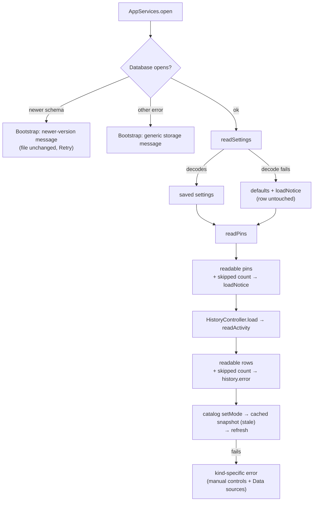
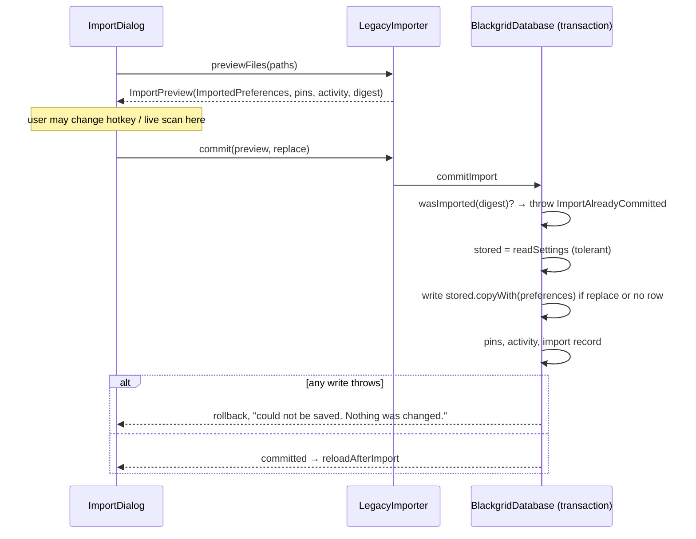
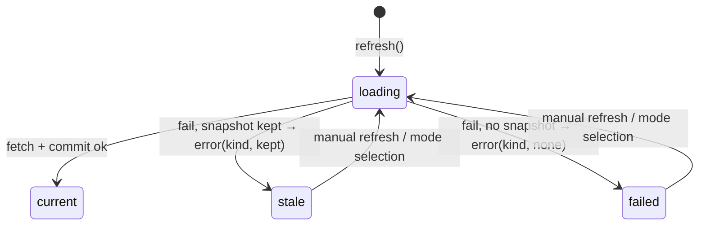

# Design

## Triage

| Trigger | Applies? | Evidence |
|---|---|---|
| T1 Components (new component, or 3+ with directed relationships) | No | No new component. The change edits `SettingsController`, `HistoryController`, `CatalogController`, `ProgressController`, `BlackgridDatabase`, `LegacyImporter` and the UI. Their relationships do not change. |
| T2 State (persistent state, caches, 3+ state machine) | Yes | Changes how stored settings, pins and history rows are loaded (`database.dart:176-235`). Moves when the import merges its preferences into stored settings (`legacy_import.dart:133-148` → `database.dart:304-348`). Neither the stored format nor the schema changes. |
| T3 Concurrency (background work, workers/isolates, async, retries) | Yes | The catalog and progress refreshes are async and fenced by generation (`catalog_controller.dart:93-126`, `progress_controller.dart:140-185`). The import commit runs in a Drift transaction on the background isolate. Preview and commit are separate user steps. |
| T4 Boundaries (data format, migration, shared interface, IPC, external) | Yes | Adds a typed refusal of a newer database that crosses the database-to-bootstrap boundary. `CatalogException` gets a failure kind. `ImportPreview.settings` becomes a preferences-only value. No wire or file format changes. |
| T5 Volume (grows without a fixed bound) | Yes | History rows have no cap (ADR-0003). Tolerant reads go through every row once per load, which is the same cost as today. |
| T6 Risk (security, money, data loss, unrecoverable user data) | Yes | Pins and history can't be recreated. Credentials are secrets. The change has to avoid deleting or overwriting records it can't read. |

TIER: FULL

## Context

The proposal lists the gaps (proposal.md, Why). The code facts this design relies on:

- **Settings and pin loading.** `SettingsController.load` (`settings_controller.dart:16-23`) has no error handling. `AppSettings.fromJson` throws when a field is unknown or missing (`settings.dart:156-178`), and so does `CustomPin.fromJson`. Either throw fails `AppServices.initialize` (`app_services.dart:234-237`), so the bootstrap shows its generic error (`app.dart:78-87`).
- **History loading.** `readActivity` uses `byName` on the mode and source (`database.dart:218-235`). One unknown value throws, and `HistoryController.load` then hides all history (`history_controller.dart:25-38`). The panel shows `error` only when there are no rows (`evidence_panels.dart:379`).
- **Newer database.** Drift calls `onUpgrade(from, to)` whenever the stored version differs from `schemaVersion`, including a downgrade, and it does so before `beforeOpen` (drift 2.35.1 `db_base.dart:117-140`).
  - For a newer file, `onUpgrade` therefore throws `StateError('Unsupported database upgrade.')` first (`database.dart:102-105`). The newer-version `StateError` in `beforeOpen` (`:109-116`) never runs.
  - The database opens lazily on the first query, on a background isolate (`createInBackground`). At startup that first query is `itemIcons.open()`, which swallows every error (`item_icon_cache.dart:126-131`). The error the bootstrap sees comes from the second query, `readSettings`.
  - `migration_test.dart:117-142` proves that the file's bytes are unchanged. It asserts only `throwsA(anything)`, and it uses a database opened in the same isolate.
- **Catalog errors.** `CatalogException` holds only a message (`catalog_client.dart:9-14`). `CatalogController._refresh` replaces every failure, including a failed `commitCatalog`, with one string (`catalog_controller.dart:119-125`). The Data sources panel never shows `catalog.error` (`evidence_panels.dart:250-257`).
- **Tracker failures.** `TrackerException.invalidatesAuthority` treats `malformed` as invalidating (`tracker_client.dart:24-26`). The controller then drops the snapshot (`progress_controller.dart:166-169`).
- **Import.**
  - The legacy importer builds a full `AppSettings` at preview time from `destinationSettings`. It leaves out `liveScan` and `scanHotkey` (`legacy_import.dart:133-148`), and `commitImport` writes that whole row when Replace is on (`database.dart:309-317`).
  - The duplicate check throws a `StateError` (`:307-309`). The dialog gives one message for every failure (`import_dialog.dart:76-83`).
- **Test patterns to reuse:**
  - file-backed restart tests through `Directory.systemTemp.createTemp` → `NativeDatabase(file)` → close → reopen (`test/data/database_test.dart`);
  - failure injection through SQLite `RAISE(ABORT)` triggers;
  - `MockClient`, `StallingHttpClient` and `SyntheticProtector` (`test/data/credential_store_test.dart:9`);
  - injected `clock`s.

## Decisions

### D1: Tolerant decoding in the database read methods, which report what they skipped

- **Choice:**
  - `readSettings` returns `StoredSettings(settings, unreadable)`. Decode errors give defaults with `unreadable: true`.
  - `readPins` and `readActivity` return the rows they could decode plus a `skipped` count. A row whose JSON, frame, mode or source cannot be decoded counts as skipped.
  - Only decoding is tolerated: query and open errors still throw, so a newer or locked database still fails startup (D2).
  - Loading never writes. Unreadable rows stay in the database until a save replaces them (settings: the next save; pins: only the same `(mapId, pinId)` key; history: only the same `(itemId, mode)` key).
- **Rejected:**
  - Catching around the whole load in each controller, as `HistoryController.load` does today. It turns one bad row into "no pins" or "no history", and it can't tell a decode error from a database that won't open.
  - Moving unreadable rows to a quarantine table, or deleting them. That is a schema change (ADR-0003, every schema change needs a migration). It also destroys rows a newer build wrote, which the user could still read by reinstalling that build.
- **Reversal cost:** low. The read methods' return types are internal. Callers are `SettingsController`, `HistoryController`, `LegacyImporter` (destination settings) and tests.

### D2: A typed `NewerDatabaseException` for the newer-version refusal

- **Choice:**
  - `onUpgrade` throws `NewerDatabaseException(onDisk: from, supported: to)` when `from > to`, before it calls the migrator or opens a transaction. Other unsupported upgrades (`from < 1`) keep the `StateError`.
  - The newer-version check in `beforeOpen` is removed, because it can't run and a second copy would only hide which check actually fires.
  - `BlackgridBootstrap` shows the newer-version message when the error that arrives is a `NewerDatabaseException`, whether it arrives directly or in the form the test below proves (wrapped once, or as Drift's cached rethrow). Every other error keeps the generic message.
  - Retry stays available for both messages, because the user may install a newer build and come back.
- **Rejected:** opening the database read-only, or checking `user_version` in a separate pre-flight before Drift opens it. That makes a second code path that reads the file, and it duplicates Drift's version handling.
- **Reversal cost:** low.
- **Assumption, settled by the first D2 task:** the test opens a `user_version 99` file through `BlackgridDatabase.open(file)` (`createInBackground`). It runs one query whose failure is ignored, as `itemIcons.open()` does, then asserts the type of the error from a second query, as `readSettings` does in `AppServices.initialize`. Driving `AppServices.initialize` directly is an alternative. The bootstrap's check matches whatever that test proves arrives. The test keeps the existing check that the file's bytes are unchanged.

### D3: Catalog failures carry a kind, and the controller owns the wording

- **Choice:**
  - `CatalogException` gets `CatalogFailure kind` with three values: `transport` (transport error or timeout), `http` (non-200 status) and `invalid` (validation or normalizer failure). The existing throw sites already separate these (`catalog_client.dart:21-84`).
  - In `CatalogController._refresh`, a throw from `commitCatalog` is `save`, and a non-`CatalogException` throw from `fetch` is `invalid`.
  - A pure function `catalogFailureMessage(kind, {required bool kept})` builds the text in the spec. `kept` is `snapshot != null` after the failure.
  - The Data sources panel shows `catalog.error` under the item data line, in the gold style the Tracker error already uses (`evidence_panels.dart:291-295`).
  - "Stored catalog unavailable" for an unreadable cache is unchanged: an existing scenario covers it.
- **Rejected:** having the client throw final user-facing strings. A save failure is only known in the controller, and the "kept" half depends on the controller's state.
- **Reversal cost:** low.

### D4: Malformed Tracker responses do not invalidate progress

- **Choice:** `invalidatesAuthority` becomes true only for `authentication`, `permission`, `mode` and `identity`. The controller's existing branch (`progress_controller.dart:166-182`) then keeps the snapshot as `stale` and sets the "Tracker response invalid" error. When there is no snapshot, the status is `failed`.
- **Rejected:** a separate retained-but-flagged state for malformed responses. `stale` already means "shown, not current", and the decision engine already treats stale progress conservatively (risk 5).
- **Reversal cost:** low.

### D5: The import merges preferences into stored settings inside the commit transaction

- **Choice:**
  - `ImportPreview.settings` becomes `ImportedPreferences`, which holds mode, map, save-marker-filters, marker filters and the Tracker switch.
  - `commitImport` reads the stored settings in its transaction through D1's tolerant read. With Replace on, or with no stored row, it writes `stored.copyWith(<imported preferences>)`. With no stored row, `stored` is `AppSettings()` defaults.
  - Local inputs therefore always come from the stored row as it is at commit time: game log folder, screenshot folder, follow-game-logs, live scan and scan hotkey.
  - The preview no longer reads destination settings to fill those fields.
- **Rejected:** copying `liveScan` and `scanHotkey` from `destinationSettings` at preview time, the one-line fix.
  - It keeps the bug class: every future local setting must be remembered in the importer, and forgetting one causes this same bug again. With the merge, the preview type cannot carry local fields at all.
  - It also overwrites anything saved between preview and commit. The dialog is modal (`import_dialog.dart:8`), so the user can't change inputs then, but app-driven saves (`ScanCoordinator`'s hotkey restore, live-scan saves) are not blocked by it.
- **Reversal cost:** low. `ImportPreview` is internal. The import record's format and digest don't change.

### D6: A typed duplicate-import refusal

- **Choice:** `commitImport` throws `ImportAlreadyCommitted` instead of `StateError`. The dialog maps that type to "These files were already imported. Nothing was changed." and any other error to "The import could not be saved. Nothing was changed."
- **Rejected:** checking `wasImported` again in the dialog before committing. That check races with the commit, while the transaction's own check does not.
- **Reversal cost:** low.

### D7: Unreadable-record messages live on the controllers, apart from save errors

- **Choice:**
  - `SettingsController` gets `loadNotice`, built from two parts.
    - The settings sentence is recomputed by every `load`, set when `unreadable` is true and cleared otherwise. A successful `save` also clears it.
    - The pins sentence is recomputed from `skipped` on every `readPins`: at every `load`, after a pin save and after a pin remove.
    - `reloadAfterImport` reaches `load`, so after a Replace import rewrites the settings row, the settings sentence clears.
  - The existing `error` (save failures) stays separate. Places that show `settings.error` show `error`, then `loadNotice`.
  - `HistoryController.load` sets `error` from `skipped` (null when it is 0). A later record failure overwrites `error` as it does today.
  - The history panel shows `error` above the list whenever it is set.
- **Rejected:** putting the unreadable-record text into `error`. Each `save` clears `error` when it starts (`settings_controller.dart:29`), so a pin edit would hide the fact that settings were reset to defaults.
- **Reversal cost:** low.

### D8: Restart and interruption are proved on a file-backed database with TEMP triggers

- **Choice:**
  - A test helper `ReopenableDatabase` in `test/data/support/` opens `BlackgridDatabase(NativeDatabase(file))` on a temp file and supports `reopen()` and `delete()`.
  - Interrupted writes are simulated with `CREATE TEMP TRIGGER … RAISE(ABORT)`. A TEMP trigger lives only for the connection that made it, so the reopened database is clean, and the test proves that the rollback, not the trigger, kept the data.
  - Damaged rows are written with `customStatement` (raw bytes in `payload`, or an unknown `mode` text).
  - Corrupt credential bytes use a fake protector that rejects any bytes without its own header. This change adds that fake next to `SyntheticProtector` and does not change the store.
- **Rejected:** killing a child process during a write. It is slow and can be flaky on Windows runners, and it only re-tests SQLite's journal, which ADR-0003 already relies on. Recorded as not built.
- **Reversal cost:** low (tests only).

## Diagrams (FULL)

T2/T4: what startup loads and how each failure is shown.

T3: import commit (D5, D6), all inside one transaction.

T3: a failed catalog refresh.

## State & Ownership (FULL)

| State | Owner (sole writer) | Lifetime | Invalidation / rebuild | Authoritative copy |
|---|---|---|---|---|
| Stored settings row | `BlackgridDatabase.saveSettings`, called from `SettingsController.save` and `commitImport` | Durable | Replaced by the next save, never by a load | SQLite `Preferences` |
| In-memory `AppSettings` | `SettingsController` | App session | `load`, `save` | The SQLite row when it decodes, otherwise defaults |
| `SettingsController.loadNotice` | `SettingsController` | Settings part: until the next `load` or successful save. Pins part: until the next `readPins` | Recomputed by every `load`; the settings part is cleared by a save; the pins part is recomputed after each pin write | none (derived) |
| Pin rows | `savePin`/`removePin`/`commitImport` | Durable | Unreadable rows stay until a same-key save | SQLite `PinRecords` |
| History rows | `recordActivity`/`commitImport` | Durable | Unreadable rows stay until a same-key write | SQLite `ActivityRecords` |
| `HistoryController.error` | `HistoryController` | Until the next `load` or `record` | Recomputed | none (derived) |
| `CatalogController.error` | `CatalogController` | Until the next refresh or `setMode` | Cleared when a refresh starts | none (derived) |
| Progress snapshot | `ProgressController` | App session, in memory only (ADR-0003) | Dropped on 401/403/mode/identity, a new credential session or a mode change. Kept as stale on transport or malformed failure | Memory |
| Import record | `commitImport` | Durable | Never removed | SQLite `ImportRecords` |

## Failure & Visibility (FULL)

| Component | Fails / dies mid-operation → | Recovery | Retry safe? | Who finds out |
|---|---|---|---|---|
| Database open | Newer schema → `NewerDatabaseException`. Anything else → error | Install a newer build / Retry | Yes, nothing is written | User: the startup message (D2) |
| `readSettings` decode | Defaults are used | The next save replaces the row | Yes | User: `loadNotice` |
| `readPins` decode | Bad rows are skipped | A same-key save, or a newer build | Yes | User: `loadNotice` with the count |
| `readActivity` decode | Bad rows are skipped | A same-key record, or a newer build | Yes | User: history panel error with the count |
| Catalog fetch/commit | Last snapshot kept, or none | Manual refresh / mode selection | Yes (idempotent GET; atomic commit) | User: the kind-specific error in manual controls and Data sources |
| Tracker fetch | Snapshot kept for transport/malformed failures; dropped on credential/mode/account failures | Manual refresh / mode selection; cooldown respected | Yes | User: "Tracker problem: …" |
| Credential read | `CredentialUnavailable` → `failed` "Tracker token unavailable"; the bad file stays | Save a new token, which replaces the file atomically | Yes | User |
| Import commit | The transaction rolls back; the process dying mid-commit is rolled back by SQLite's journal on the next open | Import again, since the digest was not recorded | Yes | User: the dialog message (D6) |
| Import reload after commit | Data is saved, the UI is not reloaded | Restart | n/a | User: the existing "saved, but could not reload" message |

## Resource Bounds (FULL)

| Queue / buffer / cache / transfer | Bound | At the bound | Timeout | At 10x / 100x |
|---|---|---|---|---|
| Tolerant `readActivity` | All rows, as today (no cap, ADR-0003, bounded by unique (item, mode)) | n/a | none | About 4,000 items × 2 modes is the realistic ceiling. One decode pass per load is the same cost as today. |
| Tolerant `readPins` | All pin rows, as today | n/a | none | Pins are user-made and in the tens. |
| Skipped counts | One int per read | n/a | n/a | n/a |
| Catalog fetch | Unchanged: 6 required datasets, 30 s per request | Abort → `transport` | 30 s | Unchanged |

## Flow & State Gaps (FULL)

- **Unreadable settings, then a save.** The first save after a default start writes defaults plus the user's change. That replaces the unreadable row, which is the user's decision (2026-11-01). An automatic save made by the app, for example a hotkey restore or map following, also counts as "the next save". The message then clears, and that is acceptable because the row has been replaced.
- **Import while the settings row is unreadable.** With Replace off and a row present, nothing is written to settings, so the unreadable row survives. With Replace on, the merge starts from defaults.
- **Preview, then a settings change, then commit.** D5 merges at commit time, so the change is kept.
- **Two imports of the same files at once.** The second transaction sees the first one's import record and throws `ImportAlreadyCommitted`.
- **Process dies mid-import, mid-save or mid-catalog-commit.** SQLite rolls back the open transaction on the next open. Only the TEMP-trigger rollback is tested (D8); the journal itself is relied on, not re-tested.
- **Catalog refresh fails after a mode switch.** Unchanged: the generation fence drops the failure (`catalog_controller.dart:120-122`).
- **Malformed response, then a mode switch and back.** Unchanged: the session fence keeps the old result from publishing.

## Mechanism Ledger (FULL)

| Mechanism | Built? | Why (harm nobody catches / expensive later) | Evidence that would change the call |
|---|---|---|---|
| Tolerant decode with skip counts (D1) | Yes | Today one bad row stops startup with a message that is wrong and that Retry can't fix | — |
| Quarantine or deletion of unreadable rows | No | It would destroy rows a newer build wrote, and it needs a migration | Users reporting rows that stay unreadable even under the newest build |
| Settings payload version field | No | Decode-or-default covers the newer-build case without a format change | A future settings change that must be migrated rather than defaulted |
| Typed newer-database refusal (D2) | Yes | Without it the user can't tell "install the newer build" from a broken disk | — |
| Kill-the-process interruption test | No | It only re-tests SQLite's journal, and it is slow and flaky on CI | A rollback bug that the TEMP-trigger test misses |
| Clear-cache feature | No | Out of scope (proposal) | A user request |
| Persisting Tracker progress | No | The user decided against it on 2026-11-01. ADR-0003 and the strategy limit progress to the current session | A user decision to revisit it |
| Commit-time import merge (D5) | Yes | A preview-time merge loses an input changed between preview and commit, and nobody would notice until the hotkey stopped working | — |
| Recovery from a failed credential removal (the token comes back after a restart) | No | Existing spec behaviour: it is cleared in memory first, and the user sees the removal error | A report of a token coming back |

## Risks / Trade-offs

- **[Risk] Tolerant decoding hides real corruption.** → Every skip is counted and shown to the user, and the rows stay on disk for a newer build or a support look.
- **[Risk] Defaults overwrite a newer build's settings on the first save.** → This is the trade-off the user chose. The message names it ("until you change one"), and the newer build's pins and history are untouched.
- **[Risk] Drift may wrap the `onUpgrade` exception, or rethrow it in a different form on the second query, which breaks D2's type check.** → The first D2 task pins down which type arrives, through `BlackgridDatabase.open` on a `user_version 99` file with a first query whose failure is ignored, then a second query (D2).
- **[Risk] Keeping stale progress after a malformed response could let a garbled server answer stand behind a decision.** → It only keeps what the last valid response said, labelled "out of date". The decision engine already treats stale progress conservatively (risk 5).

## ADRs

- **In force, constraining this change:**
  - ADR-0002 (ChangeNotifier controllers, composition root)
  - ADR-0003 (one Drift store, transactional writes, newer version refused, progress in memory)
  - ADR-0007 (runner channel and DPAPI boundary)
- **To record during apply:** none. Every decision here is tactical and stays inside those ADRs.
