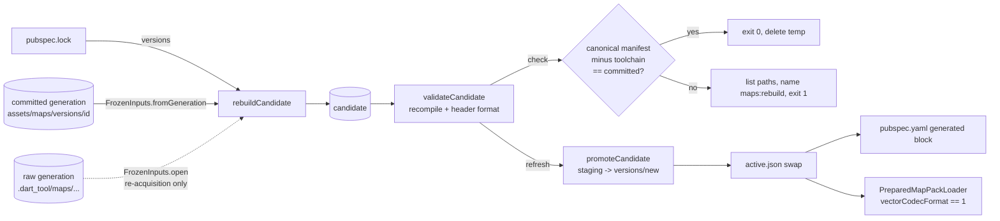
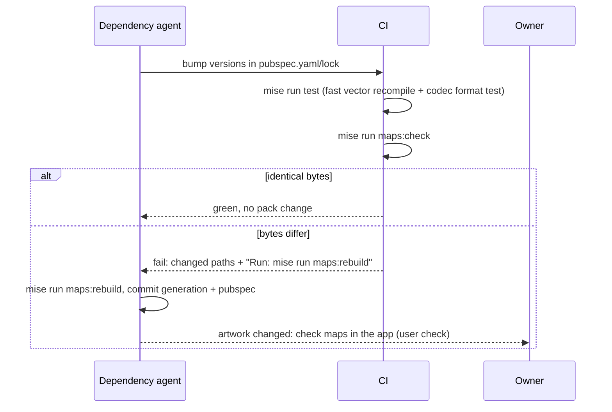

# Design

## Triage

| Trigger | Applies? | Evidence |
|---|---|---|
| T1 Components (new component, or 3+ with directed relationships) | Yes | New source view over a committed generation, new `check`/`refresh` operations in `tool/maps/prepare.dart`, and a CI step. Directed relationships: generation → rebuild → validate → promote → `pubspec.yaml`. |
| T2 State (persistent state, caches, 3+ state machine) | Yes | `assets/maps/active.json`, a new immutable generation, the generated block in `pubspec.yaml`, and the in-process compile cache `_compiledVectorHashes` (`tool/maps/pack.dart:73`) loses its frozen seed. |
| T3 Concurrency (background work, workers/isolates, async, retries) | No | Single-process, sequential offline tool. The loader change adds no async work. |
| T4 Boundaries (data format, migration, shared interface, IPC, external) | Yes | Manifest format (new `toolchain` and `vectorCodecFormat` fields; `dependencies`, `compilerVersion` and `runtimeVectorVersion` removed). Loader acceptance contract (`lib/maps/prepared_map_loader.dart:65-70`). CI gate. |
| T5 Volume (grows without a fixed bound) | Yes | Each promotion adds a generation folder to the repository (about 67 MB of files in the working tree; git deduplicates identical blobs). Check and rebuild write a full temporary copy. |
| T6 Risk (security, money, data loss, unrecoverable user data) | No | No user data. The integrity property (payload bound to source) is kept, by a different mechanism; see D3. |

TIER: FULL

## Context

The problem and goal are in proposal.md. The current state relevant to the approach:

- **Build pipeline.**
  - `rebuildCandidate` (`tool/maps/pack.dart:321-566`) reads a hash-locked raw generation through `FrozenInputs` (`pack.dart:99-135`). `FrozenInputs.open` hashes every listed source on open, and `bytes()` refuses unlisted paths.
  - For each SVG floor component, the build writes the normalized SVG, the compiler SVG and the `.vec` (`pack.dart:409-430`).
  - Raster tiles are copied byte-for-byte: visible tiles to `artwork/…`, empty tiles once per source hash to `evidence/tile-alpha/<sha>.png` (`pack.dart:609-660`, `670-715`). `image` is used only to decode alpha bounds (`pack.dart:143-168`).
  - Every non-tile source is copied to `evidence/<path>`, and `sources.json` is copied canonically (`pack.dart:521-532`).
  - The manifest is written last (`pack.dart:534-563`). The generation id is the SHA-256 of the manifest bytes (`pack.dart:1452`).
- **Validation.** `validateCandidate` (`pack.dart:836-1203`):
  - checks the output closure;
  - re-derives the normalized and compiler SVGs from the evidence source (`pack.dart:1078-1108`);
  - re-derives markers (`pack.dart:1002-1011`);
  - re-decodes tiles against the frozen hashes (`pack.dart:1205-1276`);
  - checks `.vec` hashes through `_expectedVectorHash`. That function uses the frozen table for the eight Interchange sources and compiles once for anything else (`pack.dart:84-94`), behind `compilerVersion == '1.3.0'` (`pack.dart:1112`).
  - It does not recompute `displayCrop`; it only bounds it (`pack.dart:1183-1200`).
- **The committed generation is self-sufficient for a rebuild** (measured 2026-11-02 on `d5a0f9ae…`):
  - Its `evidence/sources.json` is byte-identical to the raw generation's `sources.json`.
  - All 23 non-tile sources are carried as `evidence/<path>`.
  - Of 8,960 tile sources, 8,483 are carried by hash as artwork or witness files. The other 477 (27 MiB; Customs and Reserve `Ground_Level`, `Second_Floor`, `Third_Floor`, `Underground_Level`, `Bunkers`) are tiles under SVG floors, which `rebuildCandidate` never reads, because it reads tiles only for raster maps, raster-overlay floors and raster dependencies (`pack.dart:391-407`, `440-463`, `474-485`).
- **Costs, measured on the owner's PC with compiler 1.3.4.** Compiling all 40 components twice took 0.4 s, with 40/40 identical to the committed `.vec`. A full `validateCandidate` of the active generation took 6.7 s, mostly tile decoding.
- **Codec format.** `vector_graphics_codec` 1.1.13 writes a 4-byte magic number `0x00882d62` and a 1-byte format version (currently `1`) at the start of every buffer. Its decoder throws if either differs. Both constants are private, so the build reads them from the bytes it just compiled. One resolved codec serves both the dev-only compiler and the shipped runtime, because pub resolves a single version per package.
- **Runtime loading.**
  - The loader reads only `active.json` and the manifest. It does not decode artwork (`prepared_map_loader.dart:44-124`).
  - `.vec` bytes are decoded later, per component (`lib/maps/native_map_scene.dart:128`).
  - A loader exception becomes the map area's error text (`lib/ui/map_workspace.dart:425-430`).
- **Pubspec.** The map asset directories are a hand-pasted output of `prepare.dart assets`, at `pubspec.yaml:42-247`, with no delimiters.
- **CI.** `.github/workflows/gates.yml` runs analyze, test, build, `ci:qualification` and package. Nothing validates the committed pack: the map qualification tests build synthetic fixtures (`test/support/map_preparation_fixtures.dart`).
- **Good pattern to follow.** The marker icons (`tool/markers/icon_set.dart`) are regenerated and compared by a sync test. A compiler change that alters them fails the test, and the tool regenerates them in the same change (ADR-0023).

## Decisions

### D1: Provenance is read from `pubspec.lock`, recorded under `toolchain`, and never compared

- **Choice:**
  - A pure function `Map<String, String> toolchainFromLock(String lockYaml)` parses the lock text with `package:yaml` (already a dev dependency) and returns `{xml, image, vector_graphics_compiler, vector_graphics, vector_graphics_codec}` → version strings. It throws a `FormatException` naming the first missing package. `prepare.dart` reads `pubspec.lock` from the project root and passes the result in.
  - Test seam: `rebuildCandidate` and `compileCandidate` take a required `Map<String, String> toolchain` parameter, never reading the lock themselves. Fixtures pass a fixed map. The "package not resolved" scenario is a unit test of `toolchainFromLock` on a small lock string without `vector_graphics_codec`, plus a `prepare.dart`-level check that the error happens before the candidate folder is created.
  - `rebuildCandidate` records the map as `toolchain`. `compileCandidate`, the separate compile step after `normalize`, **replaces** `toolchain` with the map it was given. The record therefore always names the toolchain that compiled the vectors, even after a `pub get` between the two steps.
  - Remove the `dependencies`, `compilerVersion` and `runtimeVectorVersion` fields.
  - The validator and the loader ignore `toolchain`. The reproducibility check (D4) excludes it from its comparison.
- **Rejected:** Read the versions from `.dart_tool/package_config.json` root URIs, or from each package's own `pubspec.yaml`, because package_config carries no version field and parsing a cache path is fragile. `pubspec.lock` is the project's committed resolution and is what CI and the dependency agent change.
- **Rejected:** Keep the versions as gates but read them from the lock (an "equal to installed" check), because every patch bump would then force a new generation even when no byte changes. That is the churn this change removes. The check in D4 already proves the installed toolchain reproduces the pack.
- **Reversal cost:** low. A manifest field written by the tool and read by nobody.

### D2: The loader accepts by vector codec format, recorded from the compiled bytes

- **Choice:**
  - A pure helper `int vectorPayloadFormat(Uint8List bytes, String path)` checks that the payload starts with the codec magic number, which is stored little-endian as the bytes `62 2d 88 00`, and returns byte 4. It throws naming the path if the magic number is missing or the payload is shorter than 5 bytes.
  - **Whichever step compiles writes the record.** `rebuildCandidate(compileVectors: true)` and `compileCandidate` both read every payload they compile, require all to agree, and write `vectorCodecFormat`. A normalize-only candidate (`compileVectors: false`) has no `.vec` files and no `vectorCodecFormat`. It validates only with `requireCompiled: false`, and promotion refuses it as uncompiled (`pack.dart:846-850`).
  - **Validation order.** For a compiled pack, `validateCandidate` first requires `vectorCodecFormat` to be an int, then checks every committed `.vec` header with `vectorPayloadFormat` against it, then compares bytes by recompilation (D3). A corrupted header byte is therefore reported as a format mismatch naming the payload and both formats, not as a hash mismatch.
  - The loader requires `vectorsCompiled == true` and `vectorCodecFormat == preparedVectorCodecFormat`, a documented `const int` in `lib/maps/prepared_map_loader.dart` (value `1`).
    - On a different format it throws a `FormatException` built by a pure helper `unsupportedVectorFormatMessage(int recorded, int supported)` in the same library: `'Pack vector format <recorded> is not supported; this build decodes format <supported>. Rebuild the map pack: mise run maps:rebuild.'`.
    - When the field is missing it throws `'Pack vector format is not recorded.'`.
  - **Codec-format fast test** (`test/maps/vector_format_test.dart`):
    - It encodes a tiny SVG with the resolved compiler and asserts that `vectorPayloadFormat` of the result equals `preparedVectorCodecFormat`, with `unsupportedVectorFormatMessage(actual, preparedVectorCodecFormat)` as the failure reason. A codec format change therefore fails the fast suite with a message naming both formats and `mise run maps:rebuild`.
    - It asserts that `VectorGraphicsCodec().decode` (no listener) accepts the payload.
    - It unit-tests `unsupportedVectorFormatMessage(2, 1)`, so the failing branch's text is proven without a second codec.
- **Rejected:** A project-owned `packFormat` integer bumped by hand, because nothing ties it to what the runtime can decode. It would become another label that can be stale.
- **Rejected:** Drop the check and let the decoder fail at draw time, because the failure would then appear per floor, late, as a broken picture. A load-time refusal gives one clear message.
- **Rejected:** Peek at a `.vec` header at load time, because the loader deliberately avoids reading artwork (ADR-0005). The manifest record plus tool-side validation gives the same assurance more cheaply.
- **Reversal cost:** medium. It is the manifest/loader contract, but only the bundled generation is ever loaded, so a change means one rebuild.

### D3: Reproduction replaces `_pinnedVectorHashes`

- **Choice:**
  - Delete `_pinnedVectorHashes` (`pack.dart:51-72`).
  - `_compiledVectorHashes` stays as a per-process cache keyed by compiler-input hash, but only `_expectedVectorHash`, which validation uses, fills it, with the real encoder. `_compile` no longer writes to it, so an injected encoder can never feed the validator an expected hash. The validator compiles each distinct input once per process and compares bytes. That costs one extra compilation per component per build, about 0.2 s for 40.
  - `_compile` encodes twice and throws on any difference, naming the output path.
    - In `rebuildCandidate`, the manifest is written only after every component compiled, so a failed build leaves no manifest.
    - In `compileCandidate`, the manifest keeps `vectorsCompiled: false` until every component compiled, so a failed compile stays unpromotable.
  - Test seam: `rebuildCandidate`, `compileCandidate` and `_compile` take an optional `VectorEncoder encode` parameter (`typedef VectorEncoder = Uint8List Function(String xml, String debugName)`), defaulting to `_encodeVector`. The "unstable compiler output" scenario uses a hand-written fake encoder that returns different bytes on its second call. `validateCandidate` always uses the real `_encodeVector`, so validation cannot be pointed at a fake.
  - The integrity property from 72b8c0b, that a valid `.vec` copied onto another component's path is rejected, holds because the expected bytes come from compiling that component's own evidence-derived input. The existing substitution test keeps covering it.
- **Rejected:** Regenerate the hash table on each compiler bump, keyed by compiler version, because it is a hand-maintained table that proves nothing a 0.4 s recompilation does not prove directly.
- **Rejected:** Trust the manifest's output hashes, because a candidate supplies them itself. That is the hole 72b8c0b closed.
- **Reversal cost:** low.

### D4: The committed generation is its own frozen input; one rebuild path serves check and refresh

- **Choice:**
  - `FrozenInputs.fromGeneration(Directory generation)` opens a committed generation as a raw-input view:
    - The index is `evidence/sources.json`.
    - A non-tile source `p` resolves to `evidence/p`.
    - A tile source resolves to any output file of that generation whose recorded SHA-256 equals the source's hash. That is a visible-tile artwork file or an `evidence/tile-alpha/<sha>.png` witness.
    - Each carried source is hashed against the index when opened, as `FrozenInputs.open` does today.
    - A listed source with no carrier is recorded as not carried. `bytes()` on it throws `FormatException('Frozen input <path> is not carried by generation <id>; rebuild from a raw generation with prepare.dart rebuild --raw')`.
  - `rebuildCandidate` takes a `FrozenInputs` instead of a raw `Directory`. `rebuild --raw` keeps calling `FrozenInputs.open`.
  - **Verify the committed generation first.** `verifyCommittedGeneration(packs)` runs before any rebuild. It does not depend on the new manifest fields, so it also accepts `d5a0f9ae…` for the one-time D7 refresh. It checks:
    - `active.json` is well-formed (the same rules as `preparedAssetDirectories`, `pack.dart:1423-1430`);
    - `sha256(versions/<id>/manifest.json bytes) == <id>`, or it fails naming the id;
    - the generation's actual file inventory and hashes (`_outputHashes`) equal `manifest.outputs` exactly, or it fails naming the first missing, extra or changed path. This is the closure part of `validateCandidate` (`pack.dart:851-885`), extracted into a shared function that both call.
    
    This step closes the gap where an in-place edit of a committed `.svg`, `.compiler.svg` or `NOTICE.txt`, an extra file, or a rewritten manifest would pass a comparison of manifests alone. After it passes, the committed files are exactly what the committed manifest describes. The manifest comparison below therefore compares bytes.
  - Two new `prepare.dart` operations share `_rebuildActive(packs, toolchain)`, which runs `verifyCommittedGeneration`, then rebuilds into a fresh candidate and validates it:
    - `check --packs assets/maps` rebuilds into a fresh folder under the system temp directory and compares canonical manifests, with `toolchain` removed on both sides. Because the manifest lists every output's SHA-256, this one comparison covers every file. It also covers `displayCrop`, which the validator does not recompute. Output, through the shared report described next:
      - On success it prints exactly `Map pack <id> reproduced byte-identically with xml <v>, image <v>, vector_graphics_compiler <v>, vector_graphics <v>, vector_graphics_codec <v>.`, with the versions taken from the `toolchain` map it built with. A dependency PR can quote that line as proof.
      - On a difference it prints the per-map summary, then the differing paths and the non-output manifest keys that differ, and exits 1 with `Map pack is not reproducible with the installed toolchain. Run: mise run maps:rebuild`.
      - It always deletes its temp folder.
    - **Shared change report** `packChangeReport(committed, rebuilt)`, a pure function over the two manifests:
      - **Files.** Each differing or added/removed output path is attributed to `(map id, floor id)` by walking the manifest that holds it: vector components belong to their floor, tiles to their floor, and raster dependencies to `<map id> dependency <id>`. Anything else goes to an `other` group: `evidence/...`, `NOTICE.txt`, and the empty-tile witnesses `evidence/tile-alpha/<sha>.png`, which floors share. A tile that flips between visible and empty therefore shows as one path under its floor and one under `other`.
      - **Manifest values.** Differences outside `outputs` are attributed too, because a rebuild can change what the app draws while every file stays identical: an `image` bump can move a raster map's `displayCrop` or a tile's `empty`/`alphaBounds`, and an `xml` bump can change `layerOrder`. A floor value that differs (tile `empty`/`alphaBounds`, component `effects`) marks its floor. A map value that differs (`displayCrop`, `layerOrder`, anything else on the map entry outside `floors`) marks the map, as group `(map id, -)`. A top-level key other than `toolchain` and `outputs` (for example `vectorCodecFormat`) marks a `pack` group. `toolchain` alone is provenance and is never reported.
      - It prints one summary line per group, in manifest map order: `<map id> <floor id>: <n> changed file(s)`, with `, manifest values changed` appended when that group's values differ. A map-level group prints `<map id>: manifest values changed`.
      - It returns whether anything other than `toolchain` differs. That result drives the owner check below.
    - **Leftover precheck** (`check` and `refresh`, before anything else): if `assets/maps/active.next.json` exists, or any `versions/.*.staging` folder exists (whatever id it names), the command fails with `Interrupted map pack promotion left <path>; inspect and remove it, then rerun.` and writes nothing. This is new: `promoteCandidate` only refuses the staging folder of the id it is promoting, and only checks `active.next.json` after copying the generation.
    - `refresh --packs assets/maps --pubspec pubspec.yaml` runs, in order:
      1. the leftover precheck and the pubspec marker check (D5), before any write;
      2. `verifyCommittedGeneration`;
      3. the rebuild into `.dart_tool/maps/refresh-<UTC timestamp>/`, and its validation;
      4. the shared report. If `packChangeReport` finds anything other than `toolchain` differing, the report ends with `Artwork changed: the owner must check the maps listed above in the app before merge.`;
      5. promotion through the existing `promoteCandidate`;
      6. the pubspec block rewrite (D5);
      7. pruning (D8): it deletes every folder under `versions/` whose name is a 64-character lowercase hex generation id other than the new active one. It never deletes a staging folder or anything else;
      8. deleting the candidate.

      On any failure before step 5 nothing under `assets/maps/` changes. On any failure it keeps the candidate and names it.
  - mise tasks: `maps:check` → `dart run tool/maps/prepare.dart check --packs assets/maps`; `maps:rebuild` → `dart run tool/maps/prepare.dart refresh --packs assets/maps --pubspec pubspec.yaml`.
  - **CI step.** A `Map pack check` step runs `mise run maps:check` in `gates.yml`, unconditionally, after `Test`, before `Build Release`. It needs no bundle and no game check.
    - `test/tool/ci/workflow_test.dart` adds `mise run maps:check` to its ordered `gates` list, so the ordering test and the unconditional-gate test (`workflow_test.dart:172-182`, `248-262`) cover it.
    - The release-dispatch guard "Refuse a tag from before release publishing" (`gates.yml:48-60`) gets a second check of its own: if `mise.toml` lacks `[tasks."maps:check"]`, it fails with `"$env:RELEASE_TAG predates the map pack check"`. A manual release run for a tag cut before this change, v0.7.0 or earlier, then stops with a precise message instead of failing later at an unknown mise task. Those tags are already published, so this only affects a re-run.
  - **Fast committed-pack test** (`test/maps/active_pack_vectors_test.dart`, no tag):
    - For each vector component of the active generation, it recompiles the committed `.compiler.svg` with the real encoder and asserts byte equality with the committed `.vec`. On failure, the reason names the path and `mise run maps:rebuild`.
    - It runs `VectorGraphicsCodec().decode(bytes, null)` on every committed `.vec`, which parses every tag. That literally proves the shipped runtime's codec decodes the shipped pack.
    - It asserts that every committed `.vec` header matches the manifest's `vectorCodecFormat`.
    - The probe measured about 0.4 s for 80 compilations. This test does 40 compilations plus 40 decodes.
- **Rejected:** Rebuild from `.dart_tool/maps/m5-raw-20261007-abstract`, because it exists only on one PC, `flutter clean` deletes it, and CI cannot reach it.
- **Rejected:** Commit the full 100 MB raw generation, or only the 477 unread tiles, to the repository, because it adds 27-100 MB of files the build never reads. The `sourceGeneration` hash already binds the complete index.
- **Rejected:** Make the check a qualification-tagged test, because `ci:qualification` needs the release bundle and no-game confirmation and has a skip audit. A dedicated CI step fails visibly under its own name, which the dependency agent can read.
- **Rejected:** Run the full validator on the committed pack instead of a rebuild, because it does not recompute `displayCrop` and does not prove that the build itself reproduces.
- **Reversal cost:** medium. The new operations are additive. The `rebuildCandidate` signature change touches its callers, which are `prepare.dart` and the test fixtures.

### D5: `refresh` owns a delimited, generated map asset block in `pubspec.yaml`

- **Choice:**
  - Wrap the block once with `    # BEGIN generated map pack assets (mise run maps:rebuild)` and `    # END generated map pack assets` lines.
  - `refresh` checks the markers **before** the rebuild starts: exactly one begin marker, exactly one end marker, in that order. Otherwise it fails naming the marker, with nothing under `assets/maps/` written.
  - After `active.json` has moved, it replaces exactly the lines between the markers with the `preparedAssetDirectories` output for the new active generation, writing through a temp file and a rename.
  - A fast test asserts that the block equals the directories derived from the active manifest's `outputs`, computed without validation. That keeps it cheap: it reads only the manifest.
- **Rejected:** Keep the paste step manual, because the goal is one command, and a stale block ships an app that cannot find its artwork. The current block has no check at all.
- **Reversal cost:** low.

### D6: A toolchain bump with identical output needs no rebuild

- **Choice:**
  - The check passes when only the toolchain differs from the recorded one. The recorded toolchain says which versions built the generation. The passing check, in CI on every PR, says the current versions reproduce it.
  - A rebuild is needed, and the check fails, only when bytes change. When artwork bytes change, the owner checks the maps in the app before merge. This is the same rule the marker icons follow.
- **Rejected:** Require `toolchain` to equal `pubspec.lock`, which forces a new 67 MB generation on every weekly patch bump. See D1.
- **Reversal cost:** low. Adding an equality check later is one comparison.

### D7: Run it once now and promote

- **Choice:**
  - Apply ends by running `mise run maps:rebuild` on main's toolchain: compiler 1.3.4, image 4.12.0, xml 6.6.1, runtime 1.2.5, codec 1.1.13.
  - As a one-time cross-check while the raw generation still exists on the owner's PC, `prepare.dart rebuild --raw .dart_tool/maps/m5-raw-20261007-abstract` is also run into a scratch folder. Its manifest must equal the `refresh` candidate's. That proves the generation-backed view loses nothing compared with the raw view. It is a local proof recorded in tasks.md, not a permanent test.
  - Expected result: no artwork file changes (40/40 vectors identical in the probe; tiles are byte copies; xml unchanged), so only the manifest changes and the generation gets a new id.
  - `d5a0f9ae…` and `0e059640…` are deleted (user decision 2026-11-02). `refresh` prunes both once the new generation is active (D8). Git history keeps them.
- **Rejected:** Do not promote and leave `d5a0f9ae…` active, because its manifest lacks `vectorCodecFormat`, so the new loader would refuse it.
- **Rejected:** Default a missing format to `1` for old packs, because that is a hidden default on the very contract this change makes explicit.
- **Reversal cost:** low. A revert commit restores the old generation, the old loader and the old `active.json` together.

### D8: No fallback generation; one generation in the tree; preparation version 3 only

- **Choice (user decision 2026-11-02: remove the fallback deliberately):**
  - **The app has never had a runtime fallback, and still has none.** `PreparedMapPackLoader` reads only `active.json` and its generation (`prepared_map_loader.dart:44-61`). A broken pack is a load error in the map area (ADR-0005).
  - **What M3 built as "fallback" is a build-time property** (docs/qualification/m3/STATUS.md, "Failed-candidate generation preservation"): a failed promotion leaves the current active generation untouched and discoverable. That property stays, because it is validate-before-promote.
  - **The retention around it goes.**
    - The validator's `preparationVersion == 2` branches (`pack.dart:901-908`, and the `version == 3` conditionals at `909-927`, `980`, `1005` and `1017`) exist only so older three-map generations still validate. They are removed: `validateCandidate` accepts only preparation version 3.
    - The loader's lenient path for manifests without `preparationVersion == 3` (`prepared_map_loader.dart:80`) is removed too. The loader requires `preparationVersion == 3`, the supported-map closure and the output closure; otherwise it fails with `'Unsupported prepared map version <v>.'`. Its check order is: manifest schema, then preparation version, then vector format (D2). A v2 manifest therefore fails naming version 2, not the missing format record. A `vectorCodecFormat` that is present but not an int fails with `'Pack vector format is not recorded.'`, like a missing one.
    - `refresh` deletes every other generation after a successful promotion, so the working tree holds exactly the active generation, and a rollback is a git revert. `promote` (the low-level operation) keeps its current behaviour; only `refresh` prunes.
  - **Tests.**
    - The qualification test "failed new generation preserves asset discovery for an older frozen floor calibration" keeps its property: a corrupt newer candidate leaves the older active pointer and its asset directories unchanged, and a forged marker assignment fails against the older generation's own frozen calibration. Its older generation is built as a full preparation-version-3 pack with an altered frozen calibration, not as a v2 three-map pack.
    - The loader test that builds a v2 pack (`map_scene_test.dart:129`) becomes the "Older preparation version" refusal test.
    - The widget and loader fixtures (`map_widget_harness`, `map_scene_test`, `map_controller_test`, `map_controls_test`) get complete v3 manifests from one shared test helper. The helper pads the maps a test cares about with minimal maps for the remaining supported ids, and derives `outputs` from the maps' asset paths.
- **Rejected:** Keep exactly one valid previous generation in the tree, because nothing reads it. The app never loads it and no tool falls back to it, so it would be 67 MB of untested dead weight. Git history is the rollback.
- **Rejected:** Keep the v2 branches "in case", because no v2 pack exists after the deletion. The fixture that exercises them is the only reader.
- **Reversal cost:** low. Restoring v2 acceptance means reverting the validator and loader branches.

## Diagrams (FULL)

Components and data flow (T1, T4):

Upgrade flow for a dependency PR (T2):

## State & Ownership (FULL)

| State | Owner (sole writer) | Lifetime | Invalidation / rebuild | Authoritative copy |
|---|---|---|---|---|
| Active pointer `assets/maps/active.json` | `promoteCandidate` (via `refresh` or `promote`) | Repository | Atomic rename of `active.next.json` (`pack.dart:1483-1498`) | The file in git |
| Generation `assets/maps/versions/<id>/` | `promoteCandidate` creates it once; never modified; `refresh` deletes it when superseded | Repository, while active | Superseded by a new generation, then pruned by `refresh` (D8) | The folder in git; its id is the hash of its manifest |
| Manifest `toolchain` record | `rebuildCandidate`, or `compileCandidate` when compiling separately (it replaces the record), from `pubspec.lock` | With its generation | Not rebuilt; describes the build that compiled it | The manifest |
| Manifest `vectorCodecFormat` | Whichever of `rebuildCandidate`/`compileCandidate` compiles, from compiled headers | With its generation | Validated against every `.vec` header | The `.vec` headers; the field is checked against them |
| `preparedVectorCodecFormat` const | Source code (developer) | Code | A fast test fails when the resolved codec writes another format | The resolved `vector_graphics_codec` |
| Generated map asset block in `pubspec.yaml` | `refresh` | Repository | Rewritten on each `refresh`; a fast test compares it with the active manifest | The active manifest's `outputs` |
| `_compiledVectorHashes` | `_expectedVectorHash` only (validation, real encoder) | One tool process | Discarded on exit; holds only real compilations | Recompilation |
| Check temp folder | `check` | One run | Always deleted | None |
| Refresh candidate `.dart_tool/maps/refresh-<ts>/` | `refresh` | Until promoted, or kept after a failure | Deleted after a successful promotion | None (inspection copy) |

## Failure & Visibility (FULL)

| Component | Fails / dies mid-operation → | Recovery | Retry safe? | Who finds out |
|---|---|---|---|---|
| Lock read | Missing lock or package → throws before any write | Run `flutter pub get` | Yes | Developer/CI: error names the package |
| `verifyCommittedGeneration` | Manifest hash ≠ id, or extra/missing/changed file → throws before any rebuild | Restore the generation from git; never edit a generation in place | Yes | CI step / developer: error names the id or the path |
| `FrozenInputs.fromGeneration` | Edited evidence → hash mismatch; uncarried input read → throws | Restore the file from git; for uncarried inputs, `rebuild --raw` | Yes | Error names the path |
| Compile (determinism) | Outputs differ → throws; the candidate has no manifest | Investigate the compiler; a re-run gives the same verdict | Yes | Error names the `.vec` path |
| Validate | Any mismatch → throws; nothing promoted | Fix the cause; re-run | Yes | Error names the file or the rule |
| `check` | Difference → exit 1; crash → temp folder may remain under system temp | Re-run; OS temp cleanup | Yes (writes nothing in the repo) | CI step `Map pack check` fails with paths and the command |
| `refresh` before the promotion rename | Candidate kept; active unchanged | Inspect, then re-run (the timestamped folder is fresh) | Yes | Exit 1, names the candidate folder |
| `refresh` killed during staging or the pointer swap | The leftover precheck refuses the next `check` or `refresh` before any write and names the path, whatever id the leftover has | Owner inspects and removes it | After manual cleanup | The next run's error |
| `refresh` killed after the `active.json` swap, before the pubspec rewrite | Pubspec still lists the old generation | Re-run `maps:rebuild` (same manifest → same id, `promoteCandidate` re-validates the existing destination and rewrites the block). The fast pubspec test fails until then. | Yes | `mise run test` and CI |
| `refresh` killed while pruning old generations | Some superseded folders remain; active and pubspec are already correct | The next `refresh` prunes them; `git status` shows them meanwhile | Yes | Developer: leftover folders in `git status` |
| Loader | Missing or unsupported format → `FormatException` | Rebuild the pack (D2) | n/a | User: map area error text; developer: the fast real-pack loader test |

## Resource Bounds (FULL)

| Queue / buffer / cache / transfer | Bound | At the bound | Timeout | At 10x / 100x |
|---|---|---|---|---|
| Check/refresh candidate on disk | One generation (about 67 MB today) | Disk-full → write error, exit 1; the temp folder is deleted for check | None (offline; estimated 10-20 s, since validation alone measured 6.7 s) | 10x artwork is about 670 MB of temp space and minutes of runtime; acceptable for an offline tool. 100x is not a real scenario: artwork is 13 fixed maps. |
| `_compiledVectorHashes` | One entry (two 64-char hashes) per distinct component input; 40 today | n/a | n/a | Trivial |
| Generations in the working tree | Exactly one after each `refresh` (D8) | `refresh` prunes the superseded ones after promotion; git history keeps them. Identical files share git blobs, so a provenance-only generation adds one manifest and its trees to history. | n/a | Constant working tree; history grows only by changed files |
| CI time | One `maps:check` per run | n/a | Job timeout | About 10-20 s per run (estimate) |

## Flow & State Gaps (FULL)

- **Partial completion.** Covered by the failure table. `promoteCandidate` stays the only writer of `versions/` and `active.json`. The pubspec rewrite is idempotent and runs last.
- **Concurrent runs.** Two `refresh` runs in one checkout would share `versions/`. The leftover precheck and the existing staging and `active.next.json` guards make the second run fail loudly in most interleavings. No lock is added; one developer.
- **Stale lock vs installed packages.** If `pubspec.lock` was edited without `pub get`, the recorded toolchain could differ from what ran. `mise run` tasks call `dart run`, which resolves from the lock and refreshes `.dart_tool` when the lock changed, so the versions agree.
- **The active generation changes while a check runs.** Not possible in CI. Locally, the result describes the generation read at start.
- **Old generations.** None remain in the tree after `refresh` (D8). A generation restored from git history by hand would fail validation (no format record, or preparation version 2), and the app would refuse it with a load error. That is intended: a rollback is a revert of the whole change, not a pointer edit.
- **A future pack version** (`add-location-labels`). It builds through `rebuildCandidate` with its own inputs, so the toolchain record, determinism and format record apply unchanged.

## Mechanism Ledger (FULL)

| Mechanism | Built? | Why (harm nobody catches / expensive later) | Evidence that would change the call |
|---|---|---|---|
| Recompile-and-compare at validation | Yes | It is the payload-to-source binding (72b8c0b). Without it, a substituted `.vec` ships. | none |
| Compile twice (determinism) | Yes | A nondeterministic compiler would make the check flap and make generation ids meaningless. Costs 0.2 s. | none |
| `vectorCodecFormat` record + header validation + loader check | Yes | Stored format and shared interface (expensive later). A runtime format mismatch would otherwise surface as broken pictures per floor. | none |
| Codec-format fast test | Yes | Without it, a codec format bump passes the fast tests and fails only at draw time. | none |
| Committed-generation closure precheck (id = manifest hash, files = outputs) | Yes | Without it, an in-place edit of a bundled file passes the manifest comparison and ships (review M1). | none |
| `maps:check` CI step | Yes | Nothing in CI touches the pack today. That is how #83 merged with false manifest claims. | none |
| Fast vector-recompile test on the committed pack | Yes | It gives `mise run test`, the PR `validate` command, the compiler signal locally, without the 10-20 s check. Costs about 0.5 s. | If it grows past about 2 s, move it to the qualification tag. |
| Toolchain equality gate | No | D1/D6: it forces churn and proves less than the check. | A bug traced to a toolchain that reproduced the bytes but behaved differently at runtime. |
| Pruning old generations in `refresh` | Yes | User decision (D8): nothing reads an old generation, so keeping one is untested dead weight. | none |
| Runtime or validator fallback to an older generation or preparation version | No (removed) | Nothing ships or builds one (D8). | A need to ship two packs at once. |
| Vendoring the 477 unread tiles | No | The build never reads them; the index hash binds them. | A future build path that reads SVG-floor tiles. |
| Lock against concurrent `refresh` | No | One developer; the leftover precheck and promotion guards fail loudly. | Several agents rebuilding in one checkout. |
| Accepting legacy packs without a format | No | Only the bundled generation is loaded, and it is rebuilt now (D7). | Packs loaded from outside the bundle. |

## Risks / Trade-offs

- [The generation-backed view silently differs from the raw view] → D7's one-time cross-check: the manifest built from the raw generation must equal the one built from the committed generation, on the owner's PC.
- [A compiler update changes output and the dependency agent rebuilds without anyone looking at the maps] → `refresh` reports changed artwork files and says the owner must check the maps. AGENTS.md makes that a user check that blocks merge. The PR diff shows changed `.vec` files.
- [Pruning deletes the only good generation if promotion went wrong] → It runs only after `promoteCandidate` returned (which validates the destination) and the pubspec rewrite succeeded, and it never touches the active id. A mistake is recoverable from git history.
- [Removing the frozen fast path makes validation slower] → Measured: 40 compilations take about 0.2 s, against the 6.7 s full validation.
- [pub resolves different codec versions for the compiler and the runtime] → Impossible within one package resolution. The codec-format test also checks the runtime's decoder.

## ADRs

- **In force, constraining this change:**
  - ADR-0005 (native map from offline-prepared, content-addressed packs): immutable generations, atomic pointer, runtime trusts bundled bytes, loader reads no artwork. Three of its statements change here; see ADR-0033 below.
  - ADR-0023 (project-authored marker icons): same compiler flags, regenerate-and-compare pattern.
  - ADR-0024 (hosted CI runs every offline gate): the new step is an offline gate. ADR-0024 is immutable, so its step list is not edited; ADR-0033 records the added gate.
- **To record during apply:**
  - New ADR-0033 "Map packs are proven by reproduction, not pinned toolchain versions": provenance from the lock, the codec-format acceptance contract, no fallback generation (only the active generation is loaded or kept in the tree; preparation version 3 only), recompile-and-compare instead of frozen hashes, the committed generation as its own input, and the upgrade procedure. ADR-0033 **partly supersedes ADR-0005**, three statements only:
    - the consequence "old generations are kept" becomes "only the active generation is kept; git history is the rollback";
    - the consequence "`pubspec.yaml` lists every tile directory, generated by `prepare.dart assets`" becomes "…in a marked block that `refresh` rewrites";
    - the runtime bullet "The loader checks structure and versions" becomes "structure, preparation version 3 and vector format".

    The rest of ADR-0005 stays in force. ADR-0033's header says `Supersedes: 0005 (…), those three statements only`, following ADR-0029. In the `openspec/architecture.md` index, ADR-0005's row gets "Partly superseded by 0033: generation retention, the asset-list source and the loader's version check only", and ADR-0033's Supersedes column reads "0005 (those three statements only)".
  - Update the `openspec/architecture.md` index, the prepared-map-pack contract (line 112), the map tooling row (line 77), the active-generation state row (line 105) and the CI gate description.

## Open Questions

None.
