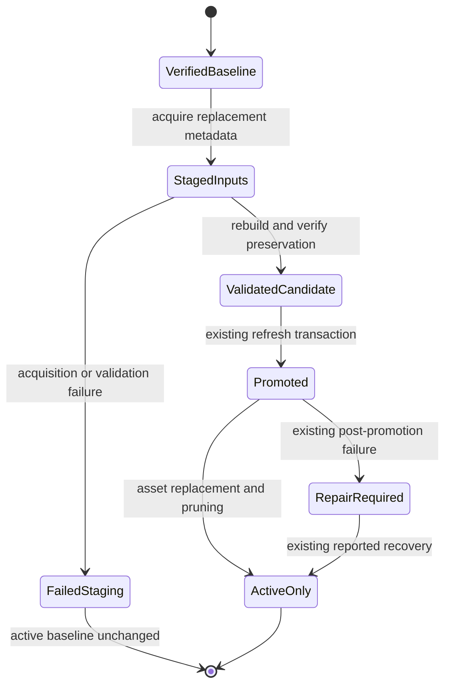
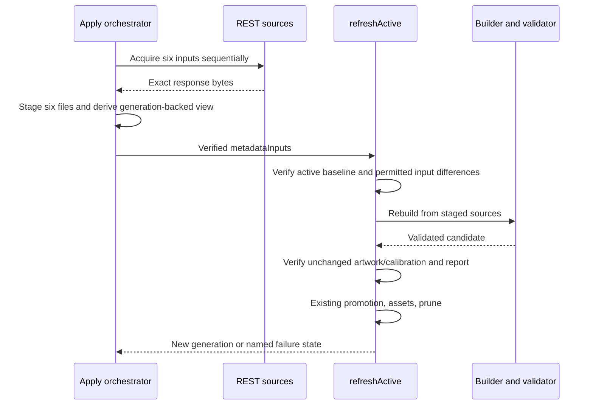
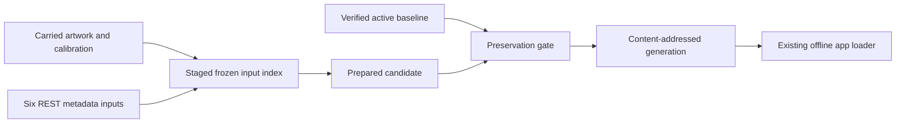

# Design

## Triage

| Trigger | Applies? | Evidence |
|---|---|---|
| T1 Components | No | Extend the existing preparation module; no new runtime component or separate service (`tool/maps/pack.dart:2233-2316`). |
| T2 State | Yes | Replacement frozen inputs create a new immutable generation and change the active pointer and asset declarations; preserve the existing promotion lifecycle (`pack.dart:1664-1718,2233-2316`). |
| T3 Concurrency | Yes | Sequential network acquisition feeds an asynchronous staged rebuild/validation/promotion flow; partial completion is possible. No new worker or concurrent fetch pipeline. |
| T4 Boundaries | Yes | A narrow optional replacement-metadata argument extends the shared refresh interface and adds a baseline-preservation gate across external JSON and the prepared pack. |
| T5 Volume | Yes | Upstream source arrays vary in size; the operation is build-time only and must not add runtime accumulation. |
| T6 Risk | No | No credentials or irreplaceable user data; immutable artifacts are recoverable from Git. Existing promotion failure recovery remains necessary. |

TIER: FULL

## Context

Scope and user choices are in `proposal.md`. Planning starts at `faab9db`, with active generation `ed26414539f458929025f4ef2c3413d3457c7b3e5b9f2e2adfb4dc20c24bba5f`.

- `FrozenInputs.fromGeneration` reconstructs and verifies carried source files, including tile carriers, while retaining missing entries for indexed but uncarried sources (`tool/maps/pack.dart:146-254`). A source index is an exact historical inventory, not proof that every indexed byte was carried. The archived `unpin-map-toolchain` design (Context, lines 33–37) measured 8,960 indexed tiles, of which 8,483 were carried and 477 unused SVG-floor tiles were not; the builder never reads those 477. ADR-0033 D4 requires carrying every source the build reads, not every indexed source. The attempted full-raw materialization failed at `tiles/customs/Ground_Level/0/10.png`; no acquisition or promotion occurred.
- The user approved correcting D1/D2 to the existing generation-backed build-read closure rather than reconstructing the full historical inventory. ADR-0034 supplements ADR-0033 without changing the preservation or source-reading decision: its complete raw input closure means the build-read closure, not every historical index entry. No accepted ADR change or new ADR is needed for this clarification.
- `acquireInputs` fetches artwork, metadata and terms as well as marker dictionaries; it is deliberately not used for this refresh (`pack.dart:292-438`). `primarySourceHashes` pins artwork/geometry sources, not the six replacement REST inputs (`tool/maps/calibration.dart:16-29`). Mutable REST inputs are nevertheless hash-bound by `evidence/sources.json` and `sourceGeneration`; do not weaken either binding.
- `rebuildCandidate` rebuilds every floor using frozen inputs and the installed toolchain (`pack.dart:449-688`). `validateCandidate` recomputes the full marker list through the same preparation functions (`pack.dart:1159-1235`); this catches candidate corruption, but is not an independent oracle for a bug shared with the builder.
- `prepareMarkers` expands `bosses[].spawnLocations[].positions[]`, preserving mob, location and boss-wide chance, then resolves names through the mob dictionary and English translations (`pack.dart:1480-1618`). Generic spawns containing category `boss` are not named boss records.
- `_rebuildActive` always reads the committed inputs today (`pack.dart:2018-2032`). `refreshActive` owns prechecks, validation, reporting, promotion, asset replacement, pruning and recovery (`pack.dart:2233-2316`). Existing refresh qualification tests are in `test/maps/map_preparation_qualification_test.dart:1291-1572`.
- Synthetic full-map input currently has `bosses: []` for every map (`test/support/map_preparation_fixtures.dart:383-401`). Focused marker tests live in `test/maps/map_preparation_test.dart:260-424`.
- The reviewed Interchange console assignment is identity/full-volume bound (`pack.dart:1518-1531`; `calibration.dart:114-146`). Its embedded source hashes are historical evidence, not a reason to relabel the new snapshot or rewrite calibration. A disappeared assignment must also be detected; the current per-present-marker check alone cannot detect its removal.

The saved current REST response was compared offline with all 13 supported source identities: all were present; boss position records including identity/location/coordinates/rate differed on eight maps. Position totals changed on Reserve (52 to 69), Lighthouse (36 to 28), and Streets (30 to 19); equal totals on other maps do not prove equal facts. These are diagnostic observations, not future live-count gates. Reserve's 17 added Glukhar positions and Streets' three reported Kollontay positions are supplied by the current source. Existing source data, not a guessed boss-to-Scav conversion, explains both reported omissions.

## Decisions

### D1: Restrict replacement to the existing six REST inputs

- **Choice:** Verify the active generation and acquire only the six paths below into an owned stage. Construct a generation-backed `FrozenInputs` view using a narrow instance method `withMetadata(Directory replacements)` on the `FrozenInputs.fromGeneration` result. The method reads only those fixed relative paths, hashes their exact bytes, and derives a new index without mutating the baseline. It retains the baseline's carried inputs and missing-entry behavior, substitutes only those six files, and verifies each replacement against its recorded hash when read, including after the view is opened. Use HTTPS JSON REST only; retain the existing regular-mode boundary and all other evidence byte-for-byte.
- **Rejected:** Materialize every historical index entry, run broad `acquire`, change artwork/calibration, introduce a generic overlay or input injection API, introduce mode-specific runtime datasets, or patch prepared markers directly; these either demand unused unavailable bytes, change the approved boundary or lose reproducibility.
- **Reversal cost:** medium.
- **Important:** yes; changes the data players see and preserves an external integration boundary.
- **Chosen by:** user (S1 and S2).

| Staged path | Existing source URL |
|---|---|
| `markers/maps.json` | `https://json.tarkov.dev/regular/maps` |
| `markers/maps_en.json` | `https://json.tarkov.dev/regular/maps_en` |
| `quests/tasks.json` | `https://json.tarkov.dev/regular/tasks` |
| `quests/tasks_en.json` | `https://json.tarkov.dev/regular/tasks_en` |
| `quests/traders.json` | `https://json.tarkov.dev/regular/traders` |
| `quests/traders_en.json` | `https://json.tarkov.dev/regular/traders_en` |

### D2: Extend refresh ownership, not the CLI or the pack format

- **Choice:** Add optional `FrozenInputs? metadataInputs` to `refreshActive`. Omission preserves its existing behavior. The metadata branch verifies the active baseline first, checks the replacement source index and build-read closure against D1, rebuilds using the staged generation-backed view through the existing builder, validates the candidate and checks baseline preservation before any promotion. Uncarried indexed sources remain missing and fail normally if needed; neither `FrozenInputs.open` nor `FrozenInputs.fromGeneration` changes its existing semantics. Reuse the existing report, asset replacement, pruning and failure path. Keep acquisition in disposable apply-time orchestration; no new permanent acquisition command, generic overlay or candidate-injection callback.
- **Rejected:** Duplicate refresh/promotion orchestration in a throwaway script, or introduce a separate refresh subsystem. The former repeats failure handling; the latter exceeds the corrective scope.
- **Reversal cost:** medium.
- **Important:** yes; extends a shared preparation interface.
- **Chosen by:** user ("Extend the existing refresh function").

The replacement source index must have the baseline's exact path inventory and URLs. Only D1's six byte hashes may differ; all non-replacement input bytes and source records remain unchanged. Compare the candidate's complete map records after excluding `markers` against the baseline, and compare the complete non-metadata output path/hash inventory, including notices, vectors, compiler inputs, raster outputs and witnesses. Only the six carried metadata files and `evidence/sources.json` may change among output files; the manifest naturally changes to bind their outputs/source generation and marker lists. Keep `sourceLock`, format/preparation versions and supported inventory unchanged. Toolchain provenance is recorded by the existing build, but changed artwork bytes still fail this metadata-only operation, even if caused by a compiler update.

Verify every reviewed floor-assignment key still resolves to the same prepared marker identity, floor and source volume. Preserve the calibration bytes and historical evidence annotations. A removed or changed reviewed marker stops the refresh; do not loosen assignment checks or invent a new calibration in this change.

The new preservation check belongs inside the metadata branch before the existing promotion point, not solely in an operator's report. Factor source-index admission and manifest/output preservation comparisons into small side-effect-free tooling functions in `pack.dart`, called by refresh and directly exercisable by focused tests. They take already validated artifact data, not an injected candidate writer or callback. Keep lifecycle ownership in refresh, without a second marker parser or another state owner. Existing normal refresh/check behavior stays unchanged.

### D3: Prove source fidelity independently in tests and the real-data audit

- **Choice:** Keep the existing full marker-list candidate validation as production authority. Add small direct projection tests with independently specified expected boss facts, then full-candidate mutation tests. For the regenerated real pack, independently enumerate raw boss positions per source map and compare a multiset of `(mob, resolved name, location, x, y, z, boss-wide chance)` with prepared records. Include occurrence counts; do not use `prepareMarkers` to compute the audit's expected records.
- **Rejected:** Assert only totals, compare the builder to itself, deduplicate by mob/coordinate, or pin today's live rates/counts as universal expectations; these miss wrong-map/fact changes or reject valid future snapshots.
- **Reversal cost:** low.
- **Important:** no; this is verification of the chosen source-fidelity contract, not a new interpretation of source facts.
- **Chosen by:** agent.

Explicit empty `spawnLocations` or `positions` arrays are valid zero-position coverage and are listed in the apply evidence. Missing/wrongly typed required arrays and malformed position records are errors, not empty fallback data. Keep optional ordinary-category handling and existing unavailable-name behavior unchanged. Add source/map/path context to errors where the existing cast or marker-list mismatch would otherwise hide the offending input; do not introduce a parallel normalization policy.

For boss records, validate nonempty mob/location identifiers and dictionary-resolved names, finite numeric `x`/`z`, numeric-or-null `y` (finite when numeric), and a finite numeric boss-wide probability in `[0, 1]`. Preserve nullable height and optional-category behavior for ordinary markers; do not tighten unrelated name or null policies. These checks reject malformed facts that the existing builder and validator could otherwise both copy.

Audit ordering is explicit: before calling refresh, the disposable orchestrator checks the acquired source for the reported Reserve/Streets records. Inside refresh, production source-to-candidate validation and preservation checks finish before promotion. After refresh returns, independently audit the exact returned active generation across all supported maps and record its id, source hashes, mismatches and empty coverage before merge. An independent audit failure blocks delivery/merge and is not reported as a successful fix. No candidate callback, duplicate real-pack rebuild or permanent boss-specific admission rule is added.

### Decision summary

| # | Decision | Choice | Rejected | Reversal cost | Important | Chosen by |
|---|---|---|---|---|---|---|
| S1 | Refresh scope | All supported maps, existing regular-mode metadata sources | Individual boss patches | medium | yes | user |
| S2 | Scope/integration | Unchanged artwork/offline runtime; extend refresh function | Artwork/live data or duplicated orchestration | medium | yes | user |
| S3 | Placement | M8 corrective after popups | Standalone bugfix | low | yes | user |
| D1 | Source boundary | Six replacements in verified carried inputs | Broad acquisition or hand-edited markers | medium | yes | user |
| D2 | Refresh owner | Optional metadata inputs, preservation gate, existing transaction | New CLI/subsystem or duplicate transaction | medium | yes | user |
| D3 | Coverage proof | Independent expected facts and per-map multiset audit | Counts/shared-parser echo/deduplication | low | no | agent |

## Validation Map

The original eleven scenarios have observed green results in the task map. The newly added staging scenario remains red until its named checks pass; observe intended failures for new behavior and mark its task-map row green only after the checks succeed.

| Added spec scenario | Automated check and cheapest complete layer |
|---|---|
| Refresh covers the supported inventory | `test/maps/map_preparation_qualification_test.dart`: `metadata refresh promotes all maps while preserving artwork and reviewed ownership`; actual all-map source inventory and independent post-refresh audit during apply |
| Source identity is missing or ambiguous | `test/maps/map_preparation_test.dart`: `metadata source identities reject missing and duplicate supported maps`; qualification metadata-refresh rejection cases prove no promotion |
| Required metadata is malformed | `test/maps/map_preparation_test.dart`: `boss source rejects malformed required arrays and facts`; parameterize absent/wrong arrays, dictionary failures, bad mob/location, nonnumeric/nonfinite coordinates, invalid chance and nullable-height control |
| Acquired evidence is altered | Existing `frozen source hash changes and missing files fail` plus `test/maps/map_preparation_qualification_test.dart`: `metadata refresh rejects altered evidence without promotion` |
| Renewal tolerates unused uncarried indexed sources | `test/maps/map_generation_inputs_test.dart`: `generation metadata view preserves missing inputs and detects replacement mutation` verifies a synthetic otherwise-valid generation's unused indexed uncarried tile, baseline immutability, needed-missing failure and changed replacement hash rejection; `test/maps/map_preparation_qualification_test.dart`: `metadata refresh succeeds with unused uncarried indexed tile` exercises the staged view through real refresh and promotion |
| Boss records retain their source facts | `test/maps/map_preparation_test.dart`: `boss positions preserve independently specified source facts`; use at least two distinct maps, different boss-wide/location probabilities, translated names and exact expected coordinates |
| Same-count corruption is rejected | `test/maps/map_preparation_qualification_test.dart`: `boss candidate corruption is rejected per map`; parameterize missing/extra/moved-map records and changed mob/name/location/coordinate/rate, including equal-total corruptions |
| Repeated boss positions retain multiplicity | `test/maps/map_preparation_test.dart`: `boss repeated positions preserve occurrence facts`; qualification source fixture and independent real-pack multiset audit retain duplicate occurrences |
| Source supplies no boss coordinates | `test/maps/map_preparation_test.dart`: `explicit empty boss location and position arrays have empty coverage`; assert exact absence for those source entries alongside nonempty control records; audit lists empty coverage |
| Metadata changes without artwork changes | Qualification success case above: changed boss and non-boss facts, complete preserved map/output equality, source hashes, changed-map/owner report, returned id, pointer/pubspec replacement and pruning |
| Artwork or calibration drifts | `test/maps/map_generation_inputs_test.dart`: `metadata preservation rejects forbidden artifact differences`; compare otherwise valid artifact data with changed notice/vector/raster/compiler/witness path or hash, geometry/frame/crop/floor/rendering property, calibration or top-level sourceLock/version/inventory |
| Reviewed floor ownership no longer matches | `test/maps/map_generation_inputs_test.dart`: `metadata preservation rejects removed changed and lost reviewed ownership`; qualification case `metadata refresh rejects disappeared reviewed markers before promotion` |

Additional admission/transaction invariants:

- `test/maps/map_generation_inputs_test.dart`: `metadata admission accepts only the six replacement source records`; reject added/removed paths, URL changes, changed non-replacement hashes or other source-record fields. Check the successful replacement case too. The refresh qualification rejection table asserts these errors leave active pointer, pubspec and generation inventory byte-identical.
- Make the positive full-map raw fixture genuinely satisfy existing reviewed ownership: add the exact Interchange console source id and complete reviewed position/height band/outline from its existing calibration to `test/support/map_preparation_fixtures.dart`. Keep that calibration assignment intact. Retain the existing Icebreaker helipad extract and all ordinary marker controls. Add a small named-boss source record on supported maps and representative duplicates/empty arrays without production-sized images or buffers.
- Construct an otherwise-valid synthetic generation with an indexed unused tile absent from its carried files. At the cheapest unit layer verify `withMetadata` succeeds without reading it, retains its missing status and the unchanged baseline index and bytes, rejects a needed missing source on read, and rejects a replacement modified after view creation on read. The qualification flow builds the six-file stage, constructs the generation-backed view and successfully refreshes that generation; needed-missing and mutated-replacement failures must prevent promotion under the existing failure and candidate-preservation gates.
- The successful replacement fixture must change at least one non-boss marker and one boss fact so it proves a complete metadata refresh, not only a boss append. Independently assert the expected facts, not just nonempty lists or growth.
- For semantic candidate mutations, update output/source index hashes when the mutated file requires it so the check reaches semantic validation rather than only an outer hash refusal. Do not weaken either check.
- Preservation drift that cannot arise through the public refresh inputs without an unrelated earlier validation failure is tested directly through the pure comparison functions using already-valid baseline/candidate structures. No generic candidate-injection API is introduced merely to force such a state. The removed reviewed-marker case reaches the real refresh gate and proves its placement before promotion.
- Extend the existing `refresh` qualification group without replacing its ordinary-refresh cases. Omitted `metadataInputs` retains the old success, precheck, candidate-retention and post-promotion recovery paths. Metadata-branch errors after rebuilding begins use the existing `MapPackRefreshFailure` wrapper and name the retained candidate; earlier admission failures leave no promotable candidate. Both classes of failure preserve the active pointer, pubspec and generations until promotion.
- Actual refreshed-generation audit is offline and source-derived per map; its evidence is generation-bound. The separate `[user]` check judges changed-map presentation and source-versus-game reality, not malformed input or artifact integrity. All automated failures block delivery; no user check substitutes for them.

## Diagrams (FULL)

T2 — artifact state:

T3 — ordered asynchronous work:

T4 — source/pack/runtime boundary:

## State & Ownership (FULL)

| State | Owner (sole writer) | Lifetime | Invalidation / rebuild | Authoritative copy |
|---|---|---|---|---|
| Acquired replacement bytes and staging index | Apply orchestrator and generation-backed input view | One refresh attempt | A failed/incomplete acquisition is discarded or retained only for diagnosis; never mixed into active data | Exact six responses and derived canonical source index |
| Baseline | Existing committed-generation verifier; read-only during staging | Until successful promotion | A corrupt baseline stops before rebuild | Active pointer plus hash-verified generation |
| Candidate | Existing builder/validator under refresh | One attempt | Existing failure path retains and names a failed candidate | Candidate manifest and carried evidence |
| Pointer, generated asset block, retained generations | Existing refresh/promotion flow | Repository lifetime | Existing recovery if interrupted after pointer replacement | Active generation and matching asset declarations |
| User map-check result | User, recorded by orchestrator only from their report | This exact generated pack | A changed generation invalidates the result | Unticked/ticked `[user]` task with generation identity |

## Failure & Visibility (FULL)

| Component | Fails / dies mid-operation → | Recovery | Retry safe? | Who finds out |
|---|---|---|---|---|
| Acquisition/staging | No input closure is handed to refresh | Correct the failed source; acquire a fresh complete set | Yes, in a fresh stage | Operator gets URL/path and failure |
| Source/preparation validation | No promotion; named candidate retained once build starts | Fix incompatible source handling within scope or escalate source drift; never bypass checks | Yes, with explicit new attempt | Operator gets source/map/path |
| Preservation gate | No active/pointer/asset changes | Inspect the exact drift; artwork or calibration changes require a different scope decision | Yes, after cause is resolved | Operator gets changed file/property |
| Promotion/assets/pruning | Existing partial-promotion state and recovery message | Follow `MapPackRefreshFailure`; no blind rollback or deletion | Existing repair path only | Operator gets active id and candidate/recovery location |
| Upstream semantic error | Source-fidelity checks cannot prove game truth | Owner checks changed maps before merge | New acquisition is not itself proof | Owner sees changed maps and source limitations |

## Resource Bounds (FULL)

| Queue / buffer / cache / transfer | Bound | At the bound | Timeout | At 10x / 100x |
|---|---|---|---|---|
| Network work | D1's fixed source set, one request in flight; no worker/retry queue | Finish or fail the current input before the next | Apply-time acquisition invocation has a finite 10-minute deadline; failure does not promote | Larger bodies do not create concurrent copies or runtime work |
| Input bytes and parsed metadata | Whole-file source handling already used by `FrozenInputs`/builder; no new persistent byte cap or cache | Memory exhaustion fails the disposable operation; no partial dataset is accepted | Acquisition deadline above; offline build uses the normal bounded tool invocation | 10x/100x input can exceed available memory; stop rather than paginate/drop records or alter runtime loading |
| Supported maps | Existing canonical inventory | Missing/ambiguous source identities fail; new maps are out of scope | None added | Input maps outside the supported inventory do not add prepared maps |
| Candidate disk data | One stage and one candidate per attempt; no automatic retries | Existing failure retention is explicit and named; remove owned staging after successful proof | Existing command lifetime | Artwork is not downloaded again, but rebuilding still uses existing full-pack scratch space |
| Coverage comparison | Per-map records and occurrence counts; no history | Process each map and release its comparison data | Offline verification invocation | Linear scans; no pairwise cross-map proximity matching |

Uncapped whole-file input size is retained deliberately: this corrective change reuses the established offline API rather than adding a new network client or package format. A larger source failing the operation cannot modify the active pack before the validation/promotion gate. No new runtime memory allocation path is introduced.

## Flow & State Gaps (FULL)

- Acquire one complete set, then treat it as immutable for the attempt. The endpoints do not promise an atomic cross-resource server snapshot; dictionary/identity validation must reject an inconsistent set instead of mixing it with selected old dictionaries.
- Partial download, malformed JSON, missing supported map or missing dictionary: stop before refresh promotion; do not keep an old replacement input as a success fallback.
- Only one apply orchestrator runs map preparation in the checkout. No new concurrency lock, background service or retry loop; do not run two refresh operations together.
- Baseline evidence and geometry remain fixed. If a reviewed floor marker no longer matches, stop; do not auto-reassign floors or update its historical witness hashes to hide the mismatch.
- Existing interrupted-promotion checks run first. Post-promotion asset/pruning failures retain their current explicit recovery semantics; this change does not claim a new all-or-nothing filesystem transaction.
- Fresh data means acquired during apply, not hardcoded to the diagnostic response's date or percentages. Follow D3's source check → internal pre-promotion validation → independent returned-generation audit ordering. If upstream no longer supplies the reported locations, report that discrepancy before refresh rather than claiming the reported bug fixed.

## Mechanism Ledger (FULL)

| Mechanism | Built? | Why (harm nobody catches / expensive later) | Evidence that would change the call |
|---|---|---|---|
| Narrow metadata input + preservation gate | Yes, inside existing refresh | Fresh inputs are otherwise unavailable to that transaction; broad acquisition or manual promotion can change artwork unnoticed | Existing refresh already supports replacement inputs (it does not) |
| Source index/hash closure | Reuse | Required by existing pack integrity; mutation must fail before promotion | None; not weakened |
| Exact boss-fact and corruption regressions | Yes | Current full-map fixture has no bosses, leaving omissions/rates/map identity unexercised | Already covered by meaningful source-position tests (not found) |
| Full independent production boss parser | No | Existing full-marker validation plus independent test/audit expectations avoids another interpretation | A demonstrated parser failure not caught by those boundaries |
| Per-marker permanent diff/report subsystem | No | Existing report identifies changed maps; apply evidence can include compact per-map category/boss differences | Owner cannot review the existing report plus audit |
| New CLI command, runtime fetch/cache, retries, worker or recalibration | No | Separate roadmap scope, not needed to correct the frozen snapshot | A new explicit user request |

## Risks / Trade-offs

- [Source fidelity is not game accuracy] → Record provenance and empty coverage; require the owner check of changed maps. Never infer a named boss from generic spawn categories.
- [Metadata refresh may invalidate reviewed floor ownership or artwork reproduction] → Fail the narrow refresh and report the conflict; do not expand to artwork/calibration changes silently.
- [Rates change while planning] → Freeze exact apply-time responses and compare source facts, not today's totals or a hardcoded 57%.
- [Metadata schemas or translations evolve] → Exercise malformed records and existing name rules; unsupported required structures stop with source context.
- [Full rebuild costs time even with unchanged artwork] → Reuse proven compilation/validation and require equality; do not introduce a second marker-only pack writer.

## ADRs

- **In force, constraining this change:** ADR-0005 as amended by ADR-0033 (offline, immutable prepared packs, source closure, existing promotion/report/owner gates); ADR-0029 (proposal release notes). No existing accepted ADR is edited.
- **Recorded during apply:** ADR-0034, `metadata-refresh-preserves-prepared-artwork`, documents D1/D2's narrow replacement-source and baseline-preservation contract and supplements, not supersedes, ADR-0033. Its source closure is the build-read closure described above; this clarification does not change its decision.

## Open Questions

None that change scope or approach. Apply-time source contents and the owner check are verification inputs, not unresolved design decisions. The staging correction itself changes planning artifacts only; renewed review precedes resumed implementation.
