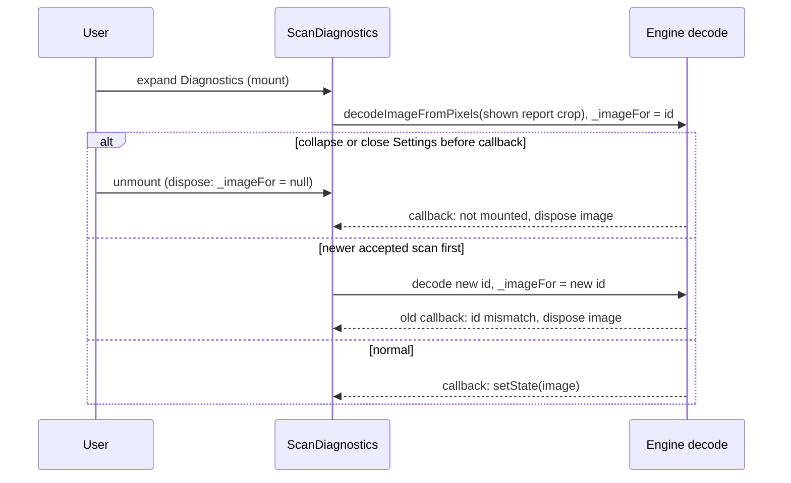

# Design

## Triage

| Trigger | Applies? | Evidence |
|---|---|---|
| T1 Components (new component, or 3+ with directed relationships) | yes | Two new widgets (scan diagnostics, data source diagnostics) read `ScanCoordinator`, `CatalogController`, `ProgressController` and `SelectionController`; three existing widgets lose content. |
| T2 State (persistent state, caches, 3+ state machine) | no | No persistent state or setting. Two session-only expansion flags are removed (`lib/ui/scanner_screen.dart:24`, `lib/ui/shell.dart:40`); Diagnostics' flag already exists (`lib/ui/settings_dialog.dart:81`). |
| T3 Concurrency (background work, workers/isolates, async, retries) | yes | The title crop decode is an async engine callback (`lib/ui/scan_evidence_panel.dart:94`) that moves into Settings, where the widget can be collapsed or the dialog closed mid-decode. |
| T4 Boundaries (data format, migration, shared interface, IPC, external) | no | UI only. The coordinator's published reports, the timing log and frame recording are read, not changed. |
| T5 Volume (grows without a fixed bound) | no | The recent list is capped at `ScanCoordinator.recentLimit = 10` (`lib/application/scan_coordinator.dart:1664`) and holds reports without crops (`:793`). |
| T6 Risk (security, money, data loss, unrecoverable user data) | no | Display only; nothing is written. |

TIER: FULL

## Context

The proposal gives the why and the scope. Current state:

- The Scanner's main column is one `ScanEvidencePanel` (`lib/ui/scanner_screen.dart:36`). It shows the phase, the shown scan's summary, the not-accepted note, the plain recent list (`lib/ui/scan_evidence_panel.dart:135`) and a `DetailsSection` (`:143`) holding everything diagnostic (`_details`, `:212`). The panel owns the crop decode: it listens to the coordinator, decodes once per report id and disposes the image it replaces (`:56-108`).
- The Scanner inspector's Sources tile holds `SourcePanel` (`lib/ui/shell.dart:303`), whose `DetailsSection` (`lib/ui/evidence_panels.dart:358`) holds the source, UTC times, record counts, items source update, cooldown end and freshness limits.
- `DetailsSection` (`lib/ui/panels.dart:194`) is used only by these two panels.
- Settings is still a dialog. Its last block is the `CollapsibleGridPanel` titled Diagnostics (`lib/ui/settings_dialog.dart:530`), whose child is built only while it is expanded (`lib/ui/panels.dart:141`), and which starts collapsed on every opening (`:79-81`). Today it holds `MapDiagnostics`, the map input lines (`lib/ui/map_diagnostics.dart`).
- The decision card's corrected subtitle names the scan (`lib/ui/item_decision_card.dart:72`). The correction offer (`CorrectionOfferBlock`), shown through the answer strip on both areas (`lib/ui/answer_strip.dart:210`), names the scan (`lib/ui/item_decision_card.dart:476`) and prints each candidate's similarity (`:504`); S6 removes both and keeps its "Read:" line.
- ADR-0013 makes the coordinator the only writer of scan state. UI widgets only listen. ADR-0037 requires every colour and type to come from the Ember theme.

## Decisions

### D1: Split the evidence panel by audience, not by visibility

- **Choice:** `ScanEvidencePanel` keeps only the phase, the shown scan's plain summary and the note, and loses its expansion parameters and the crop decode. A new `ScanDiagnostics` widget in the same library holds today's `_details` content, the recent list and the crop decode, with the helpers they share (`shownEvidence`, `shownBestMarkerScore`, labels and formatters).
- **Rejected:** Keeping one widget with a `diagnostics: bool` mode used in both places, because one widget then serves two audiences, and the Scanner would still mount the decode code and its listener.
- **Reversal cost:** low
- **Important:** no
- **Chosen by:** agent

### D2: Diagnostics is flat, with titled parts

- **Choice:** Expanding Diagnostics shows three parts in this order, each under a small heading: Map inputs (today's `MapDiagnostics`), Scans (`ScanDiagnostics`), Data sources (`DataSourceDiagnostics`). One expansion flag, as today. "Map inputs" avoids repeating the "Game files" Settings section that DESIGN.md X12 plans.
- **Rejected:** Each part as its own collapsible sub-section, which takes two clicks to reach anything and adds three more pieces of open/closed state.
- **Reversal cost:** low
- **Important:** yes; changes what users see.
- **Chosen by:** user

### D3: Data source detail becomes its own widget; Details sections go

- **Choice:** Move the content of `SourcePanel`'s Details builder into a `DataSourceDiagnostics` widget in `lib/ui/evidence_panels.dart`, built from the same `SelectionController` inspection catalog and quote, so it reports the same data the panel did. `SourcePanel` drops `detailsExpanded`/`onDetailsExpandedChanged`, and the shell drops `sourceDetailsExpanded`. `DetailsSection` and its test are deleted, because nothing uses them any more.
- **Rejected:** Keeping `DetailsSection` for later use, which keeps dead code and a spec-less widget test.
- **Reversal cost:** low
- **Important:** no
- **Chosen by:** agent

### D4: Diagnostics follows scans live while open

- **Choice:** `ScanDiagnostics` listens to the coordinator and catalog while it is mounted, so a scan published while Settings is open shows at once. It is mounted only while Diagnostics is expanded.
- **Rejected:** A snapshot taken when Diagnostics opens, which shows stale evidence while the user scans to debug a problem.
- **Reversal cost:** low
- **Important:** no; the spec already fixes the behaviour ("A scan arrives while open").
- **Chosen by:** agent

### Decision summary

| # | Decision | Choice | Rejected | Reversal cost | Important | Chosen by |
|---|---|---|---|---|---|---|
| S1 | Recent scans list | Move the whole list to Diagnostics | Keep the plain list on Scanner | low | yes | user |
| S2 | Scan numbers on main windows | Drop them; "Corrected from a scan" | Keep "scan #N" | low | yes | user |
| S3 | Scan detail in Diagnostics | Today's Details content, moved | Full evidence per recent scan | low | yes | user |
| S4 | Data sources detail | Move it to Diagnostics | Leave Details in the inspector | low | no | agent |
| S6 | Correction offer | Drop scan # and scores; keep the read text | Keep scores; drop the read text too | low | yes | user |
| S5 | Capability for Diagnostics contents | New `settings-diagnostics` | Fold into `map-rail` or `scanner-evidence` | low | no | agent |
| D1 | Split the evidence panel | Scanner summary + `ScanDiagnostics` | One widget with a mode flag | low | no | agent |
| D2 | Diagnostics layout | Flat, three titled parts | Nested collapsibles | low | yes | user |
| D3 | Data source detail widget | `DataSourceDiagnostics`; delete `DetailsSection` | Keep `DetailsSection` | low | no | agent |
| D4 | Live or snapshot | Live while mounted | Snapshot on open | low | no | agent |

## Diagrams (FULL)

T1, where each piece of information lives after the change:

```mermaid
flowchart LR
  SC[ScanCoordinator] --> SEP[ScanEvidencePanel<br/>Scanner: phase, name or reason, note]
  SC --> SD[ScanDiagnostics<br/>evidence, crop, timings, recent]
  CC[CatalogController] --> SEP
  CC --> SD
  SEL[SelectionController] --> SP[SourcePanel<br/>inspector: plain status]
  SEL --> DSD[DataSourceDiagnostics<br/>source, UTC, counts, limits]
  PC[ProgressController] --> SP
  PC --> DSD
  subgraph Settings Diagnostics, built only while expanded
    MD[MapDiagnostics] --- SD --- DSD
  end
```

T3, the crop decode inside Settings:



## State & Ownership (FULL)

| State | Owner (sole writer) | Lifetime | Invalidation / rebuild | Authoritative copy |
|---|---|---|---|---|
| Scan reports (latest, last accepted, recent) | `ScanCoordinator` (ADR-0013) | App session | Each publication | Coordinator |
| Decoded title crop and its report id | `ScanDiagnostics` state | While Diagnostics is expanded | New shown report id; disposed on unmount | Report's crop bytes |
| Diagnostics expanded | `_SettingsDialogState` | One opening of Settings | Starts collapsed each opening | That flag |
| Catalog snapshot, quote, progress | `CatalogController`, `SelectionController`, `ProgressController` | Unchanged | Unchanged | Controllers |

The removed flags (`_scanDetailsExpanded`, `sourceDetailsExpanded`) have no successor.

## Failure & Visibility (FULL)

| Component | Fails / dies mid-operation → | Recovery | Retry safe? | Who finds out |
|---|---|---|---|---|
| Crop decode | Callback after unmount or for a superseded id | The image is disposed in the callback; the next mount decodes again | yes | Nobody needs to; the placeholder reads "Decoding title crop…" until it lands |
| Crop bytes malformed (size mismatch) | No decode starts | None needed | n/a | User sees "No title crop" in Diagnostics, as today (`_hasCrop`) |
| Catalog missing | No source or counts | A refresh | yes | User: Diagnostics says no complete item data download; the inspector keeps the plain status and error |
| Recording stop | Unchanged | Unchanged | n/a | User: `RecordingStopNote` stays on the Scanner (`lib/ui/scanner_screen.dart:33`) |

## Resource Bounds (FULL)

| Queue / buffer / cache / transfer | Bound | At the bound | Timeout | At 10x / 100x |
|---|---|---|---|---|
| Recent scans shown | 10 (`ScanCoordinator.recentLimit`) | Oldest dropped by the coordinator | none | Unchanged; the bound is the coordinator's |
| Decoded crops | 1 at a time, only while expanded | Previous disposed before the next decode | none | Unchanged |
| Dataset count rows | One per catalog dataset (fixed set) | n/a | none | n/a |

Moving the decode into a collapsed section lowers memory use in normal play: no crop is decoded unless Diagnostics is open.

## Flow & State Gaps (FULL)

- **Scan published while Settings is open and Diagnostics expanded:** shown at once (D4). With Diagnostics collapsed, nothing listens; expanding shows the current state.
- **Settings closed mid-decode:** the callback sees `!mounted` and disposes the image (diagram above).
- **History inspection on Scanner while Diagnostics shows a catalog:** `DataSourceDiagnostics` reads the inspection catalog, as `SourcePanel`'s Details did, so it describes the data behind the item shown.
- **Settings opened from the status bar at a section:** Diagnostics still starts collapsed, and section focus is unchanged.

## Mechanism Ledger (FULL)

| Mechanism | Built? | Why (harm nobody catches / expensive later) | Evidence that would change the call |
|---|---|---|---|
| Per-id decode fence and dispose on unmount | yes (moved) | Without it a late callback leaks an image or shows a stale crop; the dialog can close mid-decode | none |
| A guard test that main windows show no diagnostic tokens | yes | A later change can quietly put a code or a UTC time back on a main window; a widget test over Map and Scanner with a populated scan and catalog catches it. It runs twice: with an accepted scan and the inspector sections expanded (collapsed `ExpansionTile`s build nothing, `lib/ui/shell.dart:262-305`), and with a rejected scan that shows a correction offer | none |
| Keeping Diagnostics expanded across Settings openings | no | Each opening starts collapsed today (`map-rail`), and nobody has asked otherwise | Owner feedback that debugging needs it to stay open |
| A "copy diagnostics" button | no | Not asked for | A support need for pasting scan detail |

## Risks / Trade-offs

- [The Scanner main column looks empty with only the result shown] → DESIGN.md X10 puts requirements and the price breakdown there; that fill is a later layout change and is named out of scope in the proposal.
- [Moving the recent list hides failed-scan history from players] → The owner chose it (S1). The note for the latest unaccepted scan stays on the Scanner.
- [Tests that pin today's keys (`scan-recent-*`, `scan-timing-*`, `scan-crop-image`) break] → They move to Diagnostics tests with the same keys, so their assertions survive.

## ADRs

- **In force, constraining this change:** ADR-0013 (the coordinator is the only writer; widgets only listen), ADR-0037 (Ember colours and type only), ADR-0002 (`ChangeNotifier` controllers).
- **To record during apply:** none. Where diagnostic detail lives is a UI placement rule, already set by the owner's 2026-11-08 rule and the `settings-diagnostics` spec. It binds no data format or contract.
