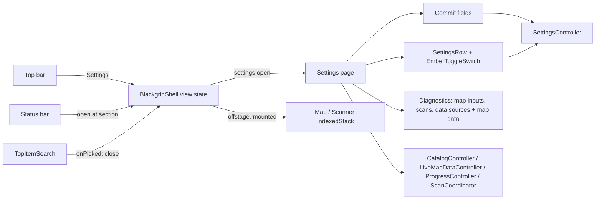
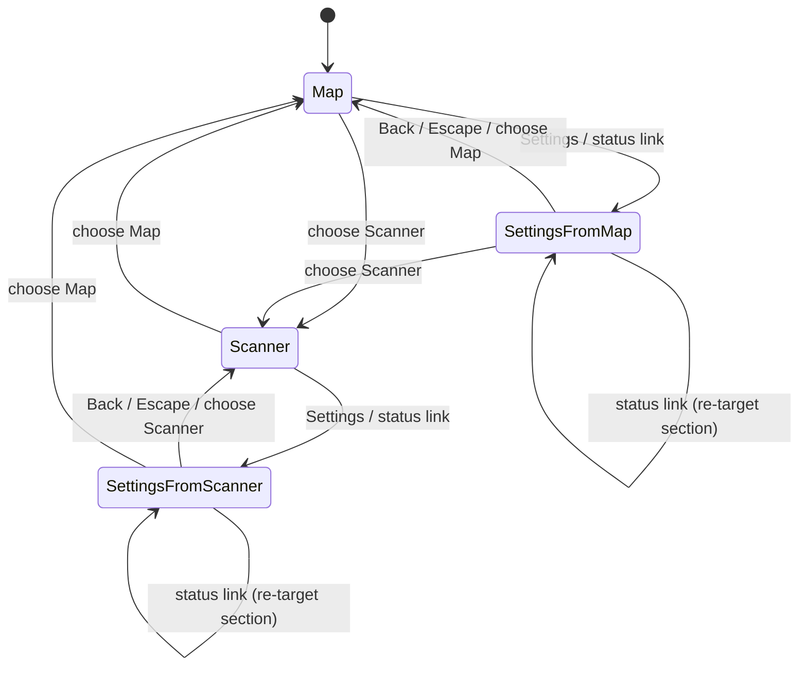
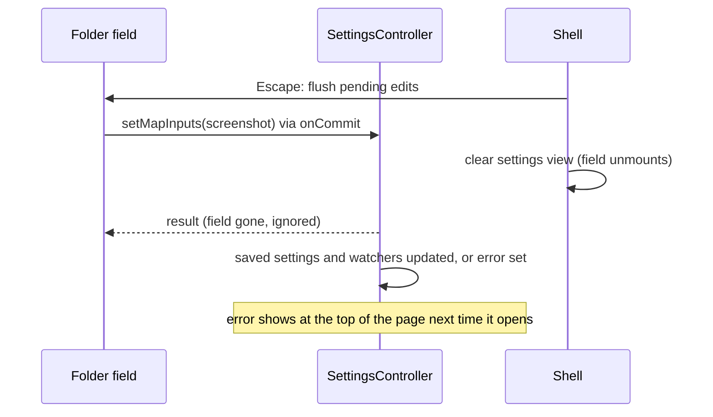

# Design

## Triage

| Trigger | Applies? | Evidence |
|---|---|---|
| T1 Components (new component, or 3+ with directed relationships) | yes | A new Settings page widget, shown by the shell and targeted by the status bar, replaces `SettingsDialog` (`lib/ui/settings_dialog.dart:34`). |
| T2 State (persistent state, caches, 3+ state machine) | yes | The shell's view gains a third state: Map, Scanner, Settings (with the area to go back to and the inspector state to restore). No persistent state changes. |
| T3 Concurrency (background work, workers/isolates, async, retries) | yes | Folder fields now save on blur and Enter through async `setMapInputs`; a save can still be in flight when the page closes. |
| T4 Boundaries (data format, migration, shared interface, IPC, external) | no | No stored format, schema or cross-isolate contract changes. `AppSettings` and `SettingsController` keep their API. |
| T5 Volume (grows without a fixed bound) | no | The page lists a fixed set of rows; Diagnostics keeps its existing bounds (10 recent scans). |
| T6 Risk (security, money, data loss, unrecoverable user data) | no | The Tracker token handling is moved, not changed: obscured field, cleared after each action (`settings_dialog.dart:104`, `:89`). |

TIER: FULL

## Context

See proposal.md for scope. Current state the approach depends on:

- The shell is one `Column`: top bar, answer strip, an `Expanded` holding an `IndexedStack` of `MapScreen` and `ScannerScreen` plus the docked inspector, then the status bar (`lib/ui/shell.dart:126-330`). Area is `selected` (0 Map, 1 Scanner) at `shell.dart:31`; inspector state is `inspectorOpen`/`inspectorVisible` at `shell.dart:32-33`. Escape is bound to `_CloseInspectorIntent` (`shell.dart:108-118`).
- Settings, Stats and Import open through `showSettings`, `showStats` and `showLegacyImport` from the top bar (`shell.dart:479-497`); the status bar opens Settings at `SettingsSection.itemData` or `.tracker` (`shell.dart:386-406`).
- `SettingsDialog` already does section targeting with `GlobalKey` + `FocusNode` per section and a post-frame `Scrollable.ensureVisible` (`settings_dialog.dart:52-70`), and has `_CommitField`, which saves on done and on blur and keeps refused text (`settings_dialog.dart:628-702`). Diagnostics is a `CollapsibleGridPanel` whose expansion is dialog state (`settings_dialog.dart:81-83`, `:532-540`); collapsed, it builds nothing (`settings-diagnostics` spec).
- Map data status and refresh are the `LiveMapStatus` widget (`lib/ui/live_map_status.dart:10`); its source and mode lines are diagnostic detail. Data sources diagnostics live in `DataSourceDiagnostics` (`lib/ui/evidence_panels.dart:363`).
- The X13 toggle switch exists as `MarkerToggleSwitch` (`lib/ui/marker_preferences.dart:158`), drawing only, with the row taking the press.
- The theme already sets `dialogTheme` (raised surface, `EmberRadius.l`, hairline; `lib/ui/ember/ember_theme.dart:151`) and button themes (`:59-90`). No `bottomSheetTheme` or `switchTheme` is set.
- The startup screen is built inline in `BlackgridBootstrap` (`lib/ui/app.dart:84-145`) with `AppLogo(size: 54)` and a hand-styled "BLACKGRID"; the header lockup is inline in `_headerItems` (`shell.dart:452-459`).
- Map help, the remove-pin confirm and the marker browser sheet are inline in `map_workspace.dart:196-330`; another remove-pin confirm is at `map_inspector.dart:228`; the pin editor is `lib/ui/pin_editor.dart`.

## Decisions

### D1: Settings is a view state of the shell, not a route

- **Choice:** The shell holds `_settings` (null when closed, else the area to go back to and whether the inspector was open). While set, the shell replaces the answer strip and the main `Expanded` with the Settings page and hides the inspector. The `IndexedStack` with `MapScreen` and `ScannerScreen` stays mounted under an `Offstage`, so map viewport, selection and scanner state survive. Because an `Offstage` child can still hold focus and take keyboard input, the areas and the inspector are also wrapped in `ExcludeFocus(excluding: settingsOpen)`. Without it, a map that took focus on a marker click (`map_workspace.dart:135`, `:263`, `:717`) would keep handling N, Enter, Delete and Escape (`map_workspace.dart:401`) under the page. Opening Settings moves focus into the page: to the target section when there is one, else to the page title. Closing gives focus back to the shell's root `Focus`, not to a node of the unmounted page.
- **Rejected:** Push Settings as a full-screen `MaterialPageRoute`, because the route would cover the top bar and status bar (X12 keeps them) or need its own copies of both, and the status bar links would then have to reach into a route.
- **Reversal cost:** medium
- **Important:** no; DESIGN.md X12 and owner decision C4 settle the page form, and nothing outside the shell depends on it.
- **Chosen by:** agent

### D2: The inspector is hidden while Settings is open

- **Choice:** Opening Settings records `inspectorOpen` and hides the inspector; its toggle is disabled. Back, Escape or choosing an area restores the recorded state.
- **Rejected:** Keep the inspector docked beside the page, because the page needs the width and the inspector's lists belong to the area being left.
- **Reversal cost:** low
- **Important:** yes, changes what users see.
- **Chosen by:** user

### D3: Escape closes Settings

- **Choice:** The shell's Escape action closes Settings when it is open (the inspector rule applies otherwise). Open menus and dropdowns are routes and take Escape first. Unmounting alone would drop a typed edit: `_CommitField` removes its focus listener in `dispose` and returns early when not mounted (`settings_dialog.dart:663`, `:672`). So every close path (Back, Escape, choosing an area, an item pick) goes through one shell method that first asks the page to flush: each commit field with pending text calls its `onCommit` (registered with the page through a small `SettingsFlushScope`). The method then clears `_settings` in the same frame. The saves run on after the page is gone, and their results land in `SettingsController` as for any save.
- **Rejected:** Back button only, which leaves keyboard users without the usual way out of a page.
- **Reversal cost:** low
- **Important:** yes, changes what users see.
- **Chosen by:** user

### D4: One entry point for opening Settings, with an optional section

- **Choice:** `showSettings(context, services, section:)` is replaced by a private shell method, `_openSettings({SettingsSection? section})`, which the top bar and status bar call (both are built by the shell). When the page is already open it only re-targets the section and keeps the original Back area. Each request carries an increasing request number, so asking again for the section already targeted still scrolls to it. The `SettingsSection` enum gains the eight page sections; the page keeps the existing `GlobalKey`/`FocusNode` targeting pattern from `settings_dialog.dart:52-70`. `TopItemSearch` gains an `onPicked` callback, called after `selection.selectManual` (`top_item_search.dart:97`); the shell closes Settings only from that callback. A live scan changing the selection never closes Settings.
- **Rejected:** A global `ValueNotifier<SettingsSection?>` on `AppServices`, because it puts view state in the composition root (ADR-0002 keeps services free of widget concerns). An `InheritedWidget` opener was also dropped: nothing outside the shell opens Settings today.
- **Reversal cost:** low
- **Important:** no
- **Chosen by:** agent

### D5: Folder fields reuse the commit field

- **Choice:** The game log and screenshot folders become two commit fields (the existing `_CommitField`, moved to a shared file), each calling `setMapInputs` with only its own folder. A `false` result shows "Not saved. Try again." and keeps the typed text. Empty text saves empty (default location), as today.
- **Rejected:** A debounced save on every keystroke, because it would save half-typed paths and start log and screenshot watchers on them.
- **Reversal cost:** low
- **Important:** no; S2 already records the user-facing choice.
- **Chosen by:** agent

### D6: Map data splits into a plain row and a diagnostics part

- **Choice:** `LiveMapStatus` is split. The Item and map data section shows Refresh map data with one plain line (checked time in local words, "refreshing", or the plain failure). A new map data part of `DataSourceDiagnostics` shows the selected mode, map data mode, source and last check time.
- **Rejected:** Keep `LiveMapStatus` whole inside Diagnostics and leave a bare button in the section, because a failure would then only be visible in a collapsed section.
- **Reversal cost:** low
- **Important:** no; S1 records the user-facing choice.
- **Chosen by:** agent

### D7: One shared toggle switch and one settings row widget

- **Choice:** `MarkerToggleSwitch` moves to `lib/ui/ember/` as `EmberToggleSwitch`; the Map inspector imports it from there. A `SettingsRow` widget lays out name, one-line explanation and trailing control, and for switches makes the whole row the press target with switch semantics (`toggled`). Material `Switch`, `SwitchListTile` and `CheckboxListTile` leave the Settings page.
- **Rejected:** Theme Material's `Switch` to look like X13, because `SwitchThemeData` cannot draw ink-only tracks with a 12px knob at 28 × 16 without fighting Material's sizes, and the map would keep a second drawing.
- **Reversal cost:** low
- **Important:** no
- **Chosen by:** agent

### D8: Dialog and sheet styling comes from the theme first

- **Choice:** Add `bottomSheetTheme` (panel surface, 12px top corners, hairline) and dialog title and actions styles to `blackgridTheme`, so every `showDialog` and `showModalBottomSheet` gets Ember without per-call styling. Each dialog then only fixes its button variants (one `FilledButton` primary, the rest quiet `TextButton`) and uses Ember rows instead of `ListTile`/`CheckboxListTile`.
- **Rejected:** A custom `EmberDialog` wrapper used at every call site, because it duplicates what `DialogThemeData` already carries and new dialogs could still bypass it.
- **Reversal cost:** low
- **Important:** no
- **Chosen by:** agent

### D9: One brand lockup widget

- **Choice:** A `BrandLockup` widget (logo, wordmark, tagline; size variants for the top bar and the startup screen) replaces the inline header lockup (`shell.dart:452-459`) and the startup screen's logo and text. It is the only place the X9 capitals exemption applies.
- **Rejected:** Keep two inline copies, because X9 limits the exemption to one asset and two copies drift.
- **Reversal cost:** low
- **Important:** no
- **Chosen by:** agent

### D10: Import Details is dialog-local state

- **Choice:** `_ImportDialogState` gains `detailsExpanded`, set false in `readPreview` before each read. The fingerprint and per-record rows build only when expanded.
- **Rejected:** Put the detail in Settings › Diagnostics, because it describes one preview of one file pair and has no meaning after the dialog closes.
- **Reversal cost:** low
- **Important:** no; S3 records the user-facing choice.
- **Chosen by:** agent

### D11: Dialogs keep the Raised surface

- **Choice:** Dialogs keep the Raised surface the theme already gives them (`ember_theme.dart` `dialogTheme`), which DESIGN.md assigns to anything that sits on top. Bottom sheets take the Panel surface (D8). The first version of the `interface-theme` delta said Panel for both; apply found the conflict with the shipped theme and DESIGN.md, and the spec was amended.
- **Rejected:** Switch dialogs to Panel as first specified, because it departs from DESIGN.md's Lifted Card rule and turns light-room dialogs warm grey. Raised for sheets too, which would change D8 for no reported need.
- **Reversal cost:** low
- **Important:** yes, changes what users see.
- **Chosen by:** user

### Decision summary

| # | Decision | Choice | Rejected | Reversal cost | Important | Chosen by |
|---|---|---|---|---|---|---|
| S1 | Where map data goes | "Item and map data" section; detail to Diagnostics | Map section; Diagnostics only | low | yes | user |
| S2 | How folder fields save | On Enter or leaving; no Save button | Keep a Save button | low | yes | user |
| S3 | Import technical detail | Collapsed Details toggle | Keep visible | low | yes | user |
| S4 | Which dialogs to restyle | Every dialog and sheet plus startup | Only those the roadmap names | low | no | agent |
| S5 | Where the version shows | General section row | Sidebar foot | low | no | agent |
| S6 | Settings dialog removed | Page replaces it everywhere | Keep as fallback | medium | no | agent |
| D1 | Settings form in the shell | Shell view state; areas stay mounted with focus excluded | Full-screen route | medium | no | agent |
| D2 | Inspector while Settings is open | Hidden, restored on leave | Docked beside page | low | yes | user |
| D3 | Escape on the page | Closes Settings, flushing pending edits first | Back button only | low | yes | user |
| D4 | Opening at a section | Private shell method with request number; search `onPicked` closes | Global notifier on services | low | no | agent |
| D5 | Folder field saving | Shared commit field per folder | Debounced save per keystroke | low | no | agent |
| D6 | Map data status | Plain row plus diagnostics part | Whole widget in Diagnostics | low | no | agent |
| D7 | Switch and row widgets | Shared `EmberToggleSwitch`, `SettingsRow` | Themed Material `Switch` | low | no | agent |
| D8 | Dialog styling | Theme first, per-dialog button variants | `EmberDialog` wrapper | low | no | agent |
| D9 | Brand lockup | One `BrandLockup` widget | Two inline copies | low | no | agent |
| D10 | Import Details state | Dialog-local, reset per preview | Move to Diagnostics | low | no | agent |
| D11 | Dialog surface | Raised, as shipped; sheets Panel | Panel for dialogs; Raised for sheets too | low | yes | user |

## Diagrams (FULL)

T1 - components:

T2 - shell view state:

T3 - a folder save racing a close:

## State & Ownership (FULL)

| State | Owner (sole writer) | Lifetime | Invalidation / rebuild | Authoritative copy |
|---|---|---|---|---|
| Settings open, back area, inspector-was-open | `_BlackgridShellState` | Shell session | Cleared on Back, Escape or area choice | Shell state |
| Target section | `_BlackgridShellState`, read once by the page after a frame | Until the page scrolls to it | Replaced by the next link | Shell state |
| Diagnostics expanded | Settings page state | Page mount | Page unmounts on close, so each open starts collapsed | Page state |
| Typed folder / timer text | Each commit field | Field mount | Follows saved value on change; refused text kept until edited or unmounted | `SettingsController.settings` |
| Saved settings | `SettingsController` (unchanged) | Durable | Unchanged | SQLite via controller |
| Import Details expanded | `_ImportDialogState` | Dialog | Reset false on each preview read | Dialog state |

## Failure & Visibility (FULL)

| Component | Fails / dies mid-operation → | Recovery | Retry safe? | Who finds out |
|---|---|---|---|---|
| Folder commit | `setMapInputs` returns false or throws while the field is shown | Field keeps text, shows "Not saved. Try again."; saved value unchanged | yes | User, under the row |
| Folder commit after close | Save fails after the page closed | `SettingsController.error` is set as today | yes | User, at the top of the page on next open |
| Map data refresh | Refresh fails | Map keeps current data (`LiveMapDataController`, unchanged) | yes | User, plain line in Item and map data |
| Tracker token action | Credential save/remove throws | Message "Tracker token operation failed..."; field cleared | yes | User, in the section |
| Section targeting | Target key has no context (section not built) | Page opens at top; no throw | n/a | Nobody needs to: the page is still usable. Widget test covers each target |
| Startup logo | Vector fails to load | Empty box (existing `AppLogo` behaviour) | n/a | Nobody; documented in `app-icon` |

## Resource Bounds (FULL)

| Queue / buffer / cache / transfer | Bound | At the bound | Timeout | At 10x / 100x |
|---|---|---|---|---|
| Settings saves in flight | 1, `SettingsController.busy` refuses a second (`settings_controller.dart:156`) | Second edit refused; row says not saved, controls disabled while busy | none (local SQLite) | Unchanged: user edits are human-paced |
| Map and Scanner kept mounted under Settings | 2 existing screens | n/a | n/a | Same as today's `IndexedStack`, which already keeps both |
| Import preview rows | Built only when Details is open; count is the file's records | Large files build a long list in a `ListView` (lazy) | none | Lazy list keeps layout bounded |

## Flow & State Gaps (FULL)

- **Map had keyboard focus when Settings opened:** the areas are focus-excluded while the page is open, and focus moves into the page (D1), so map keys do nothing under Settings.
- **A scan is accepted while Settings is open:** the selection changes underneath; Settings stays open (only the search's `onPicked` closes it), and the answer strip shows the item after Back.
- **Close with a typed, unsubmitted edit:** the close path flushes it first (D3), so a valid edit is saved and an invalid one is refused, keeping the saved value.
- **Close during a save:** the field unmounts; its result is ignored (`_CommitField` checks `mounted`, `settings_dialog.dart:683`). The controller still finishes the save or records its error.
- **Status link while open:** re-targets only; Back area stays the original one (spec "Settings opens at a requested section").
- **Mode change while open:** sections rebuild from controllers as the dialog does today (`settings_dialog.dart:210-216`); the Fence reputation field follows the new mode's value.
- **Area changes from the logs while open:** following logs can change the selected map underneath; the Map is offstage and shows the new map on return. The page does not close.
- **Item search (Ctrl K) while open:** the search stays in the top bar. Choosing an item closes Settings and shows the area the page was opened from with the item in the answer strip, because the strip is hidden while the page is open. Default assumption, covered by a test.
- **Window narrowed while open:** the inspector is hidden anyway; the page column shrinks below 720px. The sidebar keeps a fixed width.
- **Restart while open:** nothing about the page is persisted; the app starts on the Map as today.

## Mechanism Ledger (FULL)

| Mechanism | Built? | Why (harm nobody catches / expensive later) | Evidence that would change the call |
|---|---|---|---|
| Keep Map/Scanner mounted under Settings | yes | Unmounting loses the map viewport and the scanner's in-progress state, which the player would notice only after leaving Settings | none |
| Unsaved-change guard on close | no | Every row saves as it changes; text fields commit on blur, which close triggers | A field type that cannot commit on blur |
| Scroll position memory across opens | no | Spec opens at top or at a section | Owner asks for it |
| Responsive sidebar collapse | no | Settings at 960px fits a fixed sidebar plus a shrinking column; small windows are not a target | A user report at a supported width |
| Old `showSettings` kept as a shim | no | S6 removes the dialog; a shim would let new callers open a second Settings | none |

## Risks / Trade-offs

- [Many Settings tests target the dialog by type and keys] → Keep the existing keys (`settings-item-data`, `settings-live-scan`, `settings-tracker`, `settings-diagnostics-toggle`, `live-scan-switch`, `record-frames-switch`, `scan-hotkey-picker`) on the page, and rename test files only where the subject changed.
- [A row loses a control in the move] → One test walks the full list in the "Every setting stays reachable" requirement against the page.
- [Escape now closes Settings while a text field is focused, which may surprise someone mid-edit] → Every close path flushes pending edits before unmounting (D3), so a valid edit is saved; a widget test covers Escape with a valid and an invalid edit.
- [A close path added later skips the flush] → All close paths go through the one shell method; the tests cover Back, Escape, area switch and item pick.
- [Theme-level dialog styling changes dialogs this change does not touch] → All dialogs are in scope (S4), and `ember_surfaces_test.dart` covers them in both rooms.

## ADRs

- **In force, constraining this change:** ADR-0037 (colours, type, radii only from the Ember theme; no literals in `lib/ui`), ADR-0039 (amber on the map means selected; the shared toggle switch stays ink-only), ADR-0002 (controllers are SDK notifiers built by the composition root; view state stays in widgets), ADR-0015 (frame recording is session-only and on only while live scan is ready; the Live scan row keeps that rule), ADR-0028 (the header logo is the compiled app icon vector).
- **To record during apply:** none. The page form follows DESIGN.md X12; no new binding decision.
