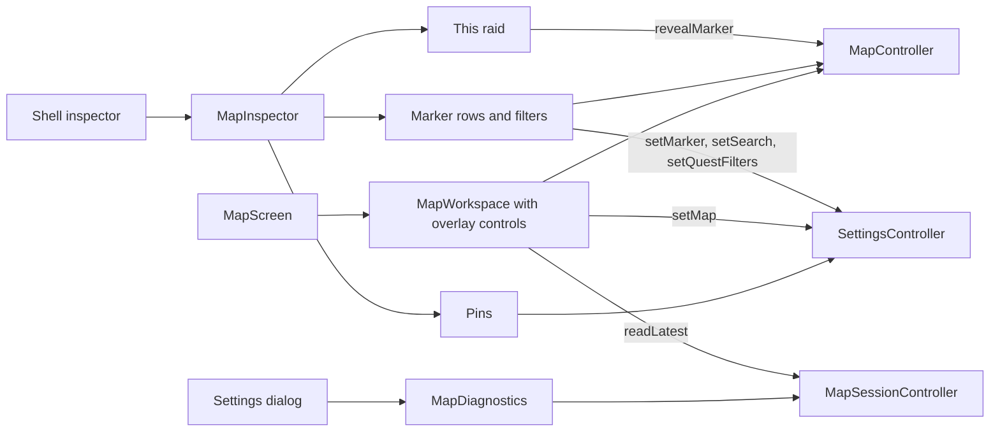
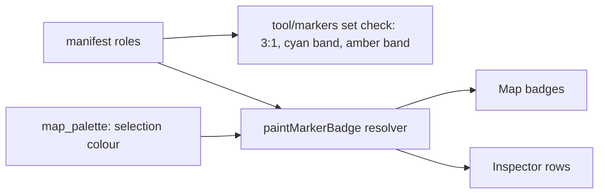
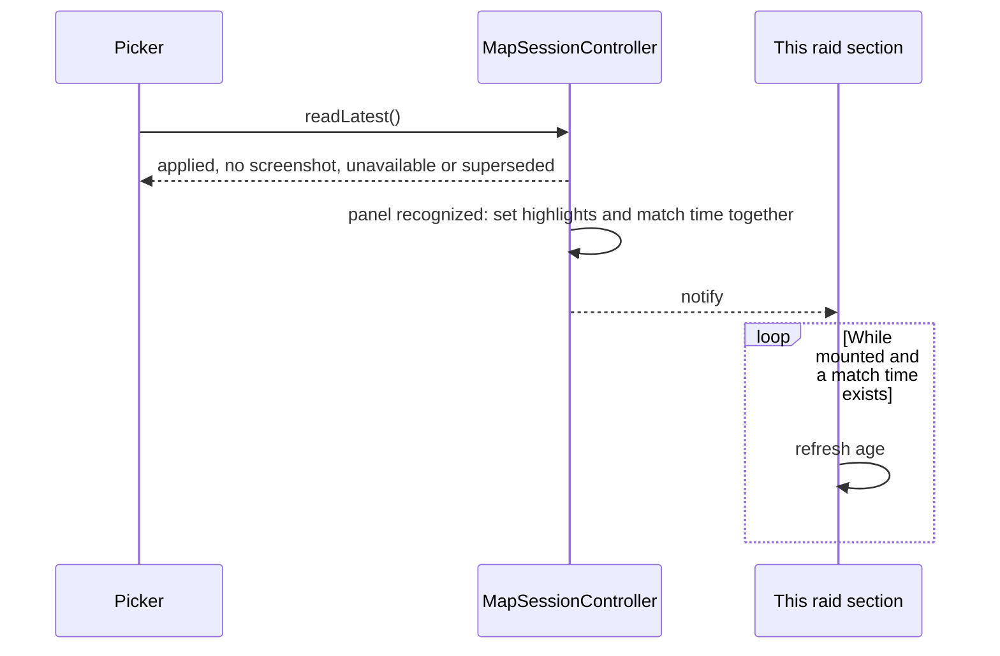

# Design

## Triage

| Trigger | Applies? | Evidence |
|---|---|---|
| T1 Components (new component, or 3+ with directed relationships) | Yes | New Map inspector, picker and on-map controls that join `MapScreen`, `MapController`, `MapSessionController`, `SettingsController` and the shell's inspector |
| T2 State (persistent state, caches, 3+ state machine) | No | `markerFilters`, `selectedMap` and `followGameLogs` keep their format; `lib/ui/map_screen.dart:221`'s `_inputsExpanded` is removed, not persisted |
| T3 Concurrency (background work, workers/isolates, async, retries) | Yes | This raid adds a periodic age refresh while mounted (D5); Read latest's outcome is reported across an async read that can be superseded (D8) |
| T4 Boundaries (data format, migration, shared interface, IPC, external) | Yes | Role colours in `assets/map_markers/manifest.json` are a checked shared file, and the palette rule binds future icon sets through a new ADR |
| T5 Volume (grows without a fixed bound) | No | Rows are bounded by 19 marker categories, the extracts on one map and the saved pins on one map, as in today's pin sheet |
| T6 Risk (security, money, data loss, unrecoverable user data) | No | No stored data is rewritten; pin removal keeps its confirmation |

TIER: FULL

## Context

See `proposal.md` for scope. Current state that shapes the approach:

- `MapScreen` builds the workspace panel and a rail in a `Flex` (`lib/ui/map_screen.dart:329`, `:373`, `:524`). `_MapInputStatus` (`:21`) holds the status lines and their age timer. Its timer ticks only while a saved-file age exists (`:48`).
- `MapWorkspace` has a toolbar `Wrap` above a viewport `Stack` (`lib/ui/map_workspace.dart:396`, `:482`). The instruction line is at `:672` and the busy line at `:666`.
- The shell's inspector is a `ListView` with a Map branch of fixed-height item panels (`lib/ui/shell.dart:248`, `:317`).
- `MarkerPreferencesGrid` draws badges through `paintMarkerBadge` (`lib/ui/marker_preferences.dart:174`), which resolves colour and size in one place (`lib/maps/map_marker_icons.dart:82`-`:94`). Painter state is a `selected` bool that today changes size only. `_outline` always uses the role colour (`lib/ui/map_workspace.dart:889`).
- `setMap` already turns following off (`lib/application/settings_controller.dart:182`), so the picker needs no new rule. `matchesQuest` treats an empty trader as all (`lib/domain/map_marker_query.dart:81`).
- `saveMarkerFilters` is reachable only from the rail (`lib/ui/map_screen.dart:470`), so it has to move to Settings in this change. Follow logs is already in Settings (`lib/ui/settings_dialog.dart:370`).
- `lib/maps/map_palette.dart` is the named exception to ADR-0037's ban on colour literals in `lib/ui`. The Ember value for the map cannot come from the room, since the map is dark in both rooms; `EmberColors.dark.accent` is `#E9A14B` (`lib/ui/ember/ember_tokens.dart:119`), and `lib/ui/map_workspace.dart:579` sets the precedent of taking dark-room ink on the map.
- The set check's palette rule lives in `tool/markers/icon_set.dart:805`-`:852`; the label palette is tested in `test/domain/map_zone_style_test.dart`.

Measured for the chosen colours, against `#090F0D`: quest 13.09:1, loot 11.63:1, Scav label 9.39:1. Nearest OKLab distances: quest 0.083 (PMC label), loot 0.082 (PMC label), Scav label 0.100 (transit label); from the pin role, 0.259, 0.122 and 0.227; from Ember, 0.160, 0.195 and 0.143.

## Decisions

### D1: Selection state lives in the one badge colour resolver

- **Choice:** `paintMarkerBadge`'s resolver takes selected before highlight before role, using a new `mapSelectionColour` literal in `map_palette.dart` (ADR-0037's named exception; `lib/maps` imports nothing from `lib/ui`), with a test pinning it to `EmberColors.dark.accent`. Map list badges stay unselected, so they reuse it unchanged. `_outline` takes the same colour for a selected marker.
- **Rejected:** A separate selected-ring overlay painted by `_MapPainter` after the badge, because the list, map and preview would then disagree on what a selected badge is, and ring and glyph would need two paint passes.
- **Reversal cost:** low
- **Important:** yes; changes what users see.
- **Chosen by:** user (S6)

### D2: Map palette values stay owned by the manifest and map palette, with the amber band added to the same checks

- **Choice:** Quest and loot change in `assets/map_markers/manifest.json`. The Scav label changes in `labelColourFor`. The amber band (hue 25°-60° at saturation 10% or more) joins the highlight-band check in `tool/markers/icon_set.dart` and the label palette test. A new ADR records the values, the band, the selection rule and the 0.08 OKLab distance floor used for new role and label colours. Distance is an authoring rule enforced by a test over the current palette, not by the set check, so candidate sets stay free to explore.
- **Rejected:** Moving marker roles into `EmberColors`, because ADR-0037 keeps Blackgrid map roles out of the shared kit and these do not follow the rooms.
- **Reversal cost:** medium
- **Important:** yes; binds future changes.
- **Chosen by:** user (S1 for values; the check placement is the agent's)

### D3: Fallback badge grey

- **Choice:** The fallback gold becomes the spawn role's neutral `#C9CDBF` in `map_marker_icons.dart`, and the popup leader line takes `mapSelectionColour`, since it only ever joins a selected marker to its bubble.
- **Rejected:** Giving the fallback a new dedicated hue, because it is shown only for an unknown key or a failed load, and a neutral tone reads as "no category".
- **Reversal cost:** low
- **Important:** no; seen only after an icon load failure or for an unknown pack key.
- **Chosen by:** agent

### D4: Map controls are a viewport overlay inside `MapWorkspace`

- **Choice:** Remove the toolbar `Wrap`. The picker and floor control go top left in the viewport `Stack`, and the action icons go in a vertical stack at the right edge, all in `MapWorkspace`, which already owns `_browse`, `_showHelp` and `_viewportCenter`. The overlays are siblings placed outside the `Focus` that owns `_key` (`lib/ui/map_workspace.dart:479`) and outside the `GestureDetector`, so Enter and clicks on them never reach the map's handlers. The artwork attribution is a small caption at the map's bottom left, in dark-room ink; the strip below the viewport (`:628`-`:677`) is removed.
- **Rejected:** A row above the map, which costs map height (owner's choice); moving the actions up to `MapScreen`, which would have to expose the workspace's private methods and focus handling.
- **Reversal cost:** low
- **Important:** yes; changes what users see.
- **Chosen by:** user (placement); agent (ownership)

### D5: Map inspector is one widget the shell mounts for the Map branch

- **Choice:** A new `MapInspector(services:)` in `lib/ui/map_inspector.dart` replaces the shell's Map branch (`lib/ui/shell.dart:317`-`:365`) and composes This raid, Markers and Pins. Markers rewrites `marker_preferences.dart` as rows. This raid reads a new non-culled `MapController` accessor of raid-matched projections (eligible by category, floor and map, independent of pan and zoom). The inspector's list work is derived once per `contentGeneration`, so a drag does not recount markers. The age comes from a new `MapSessionController` field, the screenshot time recorded when the panel highlights are set (`lib/application/map_session_controller.dart:475`), and a periodic refresh of the section runs only while it is mounted and a time exists. Existing `inspectorOpen` gating stays, so nothing runs while it is closed.
- **Rejected:** Keeping the sections in `MapScreen` and teleporting them into the shell, because the shell already owns the inspector's lifetime and focus, and a second owner would break its overlay focus handling.
- **Reversal cost:** low
- **Important:** no; internal structure.
- **Chosen by:** agent

### D6: Diagnostics reuses the status widget, moved to Settings

- **Choice:** `_MapInputStatus` becomes public `MapDiagnostics` in its own file, without the Follow logs switch and Read Latest button, mounted by a `CollapsibleGridPanel` at the end of the Settings dialog. `restyle-dialogs` carries this section into the Settings page, and DESIGN.md X12 gains a Diagnostics row so it is not lost. The section's expanded flag is state on the dialog, so it starts collapsed each time.
- **Rejected:** Log only, which loses the in-app explanation (S2); a separate debug window, which is more surface for the same lines.
- **Reversal cost:** low
- **Important:** yes; changes what users see.
- **Chosen by:** user (S2 direction); agent (mechanism)

### D7: Off-view This raid rows bring the marker into view

- **Choice:** A new `MapController.revealMarker(id)` selects the marker and, only if its anchor is outside the viewport, pans at the same zoom to centre it, which lets the existing bubble open. Selection elsewhere still never moves the view.
- **Rejected:** Selecting only, which looks as if nothing happened.
- **Reversal cost:** low
- **Important:** yes; changes what users see.
- **Chosen by:** user

### D8: Read latest reports its outcome

- **Choice:** `ScreenshotDirectoryWatcher.readLatest` returns a sealed result instead of a nullable screenshot: found, empty (the folder exists and holds no screenshot), unavailable (the folder is missing or inaccessible, or the newest file is unreadable, oversized or still changing) or discarded (the watcher closed or its generation moved on). `MapSessionController.readLatest` maps it to an outcome (applied, no screenshot, unavailable, superseded), and the picker shows a snackbar in plain words for the no screenshot and unavailable outcomes only. A context change during the read is superseded whatever the watcher returned.
- **Rejected:** Diagnostics only, which makes a failed explicit action look like nothing happened.
- **Reversal cost:** low
- **Important:** yes; changes what users see.
- **Chosen by:** user

### D9: Selected pin actions are a bar over the map

- **Choice:** The selected-pin strip becomes a floating bar at the bottom of the map in the viewport overlay layer: label, Edit, Remove, Close. `_selectedPin` stays private `_MapWorkspaceState`, its sole writer, and a listener on `maps` clears it whenever a marker becomes selected from outside the workspace.
- **Rejected:** Keeping the strip below the map, which shrinks the map while a pin is selected; moving the pin selection to `MapController`, a larger change for one interaction.
- **Reversal cost:** low
- **Important:** yes; changes what users see.
- **Chosen by:** user (placement); agent (ownership)

### Decision summary

| # | Decision | Choice | Rejected | Reversal cost | Important | Chosen by |
|---|---|---|---|---|---|---|
| S1 | New role colours | Quest `#C5E063`, loot `#7ED9C6`, Scav label `#F59AB8` | Mock-up quest blue; swapped rose and lime | low | yes | user |
| S2 | Map debug information | Clean main window; collapsed Diagnostics in Settings; Map only for now | Inspector section; log only | low | yes | user |
| S3 | Map inspector contents | This raid, Markers, Pins | Collapsed item details on Map | low | yes | user |
| S4 | This raid list | Build the simple list | Defer to M14 | low | yes | user |
| S5 | Spawn chance rounding | Whole percent, 1-99% for open interval | Plain rounding | low | no | agent |
| S6 | Selection against highlights | Selected Ember, highlights cyan, selected wins | Ember for highlights | low | yes | user |
| D1 | Selection in resolver | One resolver, selected first | Painter overlay ring | low | yes | user |
| D2 | Palette ownership and checks | Manifest and map palette, amber band in the checks, new ADR | Roles in the Ember kit | medium | yes | user |
| D3 | Fallback grey | Spawn neutral, leader line Ember | New fallback hue | low | no | agent |
| D4 | On-map controls | Overlay in `MapWorkspace`, right-edge icon stack | Row above map; `MapScreen` ownership | low | yes | user |
| D5 | Map inspector widget | `MapInspector` mounted by the shell | Teleport from `MapScreen` | low | no | agent |
| D6 | Diagnostics mechanism | Move status widget into Settings section | Log only; separate window | low | yes | user |
| D7 | Off-view This raid rows | Select and pan into view | Select only | low | yes | user |
| D8 | Read latest outcome | Plain snackbar on failure | Diagnostics only | low | yes | user |
| D9 | Selected pin actions | Floating bar over the map | Strip below the map; pin state in controller | low | yes | user |

## Diagrams

## State & Ownership

| State | Owner (sole writer) | Lifetime | Invalidation / rebuild | Authoritative copy |
|---|---|---|---|---|
| Selected map, follow logs, marker filters, save filters, pins | `SettingsController` | Persisted | Existing save and load | Settings store |
| Marker search, quest name, quest trader, floors, selected marker, raid highlights | `MapController` | Session | Existing map change handling | `MapController` |
| Selected pin | `_MapWorkspaceState` | Session, per map | Cleared when a marker is selected, including from the inspector (D9) | `_MapWorkspaceState` |
| Raid match time | `MapSessionController`, set where a screenshot sets the highlights (`:477`) | Session | Replaced on the next recognized or empty panel; unchanged by the re-match at `:339`, which reads no new screenshot; cleared in `_invalidate` | `MapSessionController` |
| Saved screenshot, age source, reading flag | `MapSessionController` | Session | Existing session updates | `MapSessionController` |
| Picker menu open | Flutter menu route | While open | Closes on choice or dismissal | Menu |
| Inspector open and focus | Shell state | Session | Existing | Shell |
| Diagnostics expanded | Settings dialog state | While the dialog is open | Reset on open | Dialog state |

## Failure & Visibility

| Component | Fails / dies mid-operation → | Recovery | Retry safe? | Who finds out |
|---|---|---|---|---|
| Settings save from a row, picker or pin | Save fails; controller keeps prior value | Player retries | Yes | Player: save error stays on the Map screen |
| Read latest screenshot | No screenshot, or file unavailable | Choose it again; the item is disabled with no folder | Yes | Player: a plain snackbar (D8). A superseded read is silent |
| Marker icons load | Fallback badges, existing log entry | Next launch | Yes | Log, and the fallback badge |
| Map artwork unavailable | Existing centred message stays | Choose another map | Yes | Player |
| Diagnostics timer | Timer is disposed with the widget when collapsed | Expand again | Yes | Nobody needs to |

## Resource Bounds

| Queue / buffer / cache / transfer | Bound | At the bound | Timeout | At 10x / 100x |
|---|---|---|---|---|
| Marker rows | 19 categories | Inspector scrolls | n/a | Fixed by the category set |
| This raid rows | Extract markers on one map | Inspector scrolls | n/a | Maps have tens of extracts |
| Pin rows | Pins on the current map, as in the removed sheet | Rendered eagerly inside the inspector `ListView`; acceptable for hand-made pins | n/a | At 100x (hundreds of pins) scrolling stays usable; lazy rows if it does not |
| Trader chips | Distinct traders on a map, plus an active absent one | `Wrap` onto more lines | n/a | Bounded by the game's traders |
| Marker row counts and trader chips | One pass per `contentGeneration`, not per pan or zoom | Cached until content changes | n/a | Map marker counts are fixed by the pack |
| This raid rows' periodic refresh | One timer while the section is mounted with a match time | Cancelled on unmount | n/a | One timer |

## Flow & State Gaps

- **Map switches while the picker is open:** the check follows `selectedMapId` on rebuild, and a choice applies through `setMap`.
- **Read in progress when the map changes:** existing session handling applies; the item shows "Reading latest…" until the flag clears.
- **Matched extract becomes hidden or the map changes:** the list derives from the non-culled accessor (D5), so the row disappears only for category, floor or map, never for pan or zoom. `revealMarker` ignores an id that is no longer eligible, so a stale tap does nothing.
- **Later screenshot with no panel:** highlights and their match time are retained together, so the age stays that of the matching screenshot.
- **Read superseded by a map change:** the outcome is superseded and no notice is shown.
- **Save in progress:** rows, picker entries and pin actions are disabled by `settings.busy`, as before.
- **Inspector closed:** the section subtree is not built, so no list work runs.
- **Trader chip for an absent trader:** shown selected, so a hidden filter is never active invisibly.

## Mechanism Ledger

| Mechanism | Built? | Why (harm nobody catches / expensive later) | Evidence that would change the call |
|---|---|---|---|
| Amber-band check in tool and label test | Yes | A later icon set could silently reuse amber and break the one-meaning rule | n/a |
| OKLab distance test over the shipped palette | Yes | Colour collisions are hard to catch in review | n/a |
| Distance rule in the set check | No | Candidate sets need freedom; the shipped palette is covered by the test | A shipped set passing the check but failing distance |
| Persisting Diagnostics expansion | No | Rarely opened | Owner feedback |
| Lazy pin rows | No | Pins are hand-made and few | A report of slow scrolling |
| A general debug-information framework | No | One section covers the known lines | A second debug source moving in beyond plain status lines |

## Risks / Trade-offs

- [Scanner still shows source and scan-evidence detail after this change] → Recorded in S2 as Map only; raised with the owner as a follow-up.
- [Removing Requirements and Sources from Map costs a screen switch for that detail] → The owner's choice (S3); the verdict stays in the answer strip.
- [Overlay controls cover map artwork at narrow widths] → They are small, and the map still pans under them. The 960 px geometry test asserts they do not overlap each other.
- [Colours are judged by numbers until seen in the app] → The final look is the milestone's user-verified criterion, unverified until the owner reports it.
- [Broad test churn in rail and tile tests] → Behaviour assertions are retained on rows and the inspector; only placement changes.

## ADRs

- **In force, constraining this change:** 0023 (marker icons and palette), 0037 (colours from the Ember theme, map palette exception), 0035 (live map data), 0036 (place labels).
- **To record during apply:** 0039, "Amber on the map means selected", `Supersedes: 0023` in part: selection draws Ember and wins over highlight, the amber band is reserved, the new quest, loot and Scav label values, and the fallback neutral. ADR-0023's other rules stay in force. Accepted ADR-0023 is not edited, and its index row in `openspec/architecture.md` gains the partial supersession.

## Open Questions

None
