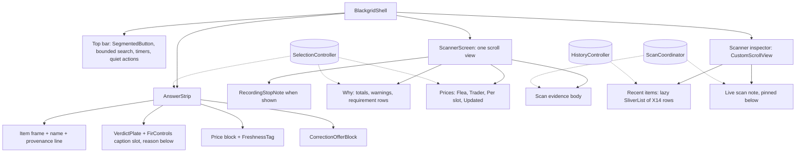
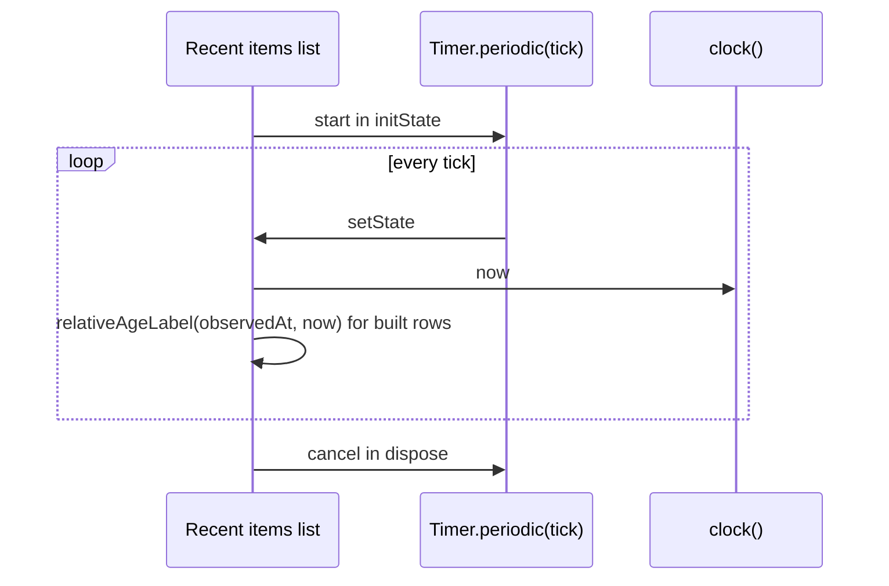

# Design

## Triage

| Trigger | Applies? | Evidence |
|---|---|---|
| T1 Components (new component, or 3+ with directed relationships) | yes | New Scanner main-column widget composing Why, Prices and Scan evidence sections; the inspector is rebuilt; `ItemDecisionCard` is retired (`lib/ui/shell.dart:484`) |
| T2 State (persistent state, caches, 3+ state machine) | no | No stored state, cache or settings key changes. The inspector's three accordion flags (`shell.dart:65-67`) are removed, not added |
| T3 Concurrency (background work, workers/isolates, async, retries) | yes | Relative history ages need a periodic UI timer, like `map_inspector.dart:105` |
| T4 Boundaries (data format, migration, shared interface, IPC, external) | yes | The Found in raid control gains an empty source-caption slot that `detect-found-in-raid` fills (S6, D6) |
| T5 Volume (grows without a fixed bound) | yes | `readActivity` returns every activity row, one per (item, mode), with no limit (`lib/data/database.dart:505-511`); the inspector must stay lazy over it |
| T6 Risk (security, money, data loss, unrecoverable user data) | no | No writes; history, Stats and settings data are untouched (S3) |

TIER: FULL

## Context

The proposal gives the why and the scope (S1–S6). The code as it is today:

- **Shell** (`lib/ui/shell.dart`):
  - The top bar is a `Row` of `_headerItems`: brand, two `InkWell` nav tabs (`_nav`, `:659`), search in an `Expanded` (`:552`), timers, inspector toggle, then `OutlinedButton.icon` actions in the order Settings, Stats, Import (`:571-588`, `_headerAction` `:638`). Below 1300px or at text scale over 1.2 it becomes a `Wrap` with icon actions.
  - The inspector (`:461-530`) is a `ListView`. It holds `HistoryPanel` in a fixed `SizedBox(height: 230 * scale)` (the clipping in the owner's screenshot), then three `ExpansionTile`s: `ItemDecisionCard(compact)`, `RequirementPanel`, `SourcePanel`.
- **Answer strip** (`lib/ui/answer_strip.dart`):
  - It lays out `[icon, name, AnswerVerdict (Expanded), FirControls, price column, …]` in a `Row` at ≥1300px, else a `Wrap` (`:167-192`). Its padding is 16/8 and its minimum height 76 (`:37-38`), pinned by `test/ui/shell_test.dart:81`. Because `AnswerVerdict` is `Expanded`, `FirControls` is pushed to the far right.
  - `FirControls` is three `ChoiceChip`s (`:225-253`).
  - The price column shows only one price (`:131-150`).
- **Scanner body:** `ScannerScreen` (`lib/ui/scanner_screen.dart:19-50`) shows only `ScanEvidencePanel`, a `GridPanel` card (`lib/ui/scan_evidence_panel.dart:176`) with a `ListView` scrolling inside it.
- **Detail widgets:**
  - `RequirementPanel` (`lib/ui/evidence_panels.dart:64-170`) already renders the requirement-rows ordering and the collapsed optional uses through `RequirementExpansion` (`:25`), inside a `GridPanel`.
  - `ItemDecisionCard` (`lib/ui/item_decision_card.dart`) holds the price cards, the "Still needed" totals and the size line (`:193-260`). Its `CorrectionOfferBlock` (`:407`) is used by the strip.
- **History:** `HistoryPanel` rows are `ListTile`s with a mode • source subtitle and a clock-time trailing label (`evidence_panels.dart:496-580`). The list is lazy with `scrollCacheExtent` 0, so off-screen rows do not lease icons (`:481-484`).
- **Verdict reason:** `verdictReason` and `_check` (`lib/domain/verdict_reason.dart:36-52`) pick the first open input, and `OpenInput.foundInRaid` maps to the fixed text. A hideout requirement's `sourceName` is the station name only; the "<station> level <L>" title is built in the UI (`lib/ui/requirement_rows.dart:146-152`). The engine marks a need `unresolved` when found in raid is unknown and the need requires it, and `irrelevant` for optional uses, crafts, barters and needs that do not apply to the player (`lib/domain/decision_engine.dart:170-186,277-282`). Its warnings repeat the open inputs, including "Found in raid unknown for this item" (`:26-38`).
- **Catalog errors:** `catalog.error` and `snapshot.localizationErrors` are shown only by `SourcePanel` (`lib/ui/evidence_panels.dart:301-310`). Settings → Item and map data shows only the status word (`lib/ui/settings/settings_page.dart:446-454`), although its `SettingsRow` takes a `message` (`lib/ui/settings/settings_row.dart`).
- **Recording note:** `ScannerScreen` starts with `RecordingStopNote` (`lib/ui/scanner_screen.dart:22`).
- **History rows across modes:** a row whose mode is not the current catalog's gets no name or icon and shows its item ID (`evidence_panels.dart:487-491`); today only its mode subtitle tells it apart.
- **Theme:** `SegmentedButton` is already themed to Ember (`lib/ui/ember/ember_theme.dart:182-190`) and is used for the theme and mode choices in Settings (`lib/ui/settings/settings_page.dart:385,403`).
- **Prices:** the Flea price is tarkov.dev's `avg24hPrice` (`lib/data/catalog_normalizer.dart:125`), gross before fees. Hence the "24 h average" label and the "before Flea fees" subtitle in the spec, not the mockup's "Last 24 h low … after fees".

## Decisions

### D1: The Scanner main column is one scroll view of flat sections

- **Choice:** `ScannerScreen` becomes a single vertical scroll view: Why and Prices in a two-column row when the column is at least 720px wide (stacked when narrower), then Scan evidence. Each section is a new flat `ScannerSection` (title, subtitle, body) with hairline separation and no `GridPanel`. The bodies are extracted from the existing widgets:
  - `RequirementPanel`'s row list becomes a shrink-wrapped body;
  - `ScanEvidencePanel`'s phase, note and summary become a plain body.
  `RecordingStopNote` stays first in the column, above Why, when it shows. The scanner-evidence requirement changes to match (one column scroll; the section no longer fills the window).
- **Rejected:** keep `GridPanel` cards and only rearrange them in a grid. This keeps the card-in-card look the owner rejected, and each card would keep its own inner scroll, which is what produced the empty fixed frame.
- **Reversal cost:** low
- **Important:** yes, it changes what users see
- **Chosen by:** agent

### D2: The inspector is one lazy sliver scroll view

- **Choice:** the Scanner inspector becomes a `Column`:
  - an `Expanded` `CustomScrollView` with the Recent items header and a lazily built `SliverList` of X14 rows, keeping the zero cache extent so only visible rows lease icons;
  - the Live scan note pinned below it, outside the scroll view, so it stays visible however long history grows.
  No fixed-height box sits between the rows and their scroll view, so no row is clipped by one (spec scenario). The three accordion flags and their `ExpansionTile`s are removed from the shell. `RequirementExpansion` moves from the shell to the Scanner screen, which now hosts the requirement rows.
- **Rejected:** keep a bounded-height history list and grow its height (rows still clip at the box edge); render all rows in a `Column` (non-lazy: every history row would lease its icon at once, see Resource bounds); or put the Live scan note as the last sliver (with hundreds of rows it is never reached).
- **Reversal cost:** low
- **Important:** no
- **Chosen by:** agent

### D3: Strip layout puts Found in raid in the verdict group

- **Choice:** the wide strip becomes `[who (icon + name)] [answer: Wrap(plate, FIR control), then reason below] [price block]`.
  - The answer group is `Expanded`, with no `Spacer`, so it takes all the width the who and price blocks leave. The price block is `flex: none` at the right end.
  - Inside the answer group, plate and FIR control are a `Wrap` with a 14px gap: the control follows the plate when they fit and wraps directly under it when they do not, as the mockup's `.row1` does. The reason wraps below them.
  - `FirControls` becomes a "Found in raid" Label-type label followed by a single `SegmentedButton<FirState>` with the Ember theme, as the B view's `.fir` block has it.
  - The who block is the icon, the name and, under it, the provenance line (D12).
  - The price block is a small two-column label/value grid: Flea with "/ slot", Trader with the trader name, then the `FreshnessTag`.
  - Below 1300px or at text scale over 1.2, the existing `Wrap` fallback keeps its order: who, answer group, price block.
  - Vertical padding becomes 14px. The empty and ordinary single-line states share one normal height of at most 100px (D9).
- **Rejected:** keep `AnswerVerdict` `Expanded` and move `FirControls` inside it after the reason (places the control under the reason on wide windows, not beside the plate as X10 and the mockup do); or a `Flexible` answer group next to a `Spacer` (it gets only half the free width, and plate plus control, about 560px, overflow at 1300px).
- **Reversal cost:** low
- **Important:** yes, it changes what users see
- **Chosen by:** agent

### D4: Retire `ItemDecisionCard`; keep `CorrectionOfferBlock`

- **Choice:**
  - Move `CorrectionOfferBlock` to its own file `lib/ui/correction_offer_block.dart` and delete `ItemDecisionCard`.
  - The card's facts are redistributed: the verdict and reason to the strip (already there), prices to the strip and the Prices section, the totals to Why's summary line (S4), and warnings to Why, as a warning-ink list under the summary. The "Found in raid unknown for this item" warning is left out there, because the strip's control and reason already ask that question.
  - Tests that mount the card move to the strip or the new sections.
- **Rejected:** keep the card unused, or keep it in the inspector. Dead UI drifts, and keeping it is exactly how the duplicate verdict survived `add-answer-strip`.
- **Reversal cost:** low
- **Important:** no
- **Chosen by:** agent

### D5: Relative history ages from an injected clock and tick

- **Choice:**
  - A pure `relativeAgeLabel(observedAt, now)` in `lib/ui/labels.dart` returns "just now" under 10 s, then "N s", "N min", "N h" or "N d", flooring each unit. A future time also gives "just now".
  - The inspector's history list owns one `Timer.periodic` that is started in `initState` and cancelled in `dispose`, as in `map_inspector.dart:105`. Its period and clock come in through constructor parameters. The period defaults to 5 s and the clock to `services.selection.clock` (`lib/application/selection_controller.dart:24-26`), which test harnesses already fake, so tests need no sleeps and no extra plumbing.
- **Rejected:** a per-row timer (one timer per visible row), or recomputing only on history notifications (ages would freeze while nothing is scanned, which fails the "ages move on" scenario).
- **Reversal cost:** low
- **Important:** no
- **Chosen by:** agent

### D6: Found in raid gets an empty source-caption slot

- **Choice:** `FirControls` takes an optional `caption` (`String?`), rendered as Label-type text on the same row, after the segmented control, when non-null, so a caption does not add a line to the strip and D9's height holds. When the row is too narrow it wraps under the control, which only the existing grow-to-fit rule covers. This change always passes `null`. `detect-found-in-raid` will add "Read from scan" and "Set by you" together.
- **Rejected:** show "Set by you" for manual choices now. The user chose to decide the wording once, in the detection change.
- **Reversal cost:** low
- **Important:** yes, it binds a future change
- **Chosen by:** user

### D7: Check reason names the first need that requires found in raid

- **Choice:** in `_check`, `OpenInput.foundInRaid` returns `Found in raid unknown: <need> needs it found in raid`. `<need>` names the first entry in `decision.reasons` (engine order) with `requirement.foundInRaid == true` and `state == NeedState.unresolved`, the need that the unknown value leaves open. Needs the engine marks `irrelevant` (optional uses, crafts, barters, needs that do not apply to the player) never qualify. If there is none, it returns today's text. The open-input order is unchanged.
  - `<need>` comes from a new pure domain function `needTitle(ItemRequirement)` in `lib/domain/`: the station name with " level <L>" for a hideout need when the level is set, else `sourceName`. `requirement_rows.dart`'s hideout title uses the same function, so the reason and the Why row name the need the same way. Keep and Keep for later reasons keep the bare `sourceName` (their scenarios are unchanged).
- **Rejected:** a sentence listing every open input (long, often two lines in the strip); naming the need in a second line under the reason (two lines of text where X1 asks for one reason); or filtering on "not satisfied" (it includes `irrelevant` barters and other-faction needs listed before the real one).
- **Reversal cost:** low
- **Important:** yes, it changes text users see (scope S5)
- **Chosen by:** agent (wording follows the user's choice S5)

### D8: Top bar uses the Ember segmented control and quiet actions

- **Choice:**
  - Replace the two nav `InkWell`s with one `SegmentedButton<int>` (Map, Scanner, with icons). It keeps `Key('nav-map')` and `Key('nav-scanner')` on the segments' labels and keeps the selected semantics. While Settings is open, the switch has `emptySelectionAllowed: true` and an empty selection, so either segment, including the area Settings came from, fires `onSelectionChanged` and closes Settings to that area (settings-page). A tapped selected segment otherwise fires nothing, which would break that rule.
  - Wrap search in a `ConstrainedBox(maxWidth: 480)` inside a `Flexible`, followed by a `Spacer`.
  - Turn `_headerAction` into a `TextButton.icon` (Ember quiet), in the order Stats, Import, Settings.
  - The compact `Wrap` path keeps icon-only actions, in the same order.
- **Rejected:** a custom segmented widget. The themed `SegmentedButton` already matches `.em-seg` and is in use (`settings_page.dart:385`).
- **Reversal cost:** low
- **Important:** yes, it changes what users see (scope S1)
- **Chosen by:** agent

### D9: The strip's normal height becomes at most 100px

- **Choice:** the empty and ordinary single-line states share one normal height of at most 100 logical pixels: 14px vertical padding, the 44px plate, a 6px gap and one reason line, with the price block's three rows fitting in the same height. The 76px pin in `shell_test.dart:81` and the workspace-shell scenario change to "equal to the empty state and at most 100px".
- **Rejected:** keep 76px with the reason beside the plate (the FIR control would then sit after the reason, the layout the owner rejected); shrink the plate below 44px (verdict-presentation fixes it).
- **Reversal cost:** low
- **Important:** yes, it changes what users see and amends a spec scenario
- **Chosen by:** agent

### D10: Catalog errors move to Settings → Item and map data

- **Choice:** the Item data `SettingsRow` passes `catalog.error` and the localization errors as its `message`, in error ink. The status bar keeps its status word and its link to that section. This is the only new home of the text `SourcePanel` showed, so S2's promise that errors stay visible holds. catalog-authority's requirement is renamed and modified to match, and player-facing-text drops the Data sources requirement with a migration note.
- **Rejected:** show the catalog error in Why (it is not about the item, and it would sit in every item's details); turn the status bar label into the error text (too long for a 28px status item).
- **Reversal cost:** low
- **Important:** yes, it changes what users see
- **Chosen by:** agent

### D11: Other-mode history rows carry a mode tag

- **Choice:** an X14 row whose mode is not the current mode shows the mode name ("PvE") as a Label-type tag between the name and the dot. Rows of the current mode show none. This replaces the mode subtitle that told such rows apart.
- **Rejected:** keep the "mode • source" subtitle (two-line rows, not X14); show nothing (two identical rows for one item, and other-mode rows show a bare item ID with no explanation).
- **Reversal cost:** low
- **Important:** yes, it changes what users see
- **Chosen by:** agent

### D12: The strip's who block carries the provenance line

- **Choice:**
  - The facts only the card's subtitle showed (`item_decision_card.dart:67-75`) move to one Label-type line under the item name in the strip, in the B view's `it.how` form: "Accepted scan · 12 s ago", "Corrected from a scan · 3 min ago · chosen by hand", "Chosen by hand", and "Current advice · saved 3 min ago" for a history inspection, plus " in PvE" when the saved mode differs. It replaces today's "Accepted scan", "Corrected scan" and "Current advice for history inspection" lines (`answer_strip.dart:104-117`), so a history inspection still labels its current advice apart from the recorded verdict.
  - The age uses `relativeAgeLabel` (D5) with " ago" appended, except "just now". `scanAgeLabel` in `item_decision_card.dart:19` goes with the card.
  - The strip and the history list share one small age-tick widget: a `Timer.periodic` with an injected period (5 s default) and the `services.selection.clock` clock, started in `initState` and cancelled in `dispose`. The selection's 30 s authority tick (`selection_controller.dart:29`) stays as it is.
  - The line fits D9: the who block is a 19px title and one Label line beside the 48px icon. A history line with a mode suffix may wrap, which the grow-to-fit rule covers.
- **Rejected:** drop the ages (scan-decisions, scan-correction and latest-accepted-scan require them); put the provenance in the reason line (it would mix the verdict's reason with where the item came from).
- **Reversal cost:** low
- **Important:** yes, it changes what users see
- **Chosen by:** agent

### D13: Tracker errors and imported scans keep a home

- **Choice:**
  - Settings → Tracker progress already shows `progress.error` in its status line (`settings_page.dart:553-560`) in tertiary ink. It changes to "Tracker problem: <error>" in the error ink, the words `SourcePanel` used (`evidence_panels.dart:334-338`), so the Tracker error keeps its text once the panel goes. settings-diagnostics now says these errors stay reachable through the status bar's status words rather than shown on Scanner.
  - An X14 row recorded from an imported scan shows an "Imported scan" Label-type tag, as D11 does for the mode, so player-facing-text's "Imported scan in history" scenario still holds without the old subtitle.
- **Rejected:** keep the Tracker error on Scanner (it is not about the item, and the owner dropped Sources in S2); show every activity source as a tag (scan, manual and correction rows would all carry one, which the X14 one-line row does not have room for).
- **Reversal cost:** low
- **Important:** yes, it changes what users see
- **Chosen by:** agent

### Decision summary

| # | Decision | Choice | Rejected | Reversal cost | Important | Chosen by |
|---|---|---|---|---|---|---|
| S1 | Include the shared top bar | Restyle it here, for Map too | Scanner body only | low | yes | user |
| S2 | Sources panel | Drop it from Scanner | Keep as flat inspector section | low | yes | user |
| S3 | Recent items Clear | Leave it out | Add a confirmed clear | low | yes | user |
| S4 | Card leftovers | Totals in Why, drop size | Keep both; drop both | low | yes | user |
| S5 | Check reason | Name the need that requires FIR | List every open input; unchanged | low | yes | user |
| S6 | FIR detection | Separate next change | Fold in | low | yes | user |
| D1 | Main column structure | One scroll of flat sections | Rearranged GridPanel cards | low | yes | agent |
| D2 | Inspector structure | Lazy sliver scroll view, Live scan note pinned below | Bounded box; non-lazy column; note as last sliver | low | no | agent |
| D3 | Strip layout | Expanded answer group, plate and labelled FIR in a Wrap, price grid at the end | FIR under the reason; Flexible + Spacer | low | yes | agent |
| D4 | ItemDecisionCard | Retire it; keep CorrectionOfferBlock | Keep it unused or in the inspector | low | no | agent |
| D5 | Relative ages | Pure label + one injected periodic tick | Per-row timers; notify-only | low | no | agent |
| D6 | FIR source slot | Optional inline caption, unused now | Show "Set by you" now | low | yes | user |
| D7 | Check reason derivation | First unresolved FIR need by engine order, named by a shared domain `needTitle` | List all inputs; second line; "not satisfied" filter | low | yes | agent |
| D8 | Top bar controls | Themed SegmentedButton (empty while Settings is open), bounded search, quiet text actions | Custom segmented widget | low | yes | agent |
| D9 | Strip normal height | At most 100px, empty and single-line equal | Keep 76px; smaller plate | low | yes | agent |
| D10 | Catalog error home | Settings → Item and map data row message | In Why; in the status bar | low | yes | agent |
| D11 | Other-mode history rows | Mode tag on rows of another mode | Subtitle; nothing | low | yes | agent |
| D12 | Strip provenance line | Source and relative age under the name, shared age tick | Drop ages; put them in the reason | low | yes | agent |
| D13 | Tracker error and imported rows | Tracker error in Settings → Tracker progress; "Imported scan" row tag | Tracker error on Scanner; a tag for every source | low | yes | agent |

## Diagrams (FULL)

T1, component graph after the change:

T3, the age tick:

T4, the caption contract: `FirControls({required services, String? caption})`. A `null` caption renders nothing; a non-null caption renders inline after the control, wrapping under it only when the row is too narrow. Only `detect-found-in-raid` passes a value.

## State & Ownership (FULL)

| State | Owner (sole writer) | Lifetime | Invalidation / rebuild | Authoritative copy |
|---|---|---|---|---|
| Current selection, FIR value | `SelectionController` (unchanged) | Session | Existing rules | `SelectionController` |
| Optional-uses expansion | `RequirementExpansion`, now created by `ScannerScreen` instead of the shell | While the Scanner is mounted (it stays mounted in the `IndexedStack`) | Reset per item, as today (`evidence_panels.dart:25-60`) | `RequirementExpansion` |
| Inspector open/visible | Shell (unchanged) | Shell session | Unchanged | Shell |
| Age tick | Recent items list state | Mounted list | Cancelled on dispose | None (derived each tick) |
| Accordion flags (`inspectionExpanded` etc.) | Removed | — | — | — |

## Failure & Visibility (FULL)

| Component | Fails / dies mid-operation → | Recovery | Retry safe? | Who finds out |
|---|---|---|---|---|
| History read | Existing error text, now shown under Recent items in error ink | Next `load()` | Yes | User |
| Catalog / item data missing | Why shows "Item data unavailable"; Prices shows "Price unavailable" values; the strip keeps its explicit states | Catalog refresh | Yes | User |
| Item data or Tracker errors (formerly shown in Sources) | Catalog error and localization errors in Settings → Item and map data (D10); Tracker errors in Settings → Tracker progress; the status bar shows the status word and links to the section (`shell.dart:295-383`); decision warnings show in Why | Settings refresh | Yes | User |
| Icon load per row | Fallback frame (X14 rule, unchanged) | None needed | — | User sees fallback |
| Age timer | Cannot fail; cancelled with the widget | — | — | — |

## Resource Bounds (FULL)

| Queue / buffer / cache / transfer | Bound | At the bound | Timeout | At 10x / 100x |
|---|---|---|---|---|
| History rows rendered | Lazy: only visible rows are built and lease icons (zero cache extent kept) | Scrolls | — | One row per (item, mode): at most about catalog size × 3 modes (~12k rows); lazy building keeps cost proportional to the viewport |
| Requirement rows in Why | Per item, catalog-bounded; optional uses collapsed by default | Column grows and scrolls | — | Items with ~100 optional uses stay collapsed until opened |
| Age timer | One per mounted list | — | 5 s period | Constant |

## Flow & State Gaps (FULL)

- **Selection changes while the Scanner scroll is mid-way:** the scroll position keeps its `PageStorageKey`. Each section rebuilds from the selection, and the optional-uses expansion resets per item as today.
- **History inspection:**
  - The strip keeps its history labelling and close action.
  - Why and Prices show the history item's current advice (the same source the card used: `selection.decision` over `inspectionCatalog`).
  - Rows keep their recorded-verdict dots.
- **A later unaccepted scan:** the Scan evidence note rules are unchanged (scanner-evidence). Why and Prices keep the accepted item.
- **Settings page open:** the main column and inspector stay mounted and offstage, as today (`shell.dart:245-285`). The area switch shows no selection (D8).
- **Inspector closed at narrow width:** it is not built, so no timer runs. The timer starts when the list mounts.

## Mechanism Ledger (FULL)

| Mechanism | Built? | Why (harm nobody catches / expensive later) | Evidence that would change the call |
|---|---|---|---|
| Lazy history list | yes | A non-lazy list leases every icon at once; that harm is real at 12k rows (T5) | — |
| History row cap / paging | no | Lazy building already bounds the cost | Profiling shows scroll jank with a large history |
| FIR caption slot | yes (empty) | Adding the slot later would re-touch every strip geometry test; the contract is cheap now | — |
| Per-row age timers | no | One list tick is enough | — |
| Thousands separators in prices | no | Not in scope; `rub()` formatting is spec'd elsewhere (verdict-presentation "₽38277") | Owner asks for it |
| History Clear action | no | S3 | Owner asks for it |

## Risks / Trade-offs

- [Geometry tests drift from the mockup again] → Pin placement numerically, as the spec scenarios do: FIR within 24px of the plate, Why beside Prices, no clipped rows. The owner's sign-off is a `[user]` task.
- [Retiring `ItemDecisionCard`, `SourcePanel` and the accordions breaks tests that mount them (`freshness_tag_test.dart`, `item_icon_surfaces_test.dart`, `verdict_plate_test.dart`, `decision_card_text_test.dart`, `data_sources_panel_test.dart`, `shell_test.dart`, and the `test/support/m1_widget_harness.dart` harness)] → Those tests move to the strip, the Prices section and the Settings section in the same task groups, so coverage of the plate, tag, icon surfaces and catalog error is kept.
- [DESIGN.md X11 still lists the actions as Settings, Stats, Import] → The top bar task updates X11 to Stats, Import, Settings, so the design system and the spec agree.
- [Wide strip crowding at 1300–1500px with a long reason] → The answer group is `Expanded` with no `Spacer` (D3), so the reason wraps (verdict-presentation keeps "never clipped"). A geometry test runs at 1300px.
- [Spec scenario titles still say "decision card" or "card" in a few places (scanner-evidence "Accepted scan drives the decision card", item-icons "The card and a history row share one download" and "Map's compact card shows the icon", verdict-presentation "A long reason at the narrowest card")] → The delta format cannot rename a scenario, so their bodies name the strip and the titles are kept. A later spec cleanup can retitle them.
- [Top bar change touches Map] → The existing Map shell tests run unchanged apart from the action order. The nav keys are kept.

## ADRs

- **In force, constraining this change:**
  - 0037: interface colours come from the Ember theme, with no colour literals in `lib/ui`;
  - 0038: activity retains the recorded verdict; history dots use saved verdicts.
- **To record during apply:** none. Layout and wording are not binding decisions. The FIR caption slot is a widget parameter, recorded in this design.

## Open Questions

- The exact strip padding, and the column gap between Why and Prices, are taken from `brand/tokens.json` spacing during apply and checked against the mockup at review. This changes no spec or task.
