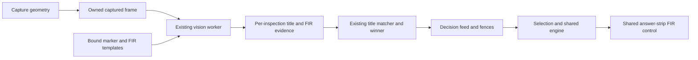
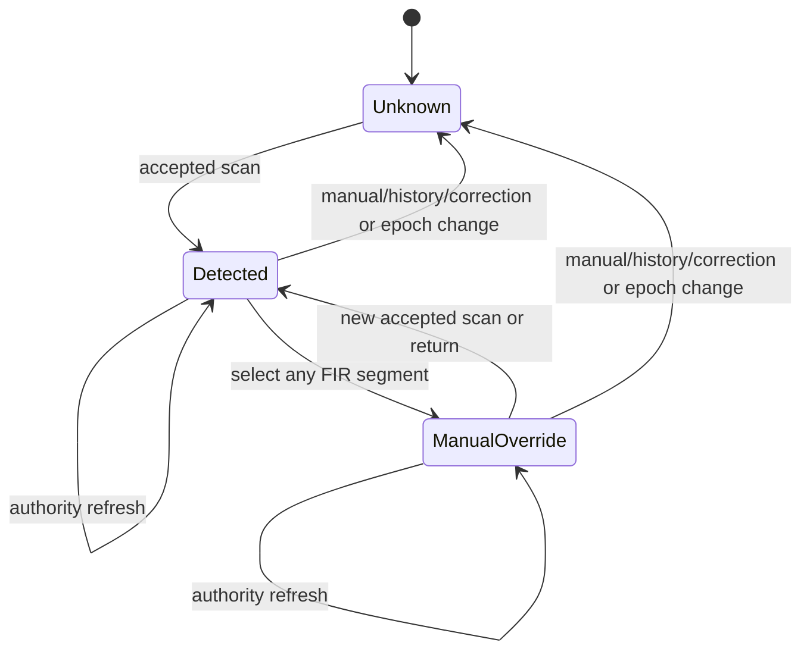
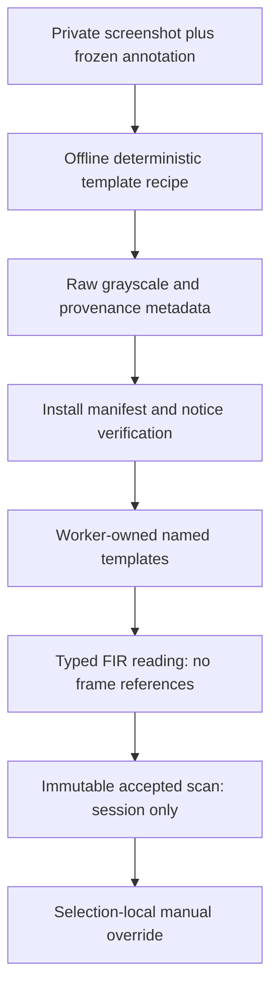

# Design

## Triage

| Trigger | Applies? | Evidence |
|---|---|---|
| T1 Components | Yes | Capture geometry → vision job/evidence → coordinator/feed → selection → shared FIR control |
| T2 State | Yes | Two bounded template caches; selection gains detected/override state across three effective values |
| T3 Concurrency | Yes | Existing capture and vision isolates; generation fences and asynchronous history writes remain |
| T4 Boundaries | Yes | Sendable inspection evidence, immutable accepted scans and manifest-bound artwork |
| T5 Volume | No new trigger | Fixed corner per inspection and existing peak/report limits; no new history or growing input watcher |
| T6 Risk | Yes | A false No can hide a FIR quest need; screenshot artwork and the no-game-contact boundary |

TIER: FULL

## Context

Scope and owner choices are in `proposal.md`. This is planning only.

- `lib/data/capture/capture_geometry.dart:43-92` owns the old band constants and exact rational scaling. Its tests already span resolution, DPI, clipping and negative monitor origins.
- `lib/data/vision/inspection_recognition.dart:75-135` computes grayscale and finds marker peaks; `:155-250` reads each title. The new detector reuses those frame pixels and grayscale rather than copying a full frame or adding an isolate.
- `lib/data/vision/inspection_evidence.dart:65-135` holds sendable values, currently title-only. `scan_coordinator.dart:2662-2668` already passes physical client dimensions independently of frame dimensions; marker coordinates are local to the real captured frame.
- Accepted outcomes already carry the winning `InspectionEvidence` (`scan_coordinator.dart:2807-2815`). `withoutCrops` rebuilds entries (`:881-922`), so it must preserve new FIR metadata. `ScanDecisionFeed._applyAccepted` (`scan_decision_feed.dart:86-140`) consumes once and fences before selection.
- `selection_controller.dart:161-207` starts each accepted scan with Unknown; `:218-247` returns with Unknown; `:420-428` also resets FIR on authority changes. These are explicit cutovers, not fallback compatibility paths. `AcceptedScan.decisionAtAcceptance` (`accepted_scan.dart:39-40`) currently documents FIR Unknown and needs to describe detected FIR.
- `answer_strip.dart:324-377` already has a wrapping `FirControls` and optional inline caption. Reuse it, Ember tokens, and the existing three segments; no new screen, accent or persistent preference. DESIGN.md X7/X10 keeps the answer first.
- `marker_template.dart:54-145`, `windows/vision/CMakeLists.txt:235-242`, `write_manifest.cmake:37-47` and `tool/vision/bundle_inventory.json:21-22` establish the loader/install/hash/notice convention. `vision_runtime.dart:32-33` also lists required template files; updating CMake alone is insufficient.

### Supplied evidence

`fixture-annotations.json` records twelve private files under `.qualification/found-in-raid/`, their source hashes, owner-confirmed client sizes, captured bounds, title-marker locations and planning experiment scores. Full JPGs are not committed. Six positives include AFAK without a medal and HK416/M4A1 with a medal. Six negatives include empty AFAK corners and medal-only HK416/AK-308 corners. Direct and container-opened inspections occur at both client resolutions.

A one-off Pillow experiment on those saved files located the existing marker with NCC and measured the check region. Positive check scores were 0.9002–1.0000; negatives 0–0.4982. This is evidence for the proposed search/threshold gap, **not** a production/native accuracy result. On all files the picture-to-action-strip transition is approximately 321–322 reference pixels below the marker. Check matches start approximately 291–292 reference pixels below it; medal presence shifts x by roughly 34 reference pixels. The source template crop and exact measurements are below. Native replay remains an apply task.

Two 3440×1392 files are bottom-cropped captures of a 3440×1440 client, as the owner confirmed. The 1922×1082 file is annotated with its 1920×1080 client beginning at image (1,1). Never resize/pad these into invented full-client screenshots. Subtract that image border when using its annotations; missing bottom rows remain missing.

## Decisions

### D1: Extend only the band's lower edge

- **Choice:** Change the below-centre reference constant to 400. The complete formula and expected rectangles live in the capture delta. This covers a marker at the old lower edge plus the picture corner and its readability guard. Width, start at client top, in-client trigger guard, full-client fallback and waits stay unchanged. Actual clipping and size checks remain authoritative.
- **Rejected:** Full-height band captures unnecessary pixels; a second corner capture can pair a title with a later screen and breaks S1/S4.
- **Reversal cost:** Low; one geometry constant and its behavioral fixtures.
- **Important:** yes — visible capture behavior and amendment of ADR-0016.
- **Chosen by:** user.

### D2: A measured template plus explicit readable-negative admission

- **Choice:** Use the guarded-template approach the owner selected. Implement the following small detector in `lib/data/vision/inspection_fir.dart`, with geometry/predicate helpers that can run without a native bundle. Native NCC uses the existing job-context primitive, not a new ABI. The classifier never treats merely failing the positive threshold as proof of No.

  **Detector recipe (single source of numeric policy):**
  1. Use `s = processingScale(clientWidth, clientHeight)`. In actual frame coordinates, form the half-open search rectangle from marker + `(floor(-8*s), floor(275*s))` to marker + `(floor(80*s), floor(330*s))`. Require the entire rectangle and all guard pixels inside the real frame. Do not clamp it and then call it complete. A clipped client elsewhere does not invalidate an intact local corner.
  2. Validate the picture/action boundary using BGR pixels, ignoring X: at reference x offsets 60, 65, 70 and 75, reference y offsets 318, 319 and 320 must have all channels ≤12, while offsets 323, 324 and 325 must have all channels in [18,45]. Sample positions use the same scaled floor rule. Failed cues mean unreadable; they do not mean an absent icon. The experiment found near-black picture samples and strip samples around 26 here across all twelve files.
  3. The stored check template is 28×28 grayscale, cropped without resampling from source `afak_fir_yes_no_medal_3440x1440.jpg` at image rectangle (1199,732,28,28). It includes the check and a dark margin. Its physical reference footprint is 21 pixels; scale to `trunc(21*s)` with the existing cubic/area rule and a four-size cache. A side below 2 or too large for the search rectangle means unreadable.
  4. Match within the bounded rectangle using existing NCC. Finite score ≥0.82 means icon found. Scores in (0.60,0.82), a non-finite score or an invalid candidate mean unreadable. These scores are detector-specific, not changes to title/marker acceptance gates. Never pass a constant template or suppress a native error.
  5. A score ≤0.60 becomes icon absent **only** when the boundary cues pass and the expected check slot contains no unexplained gold pixels. A gold pixel has R>110, G>90, B<0.8·G and R>1.4·B. A medal witness is at least `max(1,floor(2*s*s))` gold pixels in marker-relative reference rectangle x[-4,0), y[280,318). With that witness, exclude the medal and its level text by checking residual gold only in x[32,75), y[280,318); without it, check x[-4,75), y[280,318). Rectangle edges use the same floor scaling as above. Any residual gold at a low score means unreadable, not No. This colour witness never creates a positive result: only the check-template match can do that. Handle a uniformly dark **search image** as zero score only after the separate boundary guards and residual-gold admission pass.
  6. Return typed `iconFound`, `iconAbsent`, `cornerCutOff` or `cornerUnreadable` evidence with the searched rectangle and finite best score when one exists. All three effective FIR values are derivable without contradictory state/reason pairs. Missing template is a startup failure, not per-frame Unknown. Existing native failures still use the worker's typed failure path; no exception masking.

  The residual-gold rule addresses an observed counterexample in the saved AFAK positive: blacking out half-open source rectangles (1202,735,12,21) or (1202,735,16,21) preserves the boundary but lowers the check score to 0.5034/0.3633. Threshold-only classification would falsely say No. On the twelve original pictures the residual slot contains zero gold pixels for every negative and 95–241 for positives; the medal witness separates all supplied medal/no-medal cases. Add deterministic partial-check and medal-witness boundary tests, not just the twelve intact pictures.

  Template provenance records source SHA-256, source image size, physical client size, crop rectangle, grayscale conversion and recipe version. The build installs raw pixels plus metadata under `data/vision/fir/`, binds them through the runtime manifest, adds both to required core files and inventory, and records their artwork notice/source hash/recipe as for the inspection marker. Extend the existing template-loading module to load both assets before activation and migrate its production/tool/test callers to the cohesive loader; remove the obsolete single-template entrypoint rather than adding an alias. Keep the marker's existing file format and recipe unchanged.

- **Rejected:** Unconstrained gold-pixel search mistakes the medal for a check; a low NCC score alone cannot distinguish a missing corner from a negative; geometric check recognition introduces a second custom vision pipeline.
- **Reversal cost:** Low for calibrated numeric policy, medium for the bound asset/evidence contract. Native replay must establish the experiment transfers to production before shipping.
- **Important:** yes — visible classification, shared evidence and artwork boundary; the recipe is grounded in saved-image measurements, not asserted universal UI support.
- **Chosen by:** user (guarded template approach and residual-gold negative-admission rule); agent (measured crop, sampling recipe and numerical calibration within that approach).

### D3: Keep evidence per inspection in the existing worker

- **Choice:** Add a required typed FIR reading to `InspectionEvidence`. Compute it while the frame is owned by `InspectionRecognitionJob`, for every retained inspection. Reuse existing grayscale for NCC and the original BGRX view for guards. Keep the two template caches separate so equal marker/check sizes cannot collide. `ScanDecisionFeed` takes FIR only from `ScanAccepted.outcome`'s winning evidence, after all existing fences. `AcceptedScan` retains the immutable reading beside `decisionAtAcceptance`. No new report stream or detector service. Missing evidence in old test builders is migrated explicitly, never defaulted to No.
- **Rejected:** Sending picture pixels to the UI for later detection creates copies, another ordering boundary and a frame-lifetime risk; taking the first entry pairs an unrelated window's icon with the winner.
- **Reversal cost:** Medium; in-memory shared contracts and their callers, no stored data migration.
- **Important:** yes — cross-isolate and shared application contract.
- **Chosen by:** user.

### D4: Selection owns detected FIR and a nullable override

- **Choice:** Replace `_fir` as the sole undifferentiated input with a scan reading plus nullable manual override. Effective FIR is the override when present, otherwise current scan detection, otherwise Unknown. Nullable is essential: a manual Unknown is not “no override.” Selection alone changes these fields; the accepted record remains immutable. New accepted scans clear the override before projecting and recording their verdict. Returning restores the immutable reading and clears the override. Manual/history/correction selections clear scan evidence and the old override. Mode/session retirement clears all FIR context. Same-selection data refresh/age changes project without resetting these facts; separate actual mode invalidation from the current broad `_fingerprint`-change reset. No FIR is written to history or settings; history's existing recorded verdict naturally uses effective FIR at acceptance.
- **Rejected:** Mutating the latest-scan record to retain overrides confuses source evidence with user input; keeping the broad authority reset discards a valid item fact when prices age.
- **Reversal cost:** Low; transient selection state and its tests.
- **Important:** yes — visible precedence, refresh and return behavior.
- **Chosen by:** user.

### D5: Use the existing inline caption

- **Choice:** Beside Unknown/Yes/No, show scan source, manual override, or the cut-off/unreadable reason. Use `FirControls.caption` and existing Ember Label tokens/Wrap. Initial manual/history/correction Unknown has no automatic-detection claim. An explicit manual choice always has manual provenance. Make the source available in semantics as well as text. Keep both Map and Scanner on the shared control; verify dark/light and narrow wrapping without clipping the answer.

  Handle activation of the already selected segment explicitly: the pinned Flutter `SegmentedButton` suppresses that callback with its default policy. Keep its controlled `selected` set equal to the one displayed effective FIR, enable `emptySelectionAllowed` only to receive the selected-segment activation, and map an empty callback set to the value captured for that rendered control; map a non-empty set to its single value. Call `setFir` for either case and never publish/store an empty selection. This preserves all three segments, normal keyboard/button semantics and a visibly selected value while allowing automatic Yes → manual Yes and automatic Unknown → manual Unknown. The installed SDK's `_handleOnPressed` and [emptySelectionAllowed documentation](https://api.flutter.dev/flutter/material/SegmentedButton/emptySelectionAllowed.html) confirm this callback behavior. Test actual shared-control taps and semantics through a same-selection refresh, not only direct controller calls.
- **Rejected:** A diagnostic-only source hides the distinction when it matters; another toggle or setting expands the workflow unnecessarily.
- **Reversal cost:** Low.
- **Important:** yes — user-visible provenance and interaction.
- **Chosen by:** user.

### Decision summary

| # | Decision | Choice | Rejected | Reversal cost | Important | Chosen by |
|---|---|---|---|---|---|---|
| S1 | Scope/safety | Three-state FIR, override, same copy, owner live check | Boolean FIR/game interaction | Medium | yes | user |
| S2 | Return | Detection restored, override dropped | Restore override/reset Unknown | Low | yes | user |
| S3 | Correction | Manual-only FIR | Borrow rejected evidence | Low | yes | user |
| S4 | Incomplete corner | Keep accepted item; Unknown; no extra capture | FIR-driven fallback | Low | yes | user |
| S5 | Artifact | Bound tiny template, private source images | Shape-only/commit screenshots | Medium | yes | user |
| D1 | Capture | Extend lower edge only | Full height/extra capture | Low | yes | user |
| D2 | Detector | Guarded template plus residual-gold admission; numeric recipe above | Gold-only/NCC-miss-as-No; separate medal template | Medium | yes | user approach and residual guard; agent calibration |
| D3 | Evidence | Per-inspection worker reading, winner only | UI pixel transfer/first entry | Medium | yes | user |
| D4 | State | Immutable detection + selection override; preserve on refresh | Mutate scan/broad reset | Low | yes | user |
| D5 | UI | Inline caption on existing three-state control | Diagnostics-only/new settings | Low | yes | user |

## Diagrams (FULL)

### T1 — component ownership



### T2 — selection FIR state



### T3 — asynchronous publication

```mermaid
sequenceDiagram
  participant C as Coordinator
  participant W as Vision worker
  participant M as Matcher
  participant F as Decision feed
  participant S as Selection
  C->>W: Existing frame and physical client dimensions
  W->>W: Titles and per-inspection FIR from same pixels
  W-->>C: Sendable evidence; frame released
  C->>M: Existing ranked title-matching input
  M-->>C: Winning inspection, including FIR
  C->>F: Publish accepted report
  F->>F: Report high-water mark and epoch/mode/item fences
  F->>S: Select accepted scan and winning FIR
  S->>S: Clear override, project, freeze acceptance record
  S-->>F: Synchronous selection established before history await
  F-->>C: markDecided
```

### T4 — contract and format boundary



## State & Ownership (FULL)

| State | Owner (sole writer) | Lifetime | Invalidation / rebuild | Authoritative copy |
|---|---|---|---|---|
| Capture plan | Capture worker | One request | Recomputed per existing snapshot | Captured metadata, never inferred from image width |
| Scaled marker/check templates | Recognition job | Worker activation | Four-size eviction per asset; disposed with job | Verified raw templates |
| Per-inspection reading | Recognition job | Immutable result/report | Never rewritten; new scan creates new reading | Same frame as that inspection's title |
| Latest accepted reading | Selection constructs record; session state advances through feed | Current session | Existing higher-report-id rule; epoch clear | Immutable `AcceptedScan` |
| Manual override and current detected source | Selection only | Current selection | D4 transitions | Selection fields |
| Inline caption | Derived, no writer | Current build | Recomputed from selection | Typed source and reason |
| Private matrix | Owner files; annotated planning record | Qualification input | Hash mismatch fails identity check | Source hashes and frozen labels |

## Failure & Visibility (FULL)

| Component | Fails / dies mid-operation → | Recovery | Retry safe? | Who finds out |
|---|---|---|---|---|
| Template load | Activation fails before hook/recognition startup | Repair/rebuild bundle; explicit activation again | Yes after repair | Existing scan unavailable message names asset |
| Capture | Existing typed failure, no forged FIR | Next user trigger | Existing policy | Existing scan report |
| Corner admission | Unknown, cut-off/unreadable reason; accepted title unaffected | Manual override or next normal scan | No automatic retry | Inline FIR caption |
| Native FIR operation | Existing typed vision failure; frame released through worker contract | Existing next-trigger policy; no respawn | Only when worker ready | Existing failed scan report |
| Late/superseded worker answer | Discard whole result through existing generation fence | Current scan proceeds | Not reapplied | Existing timing/log evidence |
| History write | Keep decision/FIR; existing persistence error | Existing explicit operation | Existing policy | Answer-strip error |
| Missing/altered private JPG | Qualification unavailable/mismatched input, never a pass | Supply original saved input | Yes | Qualification result/evidence |
| Restart | No accepted reading or override restored | New scan/manual selection | Not a replay source | FIR starts Unknown |

## Resource Bounds (FULL)

Existing bounds below are retained, not relaxed to accommodate FIR.

| Queue / buffer / cache / transfer | Bound | At the bound | Timeout | At 10x / 100x |
|---|---|---|---|---|
| Capture | 4 slots; side 8192, 24 MiPixels; 1 active/0 queued | Existing rejection | 500 ms, 2 s drain | Reject rather than grow |
| Targeted band | Capture delta formula | Same clipping/size failure as before | Existing capture deadline | At 4K, 2280×1880; larger than old 2280×1200, not a whole client |
| Recognition entries | Existing 4096 native peaks / 8 retained inspections | Existing overflow/suppression | Existing 1.5 s submission deadline, 2 s drain | No new work queue |
| Corner work | D2's fixed scaled rectangle per retained inspection | Incomplete region → Unknown | Included in existing vision deadline | Linear in ≤8 corners, no full-frame additional copy |
| Template caches | 4 scaled marker + 4 scaled FIR images | Evict oldest per asset | Worker lifetime | Constant entry count |
| Evidence | Existing 256 KiB title preview per entry plus fixed scalar/rectangle FIR metadata; no FIR pixel preview | Existing downscale; metadata retained by crop stripping | Same worker request | No additional image retention |
| Coordinator reports | Existing latest/last accepted + 10 recent; recent title crops stripped | Existing eviction | App session | Fixed count |
| Selection | One detected reading + one nullable override | New selection replaces | Session/selection lifetime | Constant |
| Qualification | Frozen 12-source input list, one decoded picture processed at a time; derived synthetic cases one at a time | Existing capture/vision size admission; reject oversized input | Qualification test timeout, not arbitrary sleeps | No directory scan or accumulated decoded frames |

## Flow & State Gaps (FULL)

- **Multiple windows / cross-pass ranking:** FIR travels with the exact outcome entry, including when fallback wins. A targeted acceptance stops as today even with FIR Unknown. Test a winner that is not the first peak and a fallback winner with opposite FIR.
- **Partial corner:** Compare planned local rectangle and guards to actual image bounds before reads. Do not use the frame-wide clipped flag as a blanket rejection. Synthetic crops at every edge distinguish clipped corner from clipping elsewhere.
- **Shifted cascade:** Replay supplied container-opened pictures and translate a complete inspection within a synthetic client to put its corner below the former band. Translation proves geometry only; supplied pictures prove recognition. Do not label translated fixtures new observed game layouts.
- **Unknown vs No:** Black picture pixels are normal in both positive and negative captures. Require boundary cues before admitting a low-score negative; do not treat constant search image as a failed capture. Whole-frame blank capture rejection stays unchanged.
- **Duplicate / out-of-order:** Existing feed high-water mark precedes fences. No duplicate can clear a manual override. A stale mode/session result does not touch any FIR field or history.
- **Refresh:** Catalog/progress age changes do not invalidate the pictured fact. An item absent from the current catalog yields no advice; mode/session changes still clear FIR, including manual/history contexts.
- **Accepted snapshot:** Freeze `decisionAtAcceptance` only after initial detected FIR has been projected, before history await or listeners can change selection. Later overrides/refreshes do not mutate the record or its recorded verdict.
- **FIR-only task advice:** At the real feed/selection boundary use one incomplete active FIR-only need and a named RUB trader offer with no Flea eligibility. Assert initial Yes → actionable Keep, No → irrelevant need and Trader, Unknown → unresolved need and Check; freeze and persist the same initial verdict in each case. The existing precedence fixture's non-FIR needs cannot prove this path.
- **Same-value activation:** The D5 controlled empty-callback adapter only turns a press into an override; it never changes the visible value to “none.” Test automatic Yes and Unknown separately, including source semantics and refresh preservation.
- **Manual Unknown:** Preserve it as an explicit override; never use Unknown as the absence sentinel. Returning to latest is the existing way to restore that record's automatic input after leaving it; no fourth “Auto” segment is added.
- **Restart / storage:** Neither images nor readings nor overrides enter Drift, settings or Tracker. Only the existing verdict/source history write remains.

## Mechanism Ledger (FULL)

| Mechanism | Built? | Why (harm nobody catches / expensive later) | Evidence that would change the call |
|---|---|---|---|
| Full-corner completeness and readability admission | Yes | Low match on missing/covered pixels could become a false No and unsafe advice | Owner matrix and deterministic cut-off/occlusion tests |
| Per-entry typed reading and source | Yes | Multi-window winner can differ from first entry; UI must expose uncertainty | Required shared contract |
| Immutable detection + nullable override | Yes | Manual Unknown must override; duplicate/refresh must not erase it | Explicit owner choices |
| Template manifest/provenance/notice binding | Yes | Existing bundled artwork integrity boundary | New ADR required to change policy |
| Existing epoch/report/worker fences | Reuse | Already protect stale results and owned frames | Existing tests plus new FIR assertions |
| New queue/isolate/native export | No | Existing worker/context can do bounded matching | Measured deadline failure despite bounded reuse |
| FIR-only recapture/retry | No | Different screen copy risks wrong association and adds latency | Only a future owner-approved contract change |
| FIR persistence, history-image storage, new settings | No | Selection-local input; outside scope | Separate requested feature |
| Telemetry / automatic corpus collection | No | User supplies private stills; no new observation channel | Separate privacy-reviewed feature |

## Risks / Trade-offs

- **Larger targeted band** → replay existing title corpus for conflicting accepts and compare targeted times; do not change gates, suppress new marker candidates or claim old latency numbers still apply. Existing corpus inputs may be absent; record that part unverified and request saved recordings, never substitute a live agent test.
- **Small, related fixture set** → all twelve are required with exact Yes/No labels; include nonconstant textured negatives, medal-only, ambiguity, boundary damage and opposite-state windows. No universal accuracy claim from the planning experiment.
- **Readability is inferred from pixels** → D2 recognises this measured layout, not the hidden truth behind arbitrary overlays. Unmatched layout cues and ambiguous scores remain Unknown. An occlusion that exactly reproduces the expected pixels is observationally indistinguishable; no process/game probing is added to resolve it.
- **New core asset makes stale bundles fail** → explicit scan-start failure is preferable to silent fabricated No. Normal app launch with scanning off remains free of recognition startup.
- **JPG crop/border differences** → hash-bound annotations separate logical client dimensions from captured pixels; no invented padding.
- **Live correctness** → user-only check on a built bundle. Agents never launch or drive the app while the game is running and never set `BLACKGRID_NO_GAMES_RUNNING` locally.

## ADRs

- **In force, constraining this change:** 0001 shared conservative engine; 0002 generation-fenced controllers; 0004 isolates; 0008 vision runtime; 0010 capture safety/ownership; 0011 worker contract; 0012 recognition/job/template provenance; 0014 waits; 0015 private recording; 0016 band; 0017 accepted feed/fences; 0018 corrections; 0020 timing log; 0029 release notes; 0037 Ember tokens; 0038 recorded verdict. Relevant primary ADRs were read together with the architecture index; unchanged constraints are retained.
- **To record during apply:** ADR-0040 `scan-found-in-raid-evidence`: partly supersedes ADR-0016's lower-band formula only; records per-inspection FIR, the check-asset recipe/binding and selection-local override ownership. Keep ADR-0016's file unchanged and annotate its partial supersession in the architecture index. The first task group writes the ADR after this design passes review and updates affected architecture rows/contracts.

## Open Questions

None that change scope, approach or tasks. Production/native scores and offline timing remain measured acceptance work, not missing design decisions. Owner live results remain unverified until reported.
