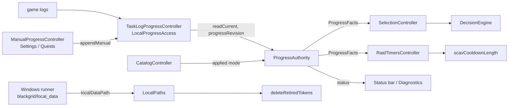
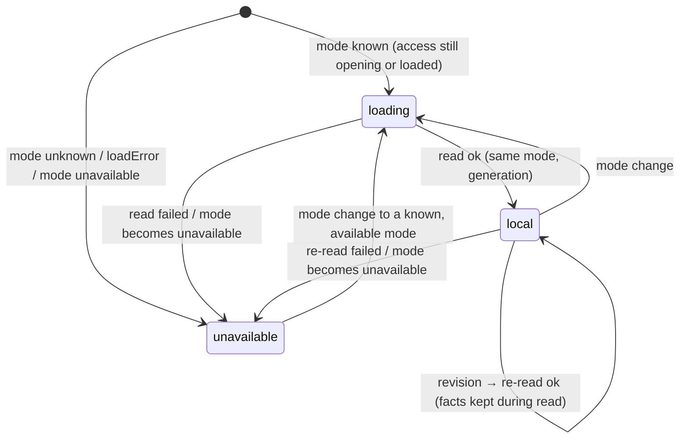
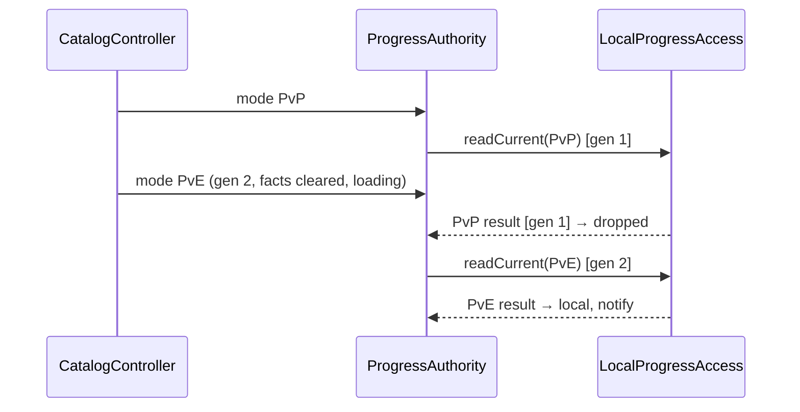

# Design

## Triage

| Trigger | Applies? | Evidence |
|---|---|---|
| T1 Components (new component, or 3+ with directed relationships) | Yes | A new `ProgressAuthority` controller sits between `TaskLogProgressController` (`LocalProgressAccess`) and three consumers: `SelectionController`, `RaidTimersController` and the shell/Diagnostics UI. `ProgressController` and `TrackerClient` are removed. |
| T2 State (persistent state, caches, 3+ state machine) | Yes | The facts held in memory form a 4-state machine (loading, local, unavailable, plus `unknown` mode). `settings.json` drops `trackerEnabled`. Saved token files are deleted. |
| T3 Concurrency (background work, workers/isolates, async, retries) | Yes | Asynchronous `readCurrent` reads race against mode switches and progress revisions (`manual_progress_controller.dart:525-640` has the same shape). The startup token clean-up is fire-and-forget. |
| T4 Boundaries (data format, migration, shared interface, IPC, external) | Yes | Runner method channel renamed and reduced (`windows/runner/credential_protector.cpp`); external `api.tarkovtracker.org` boundary removed; `settings.json` read compatibility; the shared `InspectionContext` / `DecisionEngine` progress input changes type. |
| T5 Volume (grows without a fixed bound) | Yes (bounded by existing paging) | `ProgressFacts` is built from every winner of the active wipe, which grows with the catalog's tasks, objectives and stations. That size is bounded by the catalog, not by time, and the store already pages reads (ADR-0041). |
| T6 Risk (security, money, data loss, unrecoverable user data) | Yes | Deleting files in `%LOCALAPPDATA%\Blackgrid` must touch only the three token files. Advice correctness changes, because wrong "satisfied" verdicts can make a player sell an item they need. |

TIER: FULL

## Context

The proposal sets the scope. These facts from the code shape the approach:

- **Advice input today.** `DecisionEngine.evaluate` (`lib/domain/decision_engine.dart:10-60`) is synchronous and reads `InspectionContext.progress`, a Tracker-shaped `ProgressSnapshot` (`lib/domain/progress.dart`). It holds maps of `EntityProgress` for tasks, objectives, modules (`<stationId>-<level>`) and parts, plus level, numeric edition and faction. It also carries `progressStale`, and `ProgressSnapshot.authoritativeAt` applies a 15-minute window. `_need` (`:161-296`) and `_gate` (`:298-379`) look up `p.tasks`, `p.objectives`, `p.modules` and `p.parts`. `_fleaEligible` (`:381-398`) reads `playerLevel`.
- **Who feeds it.** `SelectionController._project` (`lib/application/selection_controller.dart:455-476`) passes `progress.snapshot` when `progress.mode == inspectionMode`, plus `progressStale`. It listens to `ProgressController` and calls `updateAge()` on its timer (`:42-45`). `RaidTimersController._project` (`lib/application/raid_timers_controller.dart:124-139`) reads `RaidTimerProgressSource.snapshot`. `scavCooldownLength` (`lib/domain/raid_timers.dart:127-160`) adds the bonus of every `inputs.bonuses` key whose `modules[key].complete` is true.
- **Local progress.** `LocalProgressAccess` (`lib/application/local_progress_access.dart:24-63`) exposes `loaded`, `loadError`, `progressRevision`, `unavailableModes` and an asynchronous `readCurrent(mode)` that returns a `LocalProgressSnapshot` of winning `ProgressEvent`s keyed by `ProgressTarget`. A mode with no wipe returns `scope: null` with no winners (`task_log_progress_controller.dart:523-534`). `ManualProgressController` (`manual_progress_controller.dart:525-640`) already re-reads on revision and mode change with a generation counter and a dirty flag. Registers (ADR-0041): task `state`, objective `count` and `complete`, station `level`, player `level`, `faction` (bear/usec) and `edition` (ADR-0043 IDs), and trader `loyalty`.
- **Mode.** Selection and timers use the applied mode, `catalog.mode` (ADR-0031 D6; `app_services.dart:370-380` sets it from the effective mode). `ManualProgressController` follows `mapSession.effectiveMode`, which `AppServices.setMode` applies to the catalog.
- **Item data.** `ItemRequirement.progressIds` and `completionId` (`lib/domain/catalog.dart:222-253`) are objective IDs for tasks and part IDs for hideout. Hideout requirements carry `stationId` and `stationLevel`. Gate `stations` maps a station ID to a level. Gate `editions` (numeric) and `editionIds` (strings) come from `gameEditions` (`catalog_normalizer.dart:192-207`). `ScavCooldownInputs.bonuses` keys are `<stationId>-<level>` (`catalog.dart:391`).
- **Token plumbing.** `DpapiCredentialStore` (`lib/data/credential_store.dart`) writes `credentials\<mode>.dpapi`. `LocalPaths.resolve` creates the `credentials` folder and gets the data path over `MethodChannel('blackgrid/credentials')` (`lib/data/local_paths.dart:24-40`). The runner registers protect, unprotect, atomicReplace and localDataPath (`windows/runner/credential_protector.cpp`, `flutter_window.cpp:29`, `CMakeLists.txt:11`).
- **Settings.** `Settings.fromJson` reads `json['trackerEnabled'] as bool` (`lib/domain/settings.dart:344`). Legacy import maps `TrackerProgressEnabled` (`lib/data/legacy_import.dart:152-153`).
- **Docs.** README (sources table, privacy, contracts, settings sample, file table, credits), THIRD_PARTY_NOTICES (remote data), STRATEGY (M9 token line) and `openspec/architecture.md` describe the Tracker integration. All are updated in this change.
- **Composition order.** `AppServices` builds `progress` before `selection` and `raidTimers` (`app_services.dart:89-113`) but `localProgress` after them (`:123`). `ProgressAuthority` needs `localProgress` and `catalog`, so `localProgress` moves up and `ProgressAuthority` is built before `selection` and `raidTimers`. `localProgress` depends only on the database and `raidLifecycle`, which is already built before the timers. `open()` does not wait for the first read (startup must not block on progress, as it did not block on Tracker).

## Decisions

### D1: A `ProgressFacts` value held by a `ProgressAuthority` controller

- **Choice:** a new immutable domain type `ProgressFacts` (`lib/domain/progress_facts.dart`) holds the facts advice needs for one mode: task states, objective counts and completions, station levels, player level, faction and edition. Its lookups return the unset defaults of D3. A new `ProgressAuthority` (`lib/application/progress_authority.dart`, a `ChangeNotifier`) follows the applied mode. It reads `LocalProgressAccess.readCurrent` on each mode change, revision change, load change or availability change, and publishes `mode`, `status` (`loading`, `local`, `unavailable`) and `facts`. `DecisionEngine`, `InspectionContext` and `raid_timers.dart` take `ProgressFacts`. `ProgressSnapshot`, `EntityProgress`, `ProgressController`, `TrackerClient` and the credential store are deleted.
- **Rejected:** synthesising a `ProgressSnapshot` from local winners and leaving the engine untouched. The Tracker fields (owner, credential session, ETag, `invalid`, the 15-minute window and `parts`) would then have to be faked, and a later reader could mistake them for facts. Also rejected: making `DecisionEngine` asynchronous and reading the store per evaluation, which would move I/O into a pure domain function and into every history re-projection.
- **Reversal cost:** medium (the engine's progress input type is shared by selection, history and timers).
- **Important:** yes: binds future changes (the shared progress input of advice and timers).
- **Chosen by:** user

### D2: Facts follow the applied mode, as advice and timers do

- **Choice:** `ProgressAuthority` takes the mode from `CatalogController` (the same `catalog.mode` `SelectionController` and `RaidTimersController` use) and listens to it. Consumers still check `facts.mode == their mode` before use.
- **Rejected:** following `mapSession.effectiveMode` as `ManualProgressController` does. Advice would then briefly read one mode's progress against the other mode's catalog during a switch, because `AppServices.setMode` updates the catalog mode itself.
- **Reversal cost:** low
- **Important:** no
- **Chosen by:** agent

### D3: Unset defaults live in `ProgressFacts`

- **Choice:** `taskState(id)` returns the state or `null` (not started). `objectiveCount(id)` returns the count or 0, and `objectiveComplete(id)` the completion or false. `stationLevel(id)` returns the level or 0. `level`, `faction` and `edition` stay nullable. The engine maps them this way:
  - **Task need (ADR-0043 order):** finished means satisfied ("task completed"). Failed means satisfied ("task failed; no active obligation") unless the snapshot's `progressCatalog` task has `restartable == true`, in which case it continues as not started. A missing progress catalog or task means not restartable, as in `task_rules.dart:38`. Started means the need skips `_gate` and is actionable ("needed now"), as a started task is available without gate reasons (`task_rules.dart:45-50`). Otherwise it continues as not started through `_gate`.
  - **Task prerequisite gate:** finished counts as `complete`, failed as `failed`, and anything else as neither. The existing "complete-only prerequisite not met → needed later" rule applies.
  - **Objective entry:** count `objectiveCount`, complete `objectiveComplete`. The existing `ambiguousProgressIdentity` rule still makes the need unresolved.
  - **Hideout need:** the level is built when `stationLevel(stationId) >= stationLevel`, which makes the need satisfied. Otherwise every part counts 0, so the full count remains (proposal S3).
  - **Station gates and the previous-level gate:** built means `stationLevel >= level`.
  - **Faction:** compared upper-cased with the gate, as today; unset means unknown.
  - **Level:** a gate minimum of 1 or less passes without a recorded level (`task_rules.dart:55`); a higher minimum with the level unset is unknown. The Flea gate needs the recorded level.
  - **Faction:** `ProgressFacts.faction` holds `BEAR`/`USEC`, upper-cased from the bear/usec register when the facts are built, and the gate's faction is upper-cased before comparing, as `_gate` does today (`decision_engine.dart:309-315`).
  - **Scav bonus keys:** `<stationId>-<level>` splits at the last `-`. A key whose suffix is not a positive integer gives no bonus (the item data is validated, so this is defensive only).
- **Review round 1 (M1):** the first draft ran started tasks through every gate and satisfied every failed task. The owner agreed to align with ADR-0043 on 2026-11-19.
- **Rejected:** keeping the engine's "entry missing → unresolved" branches and materialising explicit zero entries for every catalog ID. That would build a map the size of the catalog per read, only to encode "unset".
- **Reversal cost:** low
- **Important:** yes: changes behaviour users see (proposal S2/S3, chosen by the user; this entry records the mapping).
- **Chosen by:** user

### D4: Edition gates are always unknown

- **Choice:** a requirement whose gate lists any `editions` or `editionIds` gets an unknown gate (unresolved), whatever edition is recorded.
- **Rejected:** comparing the recorded ADR-0043 edition ID with `editionIds`. Whether tarkov.dev's list means allowed or excluded editions is unverified, and a wrong "does not apply" makes a player sell a needed item.
- **Reversal cost:** low
- **Important:** yes: changes behaviour users see (edition-gated needs that Tracker's numeric edition decided now show Check).
- **Chosen by:** user

### D5: Status during reads

- **Choice:** `status` is `loading` from a mode change (or launch) until the first read for that mode ends, including while local progress is still opening (`loaded` false, no `loadError`), then `local` or `unavailable`. `unknown` mode, a `loadError` or an unavailable mode is `unavailable`. A re-read for the same mode after a revision keeps the last facts and `local`. A failed read publishes `unavailable` and clears the facts. A newer read request during a read sets a dirty flag and reads again afterwards (one read in flight), as `ManualProgressController._requestRead` does (`manual_progress_controller.dart:571-597`). While `loading` or `unavailable`, advice gets no facts.
- **Rejected:** publishing `unavailable` during loading (the bar would say unavailable at every launch); clearing facts on every re-read (verdicts would flicker to Check after every tick).
- **Reversal cost:** low
- **Important:** yes: changes what users see.
- **Chosen by:** user

### D6: Token files are deleted in Dart at startup

- **Choice:** `LocalPaths.resolve` stops creating `credentials\`. A `deleteRetiredTokens(LocalPaths)` function deletes `pvp.dpapi`, `pve.dpapi` and `seasonal.dpapi`, plus the store's own crash leftovers `<mode>.dpapi.*.tmp` for those modes (`credential_store.dart:101-105` writes `<mode>.dpapi.<pid>.<us>.tmp`), and then the folder only if it is empty (non-recursive). `AppServices.open` calls it without awaiting it. Every error is swallowed with one `debugPrint`, and the next launch tries again.
- **Rejected:** deleting the folder recursively (could remove a file the user put there); a one-shot marker that records "cleaned" (a locked file would then never be deleted).
- **Reversal cost:** low
- **Important:** no
- **Chosen by:** agent

### D7: The runner channel becomes `blackgrid/local_data`

- **Choice:** remove protect, unprotect and atomicReplace. Rename `credential_protector.{h,cpp}` to `local_data_channel.{h,cpp}`, `RegisterCredentialProtector` to `RegisterLocalDataChannel` and the channel to `blackgrid/local_data`, and update `CMakeLists.txt`, `flutter_window.{h,cpp}` and `LocalPaths.resolve`. `localDataPath` is unchanged.
- **Rejected:** keeping the `blackgrid/credentials` name with one method left. It describes something the app no longer does, and ADR-0007's credentials boundary would read as still in force.
- **Reversal cost:** low
- **Important:** yes: binds future changes (native boundary).
- **Chosen by:** user

### D8: Old settings load and lose the Tracker switch

- **Choice:** `Settings` drops `trackerEnabled`. `fromJson` ignores the key, `toJson` no longer writes it, and the settings format number stays the same. `LegacyImport` keeps tolerating `TrackerProgressEnabled` in its allowed-key list but does not map it. `ImportPreview` drops `trackerEnabled`.
- **Rejected:** a settings format bump with a migration step (no other field changes; ignoring an extra key is already safe).
- **Reversal cost:** low
- **Important:** yes: binds future changes (config key removed).
- **Chosen by:** agent (proposal S6)

### D9: Trader loyalty stays out of advice

- **Choice:** the engine's `unknownTraderOrSkill` handling is unchanged. Recorded trader loyalty is not used by advice in this change.
- **Rejected:** checking trader gates against recorded loyalty now. The item data's gate does not carry trader levels today, so this would change catalog parsing, which belongs in M11 quest planning.
- **Reversal cost:** low
- **Important:** no (advice is unchanged from today for these gates)
- **Chosen by:** agent

### D10: One ADR records the cutover

- **Choice:** ADR-0046, "Local progress is the only progress authority", records D1, D3–D5 and D7. It partly supersedes ADR-0007 (the DPAPI token and credentials channel), ADR-0031 (Tracker hideout progress for the scav cooldown) and the "Tracker coexists" clauses of ADR-0041 and ADR-0044. Their index rows in `openspec/architecture.md` gain "partly superseded by 0046".
- **Rejected:** one superseding ADR per affected ADR (four near-identical records).
- **Reversal cost:** low
- **Important:** yes: binds future changes.
- **Chosen by:** agent

### Decision summary

| # | Decision | Choice | Rejected | Reversal cost | Important | Chosen by |
|---|---|---|---|---|---|---|
| S1 | Import from the site | None; remove the token outright | One-time opt-in import | medium | yes | user |
| S2 | Unrecorded facts | Not started / zero / not built, ADR-0043 task order; unset level (>1), faction, edition → only those gates unknown | "Unknown until entered" | low | yes | user |
| S3 | Hideout items | Full count until the level is built | Unknown amount; hand-in counters | low | yes | user |
| S4 | Saved tokens and DPAPI | Delete files; remove DPAPI methods | Keep DPAPI; leave files | medium | yes | user |
| S5 | Status bar item | Progress item → Local progress | Drop the item | low | yes | user |
| S6 | Old settings key | Read and ignore `trackerEnabled` | Format bump | low | no | agent |
| D1 | Advice's progress input | `ProgressFacts` + `ProgressAuthority` | Fake `ProgressSnapshot`; async engine | medium | yes | user |
| D2 | Mode followed | Applied (catalog) mode | `mapSession.effectiveMode` | low | no | agent |
| D3 | Unset defaults | Lookups default in `ProgressFacts`; ADR-0043 order (started skips gates, restartable failed = not started, level ≤1 passes) | Explicit zero entries per catalog ID; gates for started tasks | low | yes | user |
| D4 | Edition gates | Always unknown | Match edition IDs | low | yes | user |
| D5 | Status during reads | loading → local/unavailable; re-reads keep facts | Unavailable while loading; clear on re-read | low | yes | user |
| D6 | Token clean-up | Delete three named files, then empty folder, each launch | Recursive delete; one-shot marker | low | no | agent |
| D7 | Runner channel | Rename to `blackgrid/local_data`, keep `localDataPath` only | Keep `blackgrid/credentials` | low | yes | user |
| D8 | Settings key | Drop `trackerEnabled`, ignore on read | Format bump | low | yes | agent |
| D9 | Trader loyalty in advice | Not used (unchanged) | Check trader gates now | low | no | agent |
| D10 | ADR | ADR-0046 partly supersedes 0007, 0031, 0041, 0044 | One ADR per superseded ADR | low | yes | agent |

## Diagrams (FULL)

Components after the change (T1, T4):

`ProgressAuthority` states (T2, T3):

Read sequence with a mode switch during a read (T3):

## State & Ownership (FULL)

| State | Owner (sole writer) | Lifetime | Invalidation / rebuild | Authoritative copy |
|---|---|---|---|---|
| Progress events and winners | `TaskLogProgressController` (store) | Durable (SQLite) | ADR-0041/0044 rules | Database |
| `ProgressAuthority.facts`, `status`, `mode` | `ProgressAuthority` | Memory, app session | Cleared on mode change, failed read or unavailable; rebuilt by the next read | The database; facts are a projection |
| Generation / dirty flag / read in flight | `ProgressAuthority` | Memory | Generation increments on mode change, unload and unavailability | n/a |
| Selection decision | `SelectionController` | Memory | Re-projected on each `ProgressAuthority` notify | Recomputed from facts and catalog |
| Token files `credentials\*.dpapi` | `deleteRetiredTokens` (delete only) | Until deleted | Deleted each launch while present | Disk |
| `settings.json` without `trackerEnabled` | `SettingsController` | Durable | Key dropped on next save | Disk |

## Failure & Visibility (FULL)

| Component | Fails / dies mid-operation → | Recovery | Retry safe? | Who finds out |
|---|---|---|---|---|
| Local progress load (`loaded` false, `loadError`) | `status` unavailable; advice says "Progress unavailable"; scav has no bonuses | App restart / store recovery (existing) | Yes | User: status bar "Progress unavailable" → Settings Local progress shows the error |
| `readCurrent` failure | `status` unavailable, facts cleared | Next revision or mode change re-reads | Yes (read-only) | User: status bar, verdict reason, scav tooltip |
| Mode's wipe unavailable | `status` unavailable for that mode only | Existing wipe recovery | Yes | User: status bar and Settings "Wipe unavailable" |
| `deleteRetiredTokens` | File stays (locked, permissions) | Next launch retries | Yes (idempotent delete) | Log (`debugPrint`) only. The tokens are encrypted, unused, and harmless if left one more launch |
| Native `localDataPath` | Startup fails as today | None (unchanged) | n/a | User: existing startup error |

## Resource Bounds (FULL)

| Queue / buffer / cache / transfer | Bound | At the bound | Timeout | At 10x / 100x |
|---|---|---|---|---|
| Reads in flight | 1, plus one dirty re-read | Further requests coalesce into the dirty flag | None (local SQLite; store has its own serialisation) | Unchanged |
| `ProgressFacts` maps | One entry per winning register of the active wipe: at most catalog tasks + objectives + stations + traders + 3 player fields (a few thousand) | n/a (catalog-bounded) | n/a | 10x catalog: tens of thousands of entries, still sub-MB; 100x is not a realistic catalog |
| Re-projection per notify | One `DecisionEngine.evaluate` for the current selection, as today | n/a | n/a | Unchanged |
| Token clean-up | 3 file deletes + 1 folder delete | n/a | None | n/a |

## Flow & State Gaps (FULL)

- **Mode switch during a read:** the generation check drops the stale result (sequence diagram). Facts are cleared synchronously on the switch, so advice never pairs PvP facts with PvE item data.
- **Edit during a read:** the dirty flag re-reads after the current read, so the published facts include the edit. Until then the previous facts stay.
- **Replay running:** each stored chunk bumps `progressRevision`; reads coalesce, so at most one extra read follows a burst.
- **History item in another mode:** `SelectionController` already checks the progress mode against `inspectionMode`. With facts for the applied mode only, a history item from another mode gets no progress (unchanged behaviour).
- **Verdict text while loading:** the open-input reason is "Progress unavailable" during `loading` too. The status bar's "Progress loading" carries the finer state; a verdict shown in the sub-second window names the missing input truthfully.
- **Startup before access loads:** `status` is `loading` while local progress opens, then the first read runs once `loaded` turns true. Advice has no facts meanwhile, so a verdict shown in that moment names progress as the open input, as it named missing Tracker progress before a refresh.
- **Restart mid clean-up:** deletes are idempotent; the folder is removed only when empty.
- **Downgrade to an older build:** older builds read `trackerEnabled` as a required bool and would fail to load the new `settings.json`, falling back to defaults with the load notice. Downgrade is not supported; release notes do not promise it.

## Mechanism Ledger (FULL)

| Mechanism | Built? | Why (harm nobody catches / expensive later) | Evidence that would change the call |
|---|---|---|---|
| Generation counter on reads | Yes | Without it a slow PvP read could publish into PvE advice: silent wrong verdicts | — |
| Dirty-flag coalescing | Yes | Without it a replay would queue one read per chunk, or an edit's read would be lost | — |
| Keeping facts during re-read | Yes | Without it the verdict flickers to Check on every tick (visible, but D5 chose against it) | — |
| Age window on facts | No | Local progress is not a remote snapshot; there is no staleness source | A future sync layer |
| Retry of failed reads | No | The next revision or mode change re-reads; a failed local read usually means a damaged store, which the existing recovery owns | Transient read failures seen in the field |
| Clean-up "done" marker | No | Deleting three absent files is free | — |
| Edition ID matching | No (D4) | Wrong "does not apply" is a silent sell-a-needed-item harm | Confirmed tarkov.dev semantics of `gameEditions` |
| Hideout hand-in counters | No (S3) | Out of scope; M12 hideout | Owner request |

## Risks / Trade-offs

- [A player who never replayed logs or entered progress sees every task as not started, so advice says Keep for items already used] → The release notes and the Local progress section point to log replay. This is the owner's chosen trade-off (S2), and it errs toward keeping.
- [Hideout items are over-counted for partly stocked levels] → S3 accepted; the verdict errs toward Keep.
- [Edition-gated needs that Tracker decided now show Check] → D4; rare tasks, honest wording.
- [Deleting files under `%LOCALAPPDATA%`] → Only three exact file names, non-recursive folder delete. A test covers a foreign file being kept.
- [The native rename breaks the runner build] → `mise run analyze`/`test` do not build the runner. The native task group ends with a Release build (`mise exec -- flutter build windows --release`, which compiles the runner without launching it) and `mise run bundle:check -- build/windows/x64/runner/Release`. The channel name lives in one Dart constant and one C++ constant, and a source test checks that the two match.
- [Large test churn (27 test files reference the removed types)] → Tests move to `ProgressFacts` fixtures in the cheapest layer: engine and timer permutations in domain tests, read races in `ProgressAuthority` service tests, and a few widget tests for the status item and Settings sections.

## ADRs

- **In force, constraining this change:** ADR-0007 (runner channel + FFI boundary), ADR-0031 (raid timers as projections; applied mode), ADR-0041 (local progress ledger and unset semantics), ADR-0043 (availability rules: unset means not started; edition IDs), ADR-0044 (active wipes, log progress), ADR-0040 (FIR evidence feeds the engine unchanged).
- **Main spec Purposes:** a delta cannot change a Purpose. The apply task that updates docs also rewrites the Purpose of `openspec/specs/progress-authority/spec.md` (and drops its "assume the Tracker integration is enabled" preamble), `raid-timers` and `local-progress` in place, so the archived specs carry no Tracker wording. Requirements whose scenario titles named Tracker are replaced (REMOVED plus ADDED under a new name) instead of MODIFIED, because archive refuses to drop scenario titles.
- **To record during apply:** ADR-0046 "Local progress is the only progress authority" (D10), with `Supersedes: 0007 (partly), 0031 (partly), 0041 (partly), 0044 (partly)`. In the same task, `openspec/architecture.md` is updated: the T4 boundary list, component diagram, component table (ProgressController/TrackerClient row → ProgressAuthority; runner row), state table (Tracker token and Tracker progress rows), contracts (Tracker and credentials channel bullets), resource rows (Tracker progress; HTTP bodies) and the ADR index.
