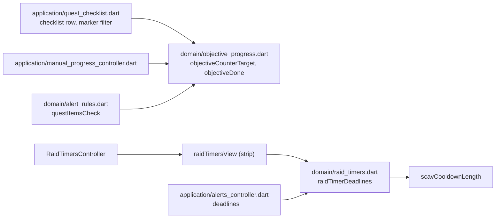
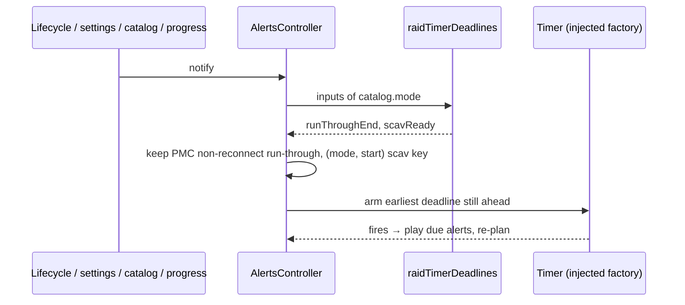

# Design

## Triage

| Trigger | Applies? | Evidence |
|---|---|---|
| T1 Components (new component, or 3+ with directed relationships) | yes | A new domain module, `lib/domain/objective_progress.dart`, gets four callers: the checklist row and marker filter (`quest_checklist.dart:242,298`), `ManualProgressController` (`manual_progress_controller.dart:286,298,342,373`) and `questItemsCheck` (`alert_rules.dart:109`). |
| T2 State (persistent state, caches, 3+ state machine) | no | Both functions are pure. No stored data, cache or state machine changes. |
| T3 Concurrency (background work, workers/isolates, async, retries) | yes (when unsure, it applies) | The deadlines feed `AlertsController._plan` (`alerts_controller.dart:509`), which arms a one-shot `Timer`. The arming, the timer and the re-plan triggers are unchanged; only where the deadline times come from changes. |
| T4 Boundaries (data format, migration, shared interface, IPC, external) | yes | Two new shared in-process interfaces: `objectiveDone`/`objectiveCounterTarget`, and `raidTimerDeadlines`/`RaidTimerDeadlines`, read by both the timer strip and the alerts. No stored format, IPC or external contract. |
| T5 Volume (grows without a fixed bound) | no | No collection grows. The deadline list is at most two entries, as today. |
| T6 Risk (security, money, data loss, unrecoverable user data) | no | Read-only rules over recorded progress and log times; nothing is written. |

TIER: FULL

## Context

The proposal gives the why. The current code:

- **Objective rule.** `objectiveCounterTarget` sits in the application layer (`lib/application/quest_checklist.dart:22`). The checklist row computes done as `_completed(winners, id) || (target != null && count >= target)` (`:242-254`). The marker filter adds counters that reached their target after collecting recorded completions (`:296-301`). `alert_rules.dart:121-128` has a private `_objectiveDone` over `ProgressFacts` that repeats the counter test, because `lib/domain` does not import `lib/application`. `ManualProgressController` uses `objectiveCounterTarget` to choose a register and validate counts (`:286-373`).
- **Deadlines.** `raidTimersView` (`lib/domain/raid_timers.dart:192`) counts the run-through as `runThroughSeconds - seconds(start, now)`, with elapsed time floored at 0 (`:234-251`). It counts the scav cooldown as `start + length - now`, in milliseconds (`_scavEntry`, `:268`). `AlertsController._deadlines` (`alerts_controller.dart:458-501`) writes its own `raid.startTime + runThroughSeconds` and `start + scavCooldownLength(...).seconds`. Only `scavCooldownLength` is shared, although the `add-audio-alerts` design D7 says both sides use "the same pure functions".
- **Inputs gating.** `RaidTimersController` passes inputs and progress only of `catalog.mode` (`raid_timers_controller.dart:129-141`). The alerts gate the same way inline. Sharing that gate is out of scope (proposal S2).

The behaviour is pinned by the existing tests: `test/domain/raid_timers_test.dart`, `test/domain/alert_rules_test.dart`, the quest checklist tests, `test/application/alerts_controller_*_test.dart` and `test/application/raid_timers_controller_test.dart`. They must pass unchanged.

## Decisions

### D1: The objective rule is a new domain module of top-level functions over plain values

- **Choice:** New `lib/domain/objective_progress.dart` with `int? objectiveCounterTarget(TaskObjective)` (moved verbatim) and `bool objectiveDone(TaskObjective, {required bool complete, required int count})`: done when recorded complete, or when the objective is a counter and `count` reached its target. Each caller passes its own recorded completion and count: the checklist from its winners map, `questItemsCheck` from `ProgressFacts`, and the marker filter with `complete: done.contains(id)`. `quest_checklist.dart` and `manual_progress_controller.dart` import it directly. The application copy and `_objectiveDone` are deleted; nothing re-exports them.
- **Rejected:** A `ProgressFacts.objectiveDone(TaskObjective)` method, because the checklist reads winners, not `ProgressFacts`, and would have to build the facts first. That is the deferred single-decoder work (proposal S1). Putting the two functions inside `progress_facts.dart` instead of a new file was also rejected: it mixes the objective rule with the facts decoder.
- **Reversal cost:** low
- **Important:** yes: binds future changes (the boundary the deferred winners decoder will call).
- **Chosen by:** user (owner, 2026-11-21: "D1 a")

### D2: One deadline function with no clock argument; alert-only rules stay in the alerts

- **Choice:** In `domain/raid_timers.dart`, `RaidTimerDeadlines raidTimerDeadlines({lifecycle, settings, activeMode, cooldownStarts, inputs, progress})` returns `RaidTimerDeadlines {DateTime? runThroughEnd, ScavCooldownLength? scavLength, DateTime? scavReady}`:
  - `runThroughEnd` is the current raid's log start plus `runThroughSeconds`, or `null` when no raid is current.
  - `scavLength` is `scavCooldownLength(...)` for the active mode, or `null` when the mode is unknown, the inputs are missing or the length is not countable.
  - `scavReady` is the active mode's start plus that length, or `null` when the length or the start is missing.

  It ignores `RaidTimerSettings.enabled` and the show flags: the alerts fire with the strip off. `raidTimersView` checks those flags itself, calls it once per view and formats from it. `AlertsController._deadlines` calls it with its mode-gated inputs, then applies its own rules: only a PMC raid that was not a reconnect gets a run-through deadline, and a scav deadline is keyed by (mode, start).
- **Rejected:** Two separate functions (`runThroughEnd`, `scavReadyAt`), because the strip also needs the length for its tooltip, so the scav function would return two values anyway. Moving the PMC/not-reconnect rule into the domain function was also rejected: the strip shows a run-through for every current raid, so it would change the strip.
- **Reversal cost:** low
- **Important:** yes: binds future changes (the contract the strip and the alerts share).
- **Chosen by:** user (owner, 2026-11-21: "D2 a")

### D3: The strip counts down to the deadline, with the same rounding as today

- **Choice:** The run-through value becomes `min(runThroughSeconds, ceil((runThroughEnd - now) in microseconds / 10^6))`, and it is `done` at `<= 0`. For a raid that started at or before `now` this equals today's `runThroughSeconds - floor(elapsed)`. For a raid whose log start is after `now` (clock behind the log), the cap gives the full length, as today's floor of elapsed at 0 does. The scav value keeps today's `ready.difference(now).inMilliseconds` arithmetic, now against `scavReady`. So the strip turns to "done" at exactly the instant the run-through alert fires on, and to "ready" at the scav alert's instant to the millisecond: as today, the strip's millisecond truncation reads `ready` when less than 1 ms is left, a little before the alert's timer fires. The agreement test asserts at whole milliseconds only.
- **Rejected:** Keeping the strip's elapsed-time arithmetic and sharing only the end time with the alerts, because the strip and the alert would again be two formulas that happen to agree, which is the drift this change removes.
- **Reversal cost:** low
- **Important:** no: behaviour is unchanged and the equivalence is proved by tests (tasks).
- **Chosen by:** agent

### Decision summary

| # | Decision | Choice | Rejected | Reversal cost | Important | Chosen by |
|---|---|---|---|---|---|---|
| S1 | Objective rule scope | Share only `objectiveDone` + `objectiveCounterTarget` | Single winners decoder; `evaluateTasks` in the engine | low | yes | user |
| S2 | Deadline scope | One pure deadline function | Shared active-mode inputs interface; shared fakes | low | yes | user |
| S3 | Where the work goes | Own change in M10 before `add-screenshot-cleanup` | Plain PR; fold into `add-screenshot-cleanup` | low | yes | user |
| S4 | Specs | `skip_specs: true` | New "shared deadline" requirement | low | no | agent |
| S5 | Stale reminder note (#123) | Out of scope | Fix here | low | no | user |
| D1 | Objective rule module | `lib/domain/objective_progress.dart`, top-level functions over completion and count | `ProgressFacts` method; inside `progress_facts.dart` | low | yes | user |
| D2 | Deadline function shape | `raidTimerDeadlines` → `RaidTimerDeadlines`; alert-only rules stay in the alerts | Two functions; PMC rule in the domain | low | yes | user |
| D3 | Strip countdown arithmetic | Count down to the deadline with equivalent rounding | Keep elapsed arithmetic, share only the end | low | no | agent |

## Diagrams (FULL)

T1 and T4, who calls the shared rules after the change:

T3, the deadline flow, unchanged apart from where the times come from:

## State & Ownership (FULL)

| State | Owner (sole writer) | Lifetime | Invalidation / rebuild | Authoritative copy |
|---|---|---|---|---|
| `RaidTimerDeadlines` value | none (pure return value) | One call | Recomputed on every view and every plan | The inputs: lifecycle, settings, catalog, progress |
| Armed deadlines, seen deadlines, deadline timer | `AlertsController` (unchanged) | Controller lifetime | Re-planned on each source change (`alerts_controller.dart:509`) | `AlertsController` |

No new state.

## Failure & Visibility (FULL)

| Component | Fails / dies mid-operation → | Recovery | Retry safe? | Who finds out |
|---|---|---|---|---|
| `objectiveDone` / `objectiveCounterTarget` | Pure; cannot fail. A wrong rule would show a wrong tick or reminder | Table tests | n/a | Tests; the user would see a wrong tick |
| `raidTimerDeadlines` | Pure; an uncountable length is `null` as today (`scavCooldownLength`), shown as "unknown" with its reason and no scav alert | n/a | n/a | User (strip tooltip), as today |

## Resource Bounds (FULL)

| Queue / buffer / cache / transfer | Bound | At the bound | Timeout | At 10x / 100x |
|---|---|---|---|---|
| Deadline list in `_deadlines` | 2 entries | n/a | none | Unchanged; it does not grow with use |

No new queue, buffer or cache. `raidTimersView` now calls `scavCooldownLength` once per view, as before.

## Flow & State Gaps (FULL)

- **Clock behind the log (raid start after now):** the strip shows the full run-through length (D3), as today. The alert deadline is in the future and arms normally, as today.
- **Mode unknown:** no scav length or ready time. The strip shows "Choose a mode" (checked before the length, as today), and no scav alert is armed.
- **Inputs of another mode:** the alerts pass `null` inputs (unchanged gate), so there is no scav deadline. The strip receives only active-mode inputs from `RaidTimersController`, as today.
- **Out-of-order events, restart:** unchanged; both callers recompute from current inputs.

## Mechanism Ledger (FULL)

| Mechanism | Built? | Why (harm nobody catches / expensive later) | Evidence that would change the call |
|---|---|---|---|
| Shared objective rule | yes | Three copies already drifted in placement; a fix to one would silently miss the others | n/a |
| Shared deadline function | yes | The strip and the alerts could disagree after either side changes, and the play-test result would no longer hold | n/a |
| Re-export of `objectiveCounterTarget` from `quest_checklist.dart` | no | Only two files import it; a re-export would keep two import paths for one rule | A caller outside `lib/` needing it (none found) |
| Shared active-mode inputs interface | no | Out of scope (proposal S2) | Owner request, or a fourth mode-gated source |
| Strip/alert agreement test through both controllers | no | The deadline test proves agreement at the domain layer, the cheapest layer that proves it; the alerts' existing fake-clock tests prove they fire on the same times | A future divergence the domain test cannot see |

## Risks / Trade-offs

- [The strip's rounding changes by accident] → New cases in `test/domain/raid_timers_test.dart` pin the run-through one microsecond before its end (`0:01`) and at it (`done`), with a fractional elapsed time (430 s run-through, 120.5 s into the raid shows `5:10`), and for a raid whose log start is after `now` (430 s run-through, start `now + 10 s` shows the full `7:10`, which proves the cap in D3). They also pin the scav cooldown one millisecond before its ready time (`0:01`) and at it (`ready`). The existing run-through and scav cases stay unchanged.
- [A caller of the moved `objectiveCounterTarget` is missed] → The analyzer fails on any unresolved import; a grep in the task confirms that no copy is left.

## ADRs

- **In force, constraining this change:** ADR-0031 (timers are projections of log times and one clock reading; the deadline function takes no clock), ADR-0046 (progress facts and timers use only the applied mode's facts; the mode gates stay as they are), ADR-0047 (alert channel and playback contract, untouched).
- **To record during apply:** none. The architecture file's `RaidTimersController` and `AlertsController` rows are updated to name `raidTimerDeadlines` and the objective module, which is an index update, not a new decision.
