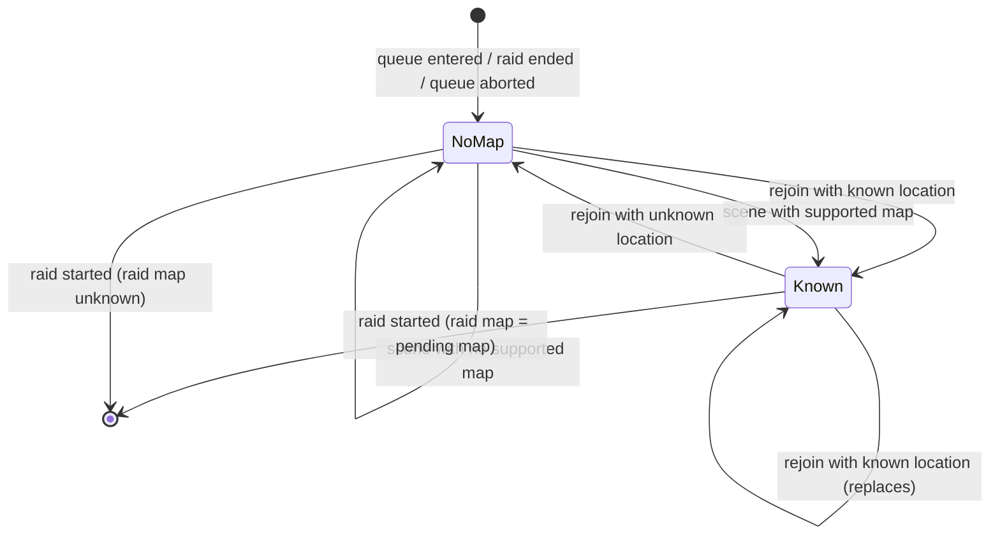

# Design

## Triage

| Trigger | Applies? | Evidence |
|---|---|---|
| T1 Components (new component, or 3+ with directed relationships) | no | Two existing pure lookup functions (`lib/data/game_log/game_locations.dart:7-33`, `:37-51`) and one existing reducer function (`lib/domain/raid_lifecycle.dart:1014-1022`) change. No component is added. |
| T2 State (persistent state, caches, 3+ state machine) | yes | The raid lifecycle is a state machine with seven phases (`lib/domain/raid_lifecycle.dart:841-847`). This change alters how a scene-loaded event updates its pending map (`:1014-1022`). |
| T3 Concurrency (background work, workers/isolates, async, retries) | no | The reducer and lookups are synchronous and pure (`lib/domain/raid_lifecycle.dart:1014-1022`, `lib/data/game_log/game_log_parsers.dart:97-110`). |
| T4 Boundaries (data format, migration, shared interface, IPC, external) | no | The parser regexes for the external log format are unchanged (`lib/data/game_log/game_log_parsers.dart:82-89`). Only the set of recognised values grows. No stored-row migration (proposal S1). The map-known transition keeps its payload (`lib/domain/raid_lifecycle.dart:1018-1020`). |
| T5 Volume (grows without a fixed bound) | no | A fixed set of map names. |
| T6 Risk (security, money, data loss, unrecoverable user data) | no | Stored stats rows are never touched (proposal S1). |

TIER: FULL

## Context

- **Transit line to map.** A transit or reconnect line produces a raid-rejoined event whose map is `rejoinLocationMapId(location)` (`lib/data/game_log/game_log_parsers.dart:100-110`). That table has no Terminal or Labyrinth entry and returns `null` for unknown names (`lib/data/game_log/game_locations.dart:37-51`).
- **Scene line to map.** A scene line produces a scene-loaded event whose map is `sceneMapId(scene)` (`lib/data/game_log/game_log_parsers.dart:97-98`). That table accepts only the bare `terminal`, `icebreaker` and `labyrinth` for the three newest maps (`lib/data/game_log/game_locations.dart:30`). The same function drives the Map tab's detected map, and an unsupported scene clears it (`lib/data/session_log_reader.dart:669-677`).
- **Supported maps.** `supportedMaps` lists 13 IDs, including `terminal` and `labyrinth` (`lib/domain/settings.dart:5-19`).
- **Reducer.** A rejoin sets the phase to raid starting and the pending map to the event's map (`lib/domain/raid_lifecycle.dart:1037-1041`). Raid starting counts as loading (`:841-842`). While loading, a scene-loaded event sets the pending map to the scene's map, even when that is `null` (`:1014-1017`). `copyWith` writes an explicit `null`, because it uses a keep sentinel (`:714-716`). The started raid takes the pending map (`:1069-1070`), and the stats controller stores it (`lib/application/local_stats_controller.dart:109-117`). A queue entered event clears the pending map (`lib/domain/raid_lifecycle.dart:991`), and so do a raid ending (`:884`) and an aborted queue (`:902`).
- **The owner's logs** (captured in task 1.1 as `evidence/owner-log-lines.txt`): every Terminal transit writes `Transit reconnect status:MatchWait raidMode:Online location:Terminal settingsLocal:False`, then `scene preset path:maps/terminal_preset.bundle rcid:terminal.scenespreset.asset` in the same millisecond. Across all the owner's logs, the transit locations are `bigmap`, `Icebreaker`, `laboratory`, `RezervBase`, `Shoreline` and `Terminal`. The scene names include `terminal_preset` (13) and `icebreaker` (8). Labyrinth appears in neither.
- **Old test.** The test named "rejoin locations are case-insensitive and cover every map" leaves out Terminal and Labyrinth (`test/data/game_log/game_log_parsers_test.dart:135-158`).

## Decisions

### D1: Add explicit entries to both lookup tables

- **Choice:** Add `terminal` and `labyrinth` to `rejoinLocationMapId`, and `terminal_preset` and `labyrinth_preset` to `sceneMapId` beside the bare names. Both lookups stay case-insensitive.
- **Rejected:** Resolve rejoin locations through `sceneMapId`, so there is one shared table. That loses because the two lines use different name sets: location IDs such as `bigmap` and `RezervBase` against bundle names such as `customs_preset` and `rezerv_base_preset`. Merging them would accept names that never occur in one of the lines and tie two independent game formats together.
- **Reversal cost:** low
- **Important:** no
- **Chosen by:** agent

### D2: Make the coverage tests check every supported map

- **Choice:** Extend the rejoin coverage test, and add a scene coverage test, so that every ID in `supportedMaps` is reached by at least one name in each table. A map added later without an entry fails the fast test suite.
- **Rejected:** Only add the missing rows to the hand-written expected maps. That repeats the old test's gap: nothing ties it to `supportedMaps`.
- **Reversal cost:** low
- **Important:** no
- **Chosen by:** agent

### D3: Implement the S6 guard in the scene-loaded reduction

- **Choice:** In `_sceneLoaded`, set the pending map to `e.mapId ?? state.pendingMapId`. The map-known transition still carries `e.mapId`, so the queue-progress contract is unchanged: an unsupported scene in a queue publishes "no map". A supported scene still replaces the pending map. The guard covers scenes only: a rejoin still sets the pending map to its location's map, which is `null` for an unknown location. In a queue whose second scene is unsupported, the map-known transition reports "no map" while the raid keeps the earlier map. That difference is deliberate: the transition reports what this scene line named, and the raid keeps the best map known.
- **Rejected:** Guard in the parser by dropping unsupported scene lines, emitting no event. That loses because it would also remove the unsupported-scene map-known transition and the Map tab's "scene is unsupported" status, which the `raid-lifecycle` and `game-log-input` specs require.
- **Rejected:** Guard only after a rejoin, by checking `pendingEntry`. That loses because it is a second rule for the same fact. The pending map is already cleared at every queue, ending and abort (`lib/domain/raid_lifecycle.dart:884`, `:902`, `:991`), so a kept value can only come from the same pending raid.
- **Reversal cost:** low
- **Important:** no. The behaviour itself is S6 (`Chosen by: user`). D3 only places it.
- **Chosen by:** agent

### Decision summary

| # | Decision | Choice | Rejected | Reversal cost | Important | Chosen by |
|---|---|---|---|---|---|---|
| S1 | Stored rows | Fix raids from now on; stored rows stay Unknown map | Repair stored null-map rows from the logs | low | yes (changes what users see) | user |
| S2 | Labyrinth | Include Labyrinth in both tables | Terminal only | low | yes (changes what users see) | user |
| S3 | Name evidence | Read the owner's real logs and capture them | Ship on the assumption | low | yes (weak evidence) | user |
| S4 | Terminal scene | Accept `terminal_preset` | Transit table only | low | yes (changes what users see) | user |
| S5 | Labyrinth scene | Accept `labyrinth_preset` by analogy | Only proven names | low | yes (weak evidence) | user |
| S6 | Guard | An unsupported scene keeps the known map | Table fixes only | low | yes (changes what users see) | user |
| D1 | How to map the new names | Explicit entries in both tables | One shared table | low | no | agent |
| D2 | Coverage guard | Tests that every supported map is reachable in each table | More hand-written rows | low | no | agent |
| D3 | Where the S6 guard lives | `_sceneLoaded` keeps the pending map on a `null` scene | Drop lines in the parser; guard after rejoins only | low | no | agent |

## Assumptions

- **A1:** Labyrinth's transit location is `Labyrinth` (any case) and its scene is `labyrinth` or `labyrinth_preset`. Not checked because the owner's logs hold no Labyrinth raid. Depends on it: none. The S6 guard and Terminal's fix don't rely on it, and a wrong guess leaves Labyrinth as it was.

## Carried constraints

- **C1:** Every supported map must be reachable from both the scene table and the rejoin table. A newly supported map needs both names, or its raids count as "Unknown map". The D2 tests enforce this. Kind: invariant. Destination: doc comment: `lib/data/game_log/game_locations.dart` `rejoinLocationMapId`
- **C2:** A scene-loaded event with no supported map must not erase the pending raid's known map, and its map-known transition still reports "no map". Kind: invariant. Destination: spec: specs/raid-lifecycle/spec.md → Requirement: A raid records its map, mode, times and entry

## Diagrams (FULL)

T2, how the pending map changes while loading:

## State & Ownership (FULL)

| State | Owner (sole writer) | Lifetime | Invalidation / rebuild | Authoritative copy |
|---|---|---|---|---|
| `pendingMapId` | the raid lifecycle reducer (`lib/domain/raid_lifecycle.dart`) | from a queue or rejoin until raid started, ended or aborted | cleared at queue entered, raid ending and queue abort; rebuilt by replaying the session folder | reducer state |
| Raid map in stats rows | `LocalStatsController` via the store | persisted | never rewritten (S1) | database row |

## Failure & Visibility (FULL)

| Component | Fails / dies mid-operation → | Recovery | Retry safe? | Who finds out |
|---|---|---|---|---|
| Lookup tables | A new or renamed game name returns `null` | Add the name. The D2 tests catch a supported map with no name. | yes, pure | The user sees "Unknown map" in Stats, and the Map tab shows "Current log scene is unsupported" (`lib/data/session_log_reader.dart:672-677`) |
| Scene-loaded reduction | Pure and synchronous, so it can't fail mid-operation | n/a | yes. A replay reduces the same way. | n/a |

## Resource Bounds (FULL)

| Queue / buffer / cache / transfer | Bound | At the bound | Timeout | At 10x / 100x |
|---|---|---|---|---|
| Lookup tables | fixed: 13 maps' names | n/a | n/a | unchanged |

Nothing new is buffered or queued.

## Flow & State Gaps (FULL)

- **Out of order:** the rejoin and scene lines share one log time. Events are applied by log time, then file, then byte offset (ADR-0030 D3, `docs/adr/0030-game-log-input.md`), so the rejoin (earlier offset) is applied first. If the scene came first, the scene would set the map (or keep it), and the rejoin would replace it with its own map.
- **Stale map:** a kept map can only come from the same pending raid, because every queue, ending and abort clears it (Context, Reducer).
- **Replay or restart:** the reducer is pure, so a replay gives the same raid map, and stats rows are stored once per record identity.
- **Rejoin then a different supported scene:** the scene wins, as before. Covered by the "Supported scene after a rejoin replaces the map" scenario.

## Mechanism Ledger (FULL)

| Mechanism | Built? | Why (harm nobody catches / expensive later) | Evidence that would change the call |
|---|---|---|---|
| Coverage tests tied to `supportedMaps` (D2) | yes | A missing name silently miscounts stats, and nobody catches it until a user reports it, as happened in #129 | n/a |
| S6 keep-known-map guard (D3) | yes | Chosen by the owner (S6). Without it, the next game rename silently erases transit maps again | n/a |
| Repair of stored rows | no | S1 | The owner asks for a backfill |
| Logging unrecognised scene or location names | no | The Map tab already shows an unsupported scene | Another unexplained "Unknown map" report |

## Risks / Trade-offs

- [The guard hides an unrecognised scene behind a stale but same-raid map] → The kept map is always from the same pending raid. The Map tab still reports the unsupported scene, so the gap stays visible.
- [`labyrinth_preset` is a guess] → It is harmless if the game never logs it (A1).

## ADRs

- **In force, constraining this change:** ADR-0030 (game log input). Its read-only rule and its ordering D3 are kept: the change adds recognised names and touches no file access or ordering. No ADR governs the lookup tables or the reducer's pending map.
- **To record during apply:** none.
