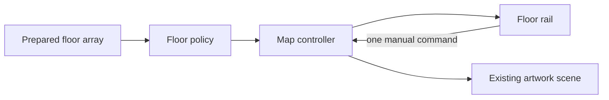
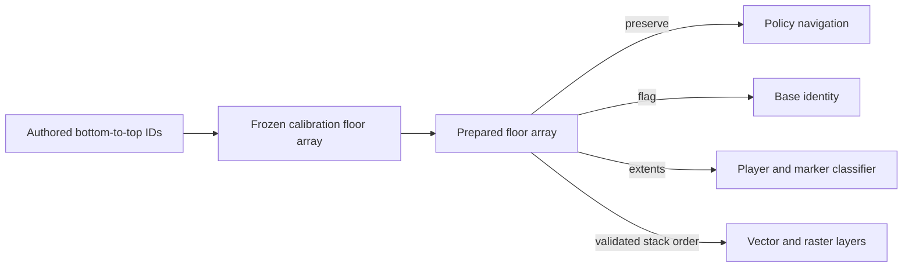

# Design

## Triage

| Trigger | Applies? | Evidence |
|---|---|---|
| T1 Components | Yes | Replace the workspace's inline segmented control (`lib/ui/map_workspace.dart:565-597`) with a rail widget bound to the existing controller. |
| T2 State | Yes | The rail adds expanded, collapsed and unavailable presentations, with a focus handoff between them. The existing workspace exposes focus separately from the picker overlay (`lib/ui/map_workspace.dart:766-769`, `:909-930`). No durable state is needed. |
| T3 Concurrency | Yes | The toast has one cancellable expiry. The order-only rebuild joins the existing asynchronous publication and failure path (`tool/maps/pack.dart:3434-3463`). |
| T4 Boundaries | Yes | The loader currently splits the prepared floor array into base and overlays (`lib/maps/prepared_map.dart:220-227`, `:246-255`). The change makes that array the shared navigation contract and adds an explicit offline calibration update. |
| T5 Volume | No | The rail uses the finite, validated prepared floor inventory. The builder already checks floor count and each indexed floor against calibration (`tool/maps/pack.dart:1814-1823`, `:1849-1856`). |
| T6 Risk | No | No user files, settings schema, game interaction, authentication or live data change. The offline tool uses the existing verified-baseline publication transaction (`tool/maps/pack.dart:3445-3454`). |

TIER: FULL

## Context

- The current UI assembles Auto and all floors as segments (`lib/ui/map_workspace.dart:565-596`). The picker and horizontal scroll view share one positioned row (`lib/ui/map_workspace.dart:909-930`). The map viewport has its own keyboard handler; arrows, Home, Enter and Escape already act on the map (`lib/ui/map_workspace.dart:410-424`, `:438-459`). The map remains mounted when switching areas (`lib/ui/shell.dart:405-417`; `lib/ui/map_screen.dart:22-32`).
- Base currently precedes every overlay in `MapFloorPolicy` (`lib/domain/map_floors.dart:64-86`). Base selection clears overlays, an exclusive selection replaces them, and an additive selection toggles them (`lib/domain/map_floors.dart:137-167`). Auto uses the same classifier for narrowest extent, stable ID tie-break and base fallback (`lib/domain/map_floors.dart:104-127`, `:170-181`). The map controller keeps Auto off per map after manual choice, immediately reuses the current sample when Auto is turned back on, and clears position on evidence reset (`lib/application/map_controller.dart:104-108`, `:403-408`, `:473-478`, `:541-552`).
- Icebreaker's authored list already puts Infirmary seventh (`tool/maps/calibration.dart:109-126`, `:310-319`). Labs lists Technical last (`tool/maps/calibration.dart:258-262`). Factory, Customs, Reserve, Streets, and the Shoreline/Ground Zero shared list also put the underground floor last (`tool/maps/inventory.dart:129-134`, `:147-152`, `:167-176`, `:241-255`, `:281-288`; shared calls at `:203` and `:301`).
- The builder passes the calibration list's order through reconciliation and checks the same order at validation (`tool/maps/calibration.dart:431-434`; `tool/maps/pack.dart:1033-1039`, `:1170`, `:1814-1823`, `:1849-1856`). Default rebuild reads the verified generation's inputs and context (`tool/maps/pack.dart:2690-2699`, `:2727-2734`); editing the authored lists alone does not change that input. Fresh artwork refresh can explicitly select reviewed calibration but acquires inputs again (`tool/maps/prepare.dart:83-103`).
- Vector components take their paint order from `layerOrder` (`lib/maps/prepared_map.dart:358-371`). Raster tiles are assembled in floor-array order (`lib/maps/prepared_map.dart:293-305`, `:309-316`, `:345-356`), filtered in that order (`lib/maps/native_map_scene.dart:432-440`), and drawn in that order after the faded-base pass (`lib/maps/native_map_scene.dart:336-369`). The proposed Labs move leaves the same two raster overlays in the correct order under D2; other permutations can change which one paints on top.
- The marker popup paints in the canvas stack before sibling overlay controls (`lib/ui/map_workspace.dart:876-930`), and its card can extend to the left viewport margin (`lib/ui/marker_popup.dart:305-317`). Its own key handler ignores A, F and Page Up/Down (`lib/ui/marker_popup.dart:123-150`). The Map already wraps controls and popup in one semantic region (`lib/ui/map_screen.dart:24-32`).

## Decisions

### D1: Rebuild explicitly from the same verified pack

- **Choice:** Add `--reviewed-floor-order` to the existing offline refresh. Read only IDs and their order from the authored inventory, verify an exact permutation and the raster check in D2, and reorder the existing frozen records. Rebind both the frozen calibration bytes and the builder context to the new calibration (existing replacement at `tool/maps/pack.dart:316-335`, paired context at `:2717-2725`). Keep the baseline's source lock, notices and other inputs. Build, fully validate, prove order-only preservation, report and publish through the existing transaction. Plain rebuild, check and metadata-only renewal keep their current behavior.
- **Rejected:** Stage fresh artwork with reviewed calibration. It reacquires sources and can be blocked by upstream drift unrelated to a floor list. A default-mode update would also change the authority used by ordinary reproduction.
- **Reversal cost:** medium.
- **Important:** yes, changes an external maintenance interface and how a new generation is admitted.
- **Chosen by:** user.

### D2: Keep navigation separate from rendering and classification

- **Choice:** Parse each floor once and preserve the prepared bottom-to-top order for navigation. Keep the flagged base, extent classifier, native vector order and faded-base pass. For an additive raster stack, process floors from the base upward and then the floors below base, in array order within each part. Share that ordering calculation between the loader and order-only admission. Compare the relative sequence of non-base tile-backed floors before and after; refuse any permutation that changes it. The owner's seven changes pass, including Labs, which still paints First as the faded base, then Second, then Technical. Exclusive floors never coexist.
- **Rejected:** Accept arbitrary permutations. Images and floor records could remain byte-identical while two overlapping overlays change paint order. Extending `layerOrder` to raster maps would change the manifest contract.
- **Reversal cost:** medium.
- **Important:** yes, binds the navigation contract and preserves current artwork behavior.
- **Chosen by:** user.

### D3: Keep the rail's presentation local to the Map

- **Choice:** Keep the picker in place. Bound the rail below it, clear of the credit and selected-pin actions. Keep the popup in front of the rail except while keyboard focus is within the rail, when the focused rail must stay visible. Keep both mounted and retain the Map's shared semantics boundary. Collapse belongs to the mounted workspace: it survives map and area changes and resets to expanded when the workspace is recreated. The rail owns scroll and row focus. Use the map's dark Ember roles, a neutral switch, a check, a leading ink edge and semibold text. Metadata on hovered or selected rows uses secondary ink; full names remain available to assistive technology and in tooltips.
- **Rejected:** Save collapse in user settings, shrink the map or hide an overlapping popup. This change only replaces the floor control and does not take space from the viewport or remove marker controls.
- **Reversal cost:** low.
- **Important:** yes, changes what players see and how the rail responds to focus.
- **Chosen by:** user.

### D4: Keep navigation writes in the controller

- **Choice:** Derive the current floor from the highest selected non-base floor, or base when none is selected. Keep it distinct from the last resolved player floor. Manual row activation uses toggle for additive maps and single selection for Icebreaker. Use one controller transition for a step or exclusive keyboard choice: replace the overlays, turn Auto off, and publish through the existing floor invalidation path. A boundary step does not call that transition. The rail and canvas share the floor shortcut dispatch only; neither receives the other's unrelated keys. Rail Escape returns to the map without clearing selection.
- **Rejected:** Simulate a step with several existing toggle calls. It exposes intermediate floor sets and triggers unnecessary scene invalidation.
- **Reversal cost:** low.
- **Important:** yes, controls visible selection and keyboard behavior.
- **Chosen by:** user.

### Decision summary

| # | Decision | Choice | Rejected | Reversal cost | Important | Chosen by |
|---|---|---|---|---|---|---|
| S1 | Replace only the floor selector | Deck rail and collapsed stepper | Another horizontal row or closed picker | Medium | Yes | User |
| S2 | Use authored floor order | Bottom to top in pack, reverse in rail | Height sort or new order field | Medium | Yes | User |
| S3 | Step to one destination | Single destination, additive base stays | Accumulate overlays | Low | Yes | User |
| S4 | Roadmap scope | Standalone | Assign to M13 | Low | Yes | User |
| D1 | Import the reviewed order | Explicit offline permutation | Fresh artwork or default-mode import | Medium | Yes | User |
| D2 | Navigation and artwork | Reject permutations that alter the existing raster stack | Allow any permutation or extend the raster manifest | Medium | Yes | User |
| D3 | Rail presentation | Workspace-owned overlay with focus-aware popup layering | Durable settings, narrower map, or obscured controls | Low | Yes | User |
| D4 | Floor writes | One controller transition | Multiple visibility toggles | Low | Yes | User |

## Assumptions

None.

## Carried constraints

- **C1:** The authored array supplies navigation order. Keep base identity and classification independent and reject order-only rebuilds that change additive raster draw order. Kind: invariant. Destination: ADR 0052.
- **C2:** Only an explicit offline order update may select current authored IDs. It cannot change existing floor records, other frozen values or artwork. Kind: invariant. Destination: spec: specs/prepared-map-packs/spec.md → Requirement: An explicit offline rebuild may update only floor order.
- **C3:** Collapse survives a mounted workspace's map and area changes, including a period without a rail. Recreating the workspace starts expanded. Kind: deliberate gap. Destination: spec: specs/map-controls/spec.md → Requirement: The rail exposes floors outside its viewport.
- **C4:** Manual ownership and player position stay separate; a manual choice never relocates the You tag. Kind: invariant. Destination: spec: specs/map-controls/spec.md → Requirement: The rail reports the player floor separately from Auto.
- **C5:** A single step replaces overlays atomically but leaves the additive base drawn. Kind: invariant. Destination: spec: specs/map-controls/spec.md → Requirement: Map shortcuts step floors and reach the rail.
- **C6:** Only the canvas with primary focus and the rail's own focus subtree handle floor shortcuts. A marker popup, text field or unrelated control cannot trigger them. Kind: invariant. Destination: spec: specs/map-controls/spec.md → Requirement: Map shortcuts step floors and reach the rail.
- **C7:** Where the popup and the rail overlap, the popup has paint and pointer priority except when the rail owns focus. Returning focus to the canvas restores popup priority and retains selection and view. Kind: invariant. Destination: spec: specs/map-controls/spec.md → Requirement: The rail exposes floors outside its viewport.

## Diagrams (FULL)

T1, consumers of prepared navigation:



T2, rail presentation:

```mermaid
stateDiagram-v2
  [*] --> Expanded: usable floor policy
  Expanded --> Collapsed: collapse; focus Expand if rail focused
  Collapsed --> Expanded: expand; reveal and focus current row if rail focused
  Expanded --> Unavailable: map has no rail
  Collapsed --> Unavailable: map has no rail
  Unavailable --> Expanded: usable policy; expanded preference
  Unavailable --> Collapsed: usable policy; collapsed preference
```



T3, order-only rebuild:

```mermaid
sequenceDiagram
  participant Command as Explicit offline refresh
  participant Build as Frozen pack builder
  participant Publish as Existing publication transaction
  Command->>Build: Verified baseline and reviewed order with same raster stack
  Build-->>Command: Validated candidate
  alt Candidate differs only in admitted order and bookkeeping
    Command->>Publish: Exact candidate and baseline identity
  else Invalid candidate or other drift
    Command-->>Command: Report error; no active writes
  end
```

T4, persisted and runtime values:



## State & Ownership (FULL)

| State | Owner (sole writer) | Lifetime | Invalidation / rebuild | Authoritative copy |
|---|---|---|---|---|
| Reviewed order | Maintainer via `calibration.dart` and `inventory.dart` | Code revision | Reviewed floor list edit | Hand-kept list |
| Frozen order | Pack preparation and publication | Active generation | Replace only via validated generation promotion | Carried calibration and validated prepared floor array |
| Floor visibility, Auto and sample | `MapController` | Existing map and evidence lifetimes | Existing selection and sample paths; no rail copy | Controller and immutable floor policy |
| Collapse preference | Mounted Map workspace | App session | Reset only when the workspace is recreated; no settings write | One bool retained even when no rail is offered |
| Active row and scroll offset | Floor rail | Displayed pack policy | Rebind on identity change; retain manual scroll until a new selected or focused row needs to be shown | Active row ID and vertical scroll position |
| Announced floor feedback | Map workspace | One short visible toast | Replace on a newer action; clear on map change or disposal | One message and one cancellable timer |

## Failure & Visibility (FULL)

| Component | Failure | Recovery | Retry safe? | Who finds out |
|---|---|---|---|---|
| Floor controller | Artwork or policy missing, position unset, or height unknown | Hide the rail when unusable; keep selection and show waiting when position cannot resolve | Yes; a later valid map or sample updates the rail | Player sees existing map load failure or Auto status |
| Floor rail | Active row clipped, map changes while reveal is scheduled, or the rail disappears with focus | Reveal only against the current policy and mounted scroll host; return abandoned rail focus to the map | Yes; no action is replayed against the new policy | Player keeps a valid keyboard target and gets the new count |
| Order-only rebuild | Baseline cannot verify, IDs or raster stack differ, or candidate changes another value | Report the map, value or path before promotion; keep the candidate when the existing refresh path does so | Safe before active writes; after a publication interruption follow the existing recovery message | Operator |

## Resource Bounds (FULL)

| Queue / buffer / cache / transfer | Bound | At the bound | Timeout | At 10x / 100x |
|---|---|---|---|---|
| Floor rows | One immutable prepared list per map; build the visible window plus normal Flutter list cache | Scroll within the rail; derive hidden counts from list metrics and row extents, excluding the divider | None | More entries add proportional model data, not more mounted rows |
| Focus reveal and toast | Latest requested reveal, one toast and one timer | New request replaces pending presentation; no notice backlog | Toast expires after 2.6 seconds, driven by fake widget time in tests | No proportional growth |
| Order rebuild | One verified generation and one candidate; one permutation lookup per floor per rebuild | Validation stops on mismatches, and the existing one-writer rule still applies | Existing offline rebuild behavior; no new timer or network calls | Uses existing builder capacity; the new order-only work is linear in floor/input counts and compares hashes, not decoded duplicates |

## Flow & State Gaps (FULL)

- Reserve top and bottom cue space only when the list needs to scroll. Use real scroll extents and row bounds for counts; change cues without changing the list extent when crossing an edge. Scroll wheel, drag and cue targets affect the rail only. Bring current or focused rows into view on floor change, focus or reopen, not on unrelated controller notifications.
- A single tab stop enters the list. Maintain one logical row for keyboard navigation, expose full row names and mutually exclusive or pressed state to assistive technology, and reveal the row before moving keyboard focus. Use 28 logical pixel rows, at least 24 logical pixel targets, and the 2 pixel Ember focus outline. At constrained sizes bound the rail without moving viewport geometry or overlapping the credit and pin bar. Use dark-role secondary ink for selected or hovered metadata so text retains at least 4.5:1 contrast; the focus outline reaches at least 3:1 against the rail.
- A held step may repeat; A, F and Escape handle key-down only. Ignore modified letter shortcuts. Only dispatch from the canvas when its focus node has primary focus, or from within the rail. Absent rail means no floor callbacks. Escape down in the rail gives focus to the canvas. Canvas Escape repeats cannot clear the marker or pin; a fresh Escape can. The popup's own keys and dismissal keep working. When a focused rail switches presentation, collapsing hands focus to Expand, and expanding reveals and focuses the current row without activating it. Keep both overlap targets mounted and restore popup paint and pointer priority when the rail loses focus. A stale reveal cannot select a new map's floor, and Auto updates never take focus. The expanded list shows Auto status and You; the compact line uses the Auto tag, and A continues to work.
- Verify the current-format baseline and its carried source index. Reorder its existing calibration records by ID; the order-only option cannot combine with metadata renewal or v4 migration. The candidate's source index must equal the baseline's with only the calibration SHA-256 replaced. Compare map facts outside floor arrays, the expected ordered floor arrays with unchanged records by ID, and the exact output path/hash inventory except calibration and its source index. Accept only order and its bookkeeping or toolchain provenance in the manifest. Candidate-own-source validation still checks all files. The default check reads the new frozen calibration.
- Existing artwork staging compares authored and active calibration, and publication checks against the current reviewed calibration (`tool/maps/pack.dart:604-642`, `:3204-3214`, `:3571-3577`). Promote the offline order-only update before staging artwork against the new order. Restage candidates made before the reorder; do not bypass admission. The ordinary report compares floor records by ID (`tool/maps/pack.dart:2367-2388`) and calls any non-metadata change "Artwork changed" (`:3434-3443`). Report floor-array order by map and label the admitted change as "Floor order changed". Retain the owner's pre-merge check.

## Mechanism Ledger (FULL)

| Mechanism | Built? | Why | Evidence that would change the call |
|---|---|---|---|
| Separate order-only admission and preservation proof | Yes | Default rebuild ignores the authored lists; an unchecked recalibration could silently change floors or artwork in a selector-only change | An existing exact-permutation offline route would replace this flag |
| Atomic controller floor command | Yes | Several manual toggles would publish intermediate visibility to the scene and markers | One existing command with the same semantics would remove the need |
| Incremental or persisted floor state | No | The controller already owns selection and position. Collapse only needs to survive within a mounted workspace | An owner-approved requirement to remember collapse after restart |
| Additional manifest field or source-height sorting | No | The existing array carries the order; extents answer classification, not navigation | A later explicit independent ordering contract |
| Separate renderer pipeline or pack publication writer | No | The existing tile/vector paths and transaction already handle the work | Evidence their existing semantics cannot be preserved with the existing inputs |

## Risks / Trade-offs

- Rail covers part of the left edge by design. Collapse restores most of that space, and neither state changes the viewport or its controls.
- A regenerated pack can change the apparent map even when vector and image hashes match. Use the byte-and-fact preservation gate, the Labs overlapping-tile draw test, and the owner's pre-merge map check rather than treating a new generation hash as proof of rendering.
- A fake-clock toast test advances only the widget clock. Offline fixtures and widget tests do not launch the game or the Windows app.

## ADRs

- **In force, constraining this change:** ADR-0005 and ADR-0033 for preparation and promotion; ADR-0034 and ADR-0035 for metadata preservation and ownership; ADR-0036 and ADR-0050 for labels and extents; ADR-0037 and ADR-0039 for Ember and map selection colors.
- **To record during apply:** ADR-0052, floor navigation order lives in the prepared floor list. It extends ADR-0033's offline build contract with the explicit order-only route and leaves its default behavior and ADR-0050's extent ownership intact.
