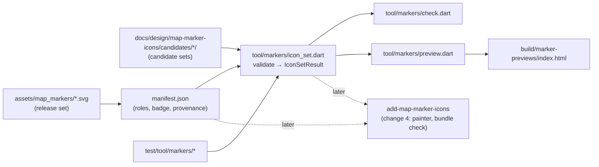
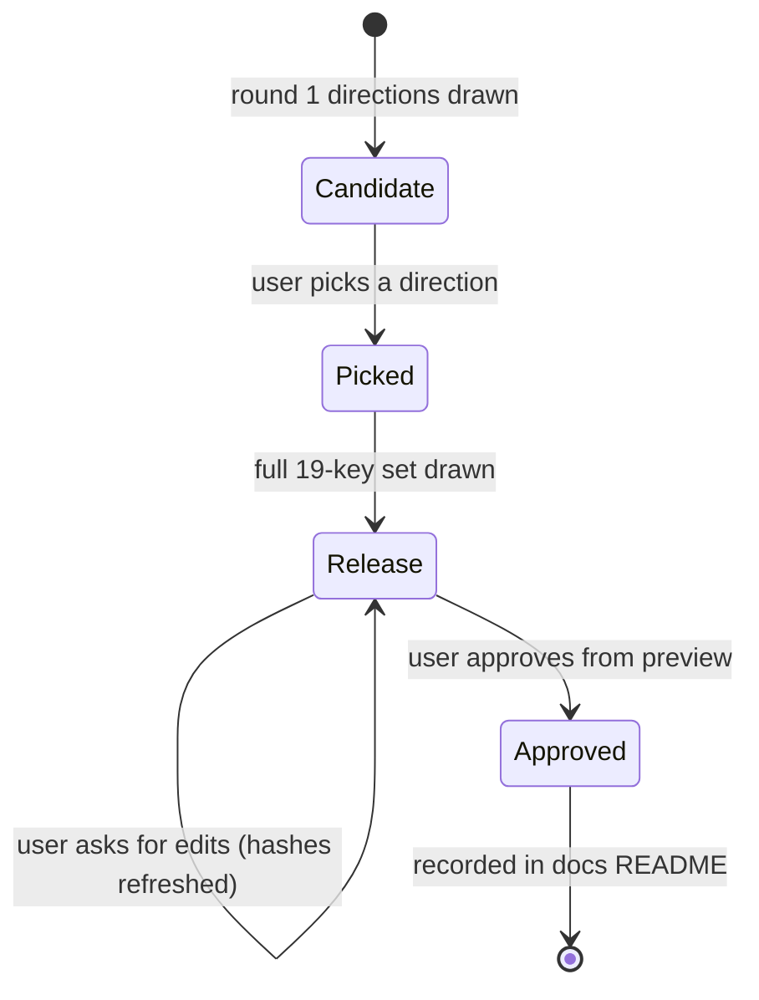
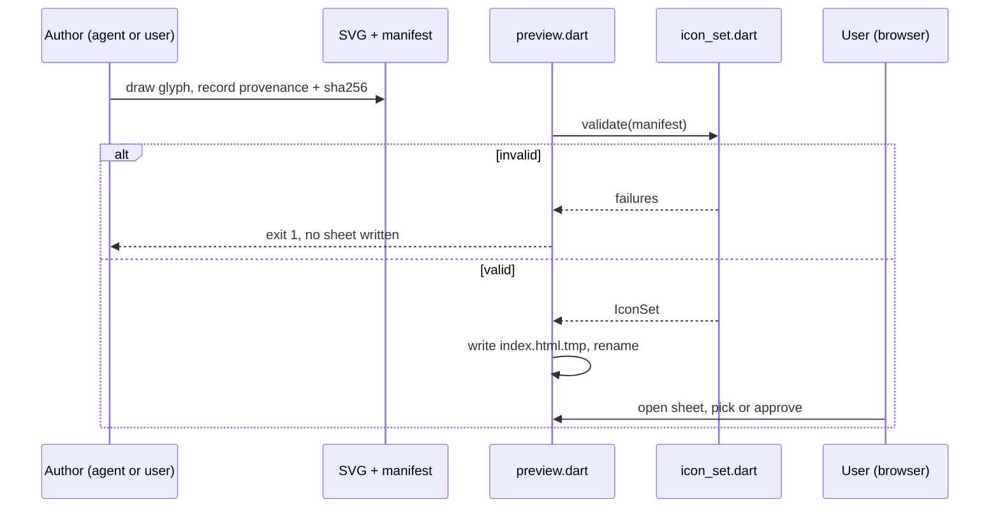

# Design

## Triage

| Trigger | Applies? | Evidence |
|---|---|---|
| T1 Components (new component, or 3+ with directed relationships) | Yes | Two new offline tools: the set checker (`tool/markers/`) and the preview generator, which calls the checker. `add-map-marker-icons` consumes the set later. |
| T2 State (persistent state, caches, 3+ state machine) | Yes | New committed state: the icon files and their manifest (palette, badge geometry, provenance). No runtime state or cache. |
| T3 Concurrency (background work, workers/isolates, async, retries) | No | Both tools are single-run CLIs with no workers, timers or retries. |
| T4 Boundaries (data format, migration, shared interface, IPC, external) | Yes | A new manifest format and SVG form that change 4 (renderer, bundle check) and change 5 (preference tiles) consume. |
| T5 Volume (grows without a fixed bound) | No | 19 categories. Candidate sets are bounded below (D6). |
| T6 Risk (security, money, data loss, unrecoverable user data) | Yes (rights) | The milestone's reason is legal provenance: third-party marker art must not ship. No user data is involved. |

TIER: FULL

## Context

See proposal.md for the why.

Today's rendering, which change 4 replaces:
- **Placeholder ring.** `_MapPainter._glyph` draws an inset disc of radius 9 (12 when selected), a 2 px ring and a 3 px dot (`lib/ui/map_workspace.dart:674-681`).
- **Colour choice.** Highlight wins first and draws `Colors.cyanAccent`. Then a filter key containing `Extract` draws `GridColors.green`, `category == 'hazards'` draws `Colors.redAccent`, and everything else draws `GridColors.gold` (`:623-630`).
- **Dimming.** Dimming sets alpha 0.22 (`:630`).
- **Pins.** Pins draw `Colors.lightBlueAccent` (`:655-671`).
- **Hit testing.** Hit radius 22 (`:95`).

Category keys:
- **Filter keys.** `_markerFilterKey` derives them (`lib/maps/prepared_map.dart:687-717`).
- **Persisted keys.** `markerCategories` lists 20 persisted keys (`lib/domain/settings.dart:18-39`).
- **Keys that get an icon.** 18 keys can come from a pack marker. `CustomPins` is added for every map (`lib/application/map_controller.dart:76-79`). `Labels` only appears in legacy import.

Vector pipeline:
- **Build-time compile.** SVG compiles to `.vec` at build time with `vector_graphics_compiler` (`tool/maps/pack.dart:9,75`).
- **Runtime decode.** It is decoded at runtime with `vector_graphics` only; there is no `flutter_svg` (ADR-0005).
- **Available packages.** `xml` 6.6.1, `crypto` and `vector_graphics_compiler` are already dependencies (`pubspec.yaml`).

Manifest precedent:
- **Hash-bound files.** Hash-bound JSON manifests already sit next to their files (`assets/vision/marker/inspection_marker.json`, ADR-0012).
- **Provenance record.** `bundle:check` enforces a recorded provenance for game artwork (`tool/vision/check_bundle.dart:468-568`).

**Gap.** No marker icon, icon manifest or icon check exists today (grep of `lib/`, `tool/`, `test/`).

## Decisions

### D1: One icon per filter key, 19 keys

- **Choice:**
  - The set covers the filter keys a pack can produce:
    - `QuestItems`, `QuestObjectives`;
    - `PmcExtracts`, `ScavExtracts`, `SharedExtracts`, `Transits`;
    - `Hazards`, `HazardZones`, `Switches`;
    - `PmcSpawns`, `ScavSpawns`, `BossSpawns`, `CultistSpawns`;
    - `BtrStops`, `lootContainers`, `lootLoose`, `locks`, `stationaryWeapons`.
  - It also covers `CustomPins`.
  - The tool holds this list as one constant. A test pins it to `markerCategories` minus `Labels`, so a new category in the app fails the test until it gets an icon.
  - `HazardZones` gets an icon. Today the map draws a zone's polygon and then the ring glyph at the marker point (`lib/ui/map_workspace.dart:600-635`). Change 4 replaces that ring with this icon, and change 5's preference tile needs it too.
- **Rejected:** one icon per raw pack category (13 icons: `extracts`, `spawns`, `bosses` …). It loses the PMC/Scav/shared, PMC/Scav spawn, boss/cultist and hazard/zone splits that the filters and the preference grid already show. Change 5 would then need a second set.
- **Reversal cost:** low. Adding or merging a key is one icon and one manifest entry.

### D2: Single-tint glyph inside a painter-drawn badge

- **Choice:**
  - An icon file is the glyph only. It is drawn in white (`#FFFFFF`) as the tint placeholder on a transparent `0 0 24 24` canvas.
  - The badge, a dark disc with a role-coloured ring, is not part of the file. The renderer draws it and tints the glyph with the category's role colour, using a `srcIn` colour filter on the compiled picture.
  - Selection, dimming, cyan highlight and pins therefore stay painter states: one file per category serves every state.
  - **Closed allow-list.**
    - An element or attribute not listed here fails the check, naming the file, element and attribute.
    - Namespace declarations other than the SVG namespace fail too.
    - This rejects, among others: `style`, `class`, `id`, `href`, `xlink:*`, `xml:base`, every `on*` event attribute, `image`, `text`, `font`, `filter`, `mask`, `use`, `script`, `foreignObject` and gradients.

    | Element | Geometry attributes |
    |---|---|
    | `svg` (root only) | `xmlns`, `viewBox` (must be `0 0 24 24`), optional `width`/`height` (must be `24`) |
    | `g` | none |
    | `path` | `d` |
    | `circle` | `cx`, `cy`, `r` |
    | `ellipse` | `cx`, `cy`, `rx`, `ry` |
    | `rect` | `x`, `y`, `width`, `height`, `rx`, `ry` |
    | `polygon`, `polyline` | `points` |
    | `line` | `x1`, `y1`, `x2`, `y2` |

    - Every element may also carry `transform`.
    - Every element may carry these paint attributes: `fill`, `stroke`, `stroke-width`, `stroke-linecap`, `stroke-linejoin`, `stroke-miterlimit`, `fill-rule`, `clip-rule` and `opacity`.
    - `fill` and `stroke` take only `#FFFFFF`, `#fff`, `white` or `none`.
  - **Effective paint.**
    - The check resolves each shape's effective `fill` and `stroke` through its `g` ancestors and the SVG defaults (`fill` black, `stroke` none).
    - Any effective colour other than the tint fails, so a shape that relies on the default black fails.
    - A shape whose effective fill and stroke are both `none` paints nothing and is allowed.
  - Size cap: 8 KiB per file.
- **Rejected:**
  - Full-colour icons with baked category colours: each state (dimmed, highlighted, selected) would need its own file or a recolour, and a baked colour fights the cyan highlight.
  - An icon font: it needs a font build pipeline and glyph-coverage tooling for 19 glyphs.
  - Material Symbols or another licensed set: third-party art, which the exit criterion excludes.
- **Reversal cost:** medium. Change 4's painter and change 5's tiles build on single-tint glyphs. Moving to full-colour later means redrawing the set.

### D3: Manifest format, `assets/map_markers/manifest.json`, schema 1

- **Choice:** one JSON manifest next to the SVGs, read by the checker, the preview generator and (in change 4) the app and the bundle check:

  ```json
  {
    "schemaVersion": 1,
    "scope": "release",
    "background": "#090F0D",
    "badge": { "diameter": 24, "selectedDiameter": 30, "glyph": 16, "ring": 2 },
    "roles": { "exit": "#48D28B", "danger": "#FF5252", "pin": "#40C4FF", "...": "#RRGGBB" },
    "icons": [
      {
        "key": "PmcExtracts", "file": "pmc_extracts.svg", "role": "exit",
        "sha256": "<64 hex>",
        "provenance": {
          "author": "Blackgrid project", "origin": "project",
          "method": "ai-assisted", "tools": ["Claude Code (claude-opus-5-5)"],
          "concept": { "source": "none" },
          "date": "2026-10-28"
        }
      }
    ]
  }
  ```

  - `scope` is `release` (full coverage) or `candidate` (subset allowed, D6).
  - `concept` is `{ "source": "none" }` or `{ "source": "<tool>", "promptRecord": "<path relative to the manifest>" }`. The prompt record must exist (D4).
  - `method` ∈ {`hand-authored`, `ai-assisted`}. `tools` is required and non-empty for `ai-assisted`.
  - `origin` must be `project`.
  - File names are lower snake case derived from the key and must sit beside the manifest. There are no subpaths and no `..`.
  - Unknown fields are rejected, so a typo cannot pass silently.
  - **Line endings.**
    - Before the first icon is committed, `.gitattributes` marks `assets/map_markers/** -text` and `docs/design/map-marker-icons/candidates/** -text`.
    - This follows the existing hash-bound trees (`.gitattributes:1-7`).
    - Without it, `core.autocrlf` rewrites line endings on checkout, and every recorded SHA-256 would read as stale on a clean tree.
  - The badge geometry is the proposed draw size. The preview uses it, and change 4 adopts it or edits it in its own change.
- **Rejected:**
  - Per-file sidecar provenance (`<key>.svg.json`): change 4's bundle check and the preview would each have to re-assemble the set, and nothing would catch a sidecar without its icon.
  - Recording provenance in `THIRD_PARTY_NOTICES.md`: the icons are not third-party, and the notices file is prose that cannot be checked per file.
- **Reversal cost:** medium. It is a shared format: change 4 and change 5 read it. `schemaVersion` lets a later change evolve it.

### D4: Checker as a pure library plus a thin CLI

- **Choice:**
  - `tool/markers/icon_set.dart` validates the set and returns a typed result: a sealed `IconSetResult` with `valid(set)` or `invalid(List<IconSetFailure>)`. Each failure names the rule, the key or file, and the measured value.
  - It parses the manifest and the SVGs with `package:xml` and hashes with `package:crypto`.
  - **Compile check.**
    - It compiles each SVG with `vector_graphics_compiler`'s `encodeSvg`, using exactly the flags `pack.dart:75-81` uses: `warningsAsErrors: true`, with the masking, clipping and overdraw optimizers disabled.
    - Any of these counts as a compile failure: a warning (unsupported content the parser would otherwise drop), an exception, or empty output.
    - Change 4 compiles the bundled `.vec` files with the same flags.
  - **Palette rule.**
    - It computes the WCAG relative-luminance contrast against `background`, and the HSL hue.
    - The rule fails a role whose contrast is below 3:1.
    - It also fails a role whose hue is in [170°, 190°] and whose HSL saturation is at least 10%.
    - A colour below 10% saturation counts as grey and is outside the band, because its hue is undefined.
  - **Prompt record paths.**
    - A `promptRecord` path resolves relative to the manifest's directory and must stay inside the repository.
    - The check therefore gives the same answer from any working directory, including in tests that use temporary directories.
  - Required roles: every key containing `Extract` → `exit`; `Hazards`, `HazardZones` → `danger`; `CustomPins` → `pin`.
  - `tool/markers/check.dart <manifest>` prints every failure, one per line, and exits 1 on any failure and 0 otherwise.
- **Rejected:** folding the check into `tool/vision/check_bundle.dart` now. That tool checks bundled files against the bundle inventory, and these icons are not bundled until change 4. Change 4 calls this library from the bundle check instead of duplicating it.
- **Reversal cost:** low.

### D5: Preview sheet as self-contained HTML, generated offline

- **Choice:**
  - `tool/markers/preview.dart <manifest>... [--out build/marker-previews/index.html]` first validates every given set with D4. Any failure → it prints the failures, exits 1 and writes nothing.
  - It then writes one HTML file to `<out>.tmp` and renames that onto `<out>` (`build/` is git-ignored, `.gitignore:35`).
  - The file inlines every SVG with no external URL, script or font.
  - **Tinting.**
    - The preview tints each glyph by alpha, the HTML equivalent of the `srcIn` filter change 4 uses.
    - It does this with an inline SVG filter: `feFlood` in the role colour, then `feComposite operator="in"` with the glyph.
    - It never rewrites the white literal, so the sheet shows what the app will draw whatever the file carries.
  - Per category row, per set, it shows:
    - the badge at `badge.diameter` (24 px) and ×3;
    - on three backgrounds: `#070D0B` (`GridColors.background`), a mid map tone and a light map tone;
    - in four states: normal; selected (`selectedDiameter`); dimmed (alpha 0.22, as `map_workspace.dart:630`); highlighted (cyan `#18FFFF` ring, as `Colors.cyanAccent`).
  - A final row applies an inline SVG `feColorMatrix` deuteranopia simulation to the normal state.
  - Multiple manifests render side by side, headed by each manifest's directory name.
  - The user opens the file in a browser, so no app or game launch is involved.
- **Rejected:** Flutter golden images rendered in `flutter test`. They show the true Skia rendering, but goldens need per-platform baselines, are slow to iterate on during a style round, and render text in the test font. Change 4 proves in-app rendering with widget tests.
- **Reversal cost:** low. It is a dev tool.

### D6: Style rounds, candidate sets and authorship

- **Choice:**
  - **Round 1:** 2–3 style directions, each a `scope: candidate` set in `docs/design/map-marker-icons/candidates/<direction>/`. Each covers the same six representative keys: `PmcExtracts`, `Transits`, `Hazards`, `BossSpawns`, `lootContainers`, `QuestItems`.
  - **Pick:** the user picks a direction from the preview.
  - **Round 2:** the full 19-key `scope: release` set in `assets/map_markers/`, plus the palette.
  - **Approval:** the user approves the set or asks for edits. Each round is rendered and judged the same way.
  - **Bound:** at most 4 candidate sets per preview, the CLI refusing more, so a sheet stays readable.
  - **Unpicked candidates** stay in `docs/` as the design record (small SVGs). They are never bundled.
  - **Agent authorship.** The agent hand-codes SVG path data. Such files are `ai-assisted` with the agent's tool named.
  - **User authorship.** The user may hand-draw an icon (`hand-authored`).
  - **ChatGPT concepts.** The user may also generate concept images with ChatGPT image generation. The agent cannot drive ChatGPT. A concept image is then redrawn as vectors. Its prompt is saved under `docs/design/map-marker-icons/prompts/`, and the concept image itself is not committed.
  - **No third-party reference.** No author opens, traces or describes to a tool any third-party marker set (tarkov.dev, the Tarkov wiki, the game's own UI). Prompts must not name them as a style reference. The provenance record is the author's attestation of this.
  - **Design record.** `docs/design/map-marker-icons/README.md` records each round, the directions shown, the user's pick and words, and the final palette.
- **Rejected:** drawing the full 19-icon set straight away in one style. A rejected style would throw away 19 icons instead of 6.
- **Reversal cost:** low.

### D7: Initial role palette

- **Choice:** starting roles for round 2. Each category maps to exactly one role, and the user may retune hues within the D4 rules.

  | Role | Starting colour | Keys |
  |---|---|---|
  | `exit` | `#48D28B` (`GridColors.green`) | `PmcExtracts`, `ScavExtracts`, `SharedExtracts`, `Transits` |
  | `danger` | `#FF5252` (`Colors.redAccent`) | `Hazards`, `HazardZones`, `stationaryWeapons` |
  | `boss` | `#E57CE5` | `BossSpawns`, `CultistSpawns` |
  | `spawn` | `#C9CDBF` | `PmcSpawns`, `ScavSpawns` |
  | `quest` | `#DCC05A` (`GridColors.gold`) | `QuestItems`, `QuestObjectives` |
  | `loot` | `#E8A04A` | `lootContainers`, `lootLoose` |
  | `utility` | `#B7A6F0` | `locks`, `Switches`, `BtrStops` |
  | `pin` | `#40C4FF` (`Colors.lightBlueAccent`, hue ≈ 199°) | `CustomPins` |

  - Pin, exit and danger keep today's colours, so the map's existing meanings do not shift.
  - `stationaryWeapons` moves from today's gold to the danger red, which today means hazards only. That changes its meaning, so the design record lists it as an explicit round-2 decision for the user.
  - Shape separates keys that share a role. For example, PMC, Scav and shared extracts share green and differ by glyph.
- **Rejected:** a distinct colour per key (19 hues). That many hues cannot all stay separable against map artwork and under colour-vision deficiency, so colour would carry no reliable meaning.
- **Reversal cost:** low. Colours live in the manifest.

## Diagrams (FULL)

Components (T1):



State (T2):



Data flow (T4):



## State & Ownership (FULL)

| State | Owner (sole writer) | Lifetime | Invalidation / rebuild | Authoritative copy |
|---|---|---|---|---|
| Release SVGs + `assets/map_markers/manifest.json` | The change author (agent or user), through commits | Committed, permanent, stored byte-exact (`-text`, D3) | An edit to an SVG makes its `sha256` stale and the check fails until the record is refreshed | Git `main` |
| Candidate sets in `docs/design/.../candidates/` | Same | Committed as the design record | Never consumed by the app. Revalidated whenever previewed | Git |
| Design record README and prompt records | Same | Committed | Appended per round | Git |
| `build/marker-previews/index.html` | `preview.dart` | Disposable, git-ignored | Regenerated on each run (atomic rename) | None: derived from the manifests |
| Category key list | `tool/markers/icon_set.dart` constant | Code | A test ties it to `markerCategories` minus `Labels` | `lib/domain/settings.dart` |

## Failure & Visibility (FULL)

| Component | Fails / dies mid-operation → | Recovery | Retry safe? | Who finds out |
|---|---|---|---|---|
| Set checker | Exits 1 with one line per failure | Fix the file or record and rerun | Yes, read-only | Author at the CLI, and `mise run test` through the committed-set test (task group 4) before any push (`pr.validate`) |
| Preview generator: invalid input | Exits 1, prints failures, writes nothing | Fix and rerun | Yes | Author |
| Preview generator: killed mid-write | Leaves `index.html.tmp`; `index.html` stays the previous complete sheet | Rerun overwrites the tmp file | Yes | Author: no new sheet appears |
| Vector compiler throws on an SVG | Recorded as a compile failure for that file | Fix the SVG | Yes | Author and test |
| A third-party-derived icon slips in with a false attestation | Not mechanically detectable | Provenance names an accountable author and method. User approval in round 2 | n/a | User review. The record makes any later audit possible |

## Resource Bounds (FULL)

| Queue / buffer / cache / transfer | Bound | At the bound | Timeout | At 10x / 100x |
|---|---|---|---|---|
| Icon file size | 8 KiB per SVG (D2) | Check fails, naming the file and size | n/a | A 19-icon set stays under 152 KiB; 10x keys = 1.5 MiB, still trivial |
| Icons per set | 19 keys in release; ≤ 19 in a candidate set (unknown keys rejected) | Unknown or duplicate key fails | n/a | Fixed by the category list |
| Candidate sets per preview | 4 (D6) | CLI exits 1 before writing | n/a | n/a |
| Preview sheet size | ≈ sets × 19 × (states 4 × backgrounds 3 + 2) inline SVG references, each glyph inlined once and reused via a `<symbol>` defined in the sheet | n/a | n/a | Under 1 MB at 4 sets |
| Compile time | One `encodeSvg` per icon | n/a | Rides the test runner's default timeout | 19 × small files, a few ms each |

## Flow & State Gaps (FULL)

- **SVG edited, record not refreshed:** the check fails with "stale". The author refreshes the hash only after re-attesting the provenance. No tool writes the hash automatically, so a hash refresh is a deliberate act.
  - The check may print the expected hash to help.
- **A key added to `markerCategories` later:** the key-list test fails until the icon set adds it. This is deliberate, so a new category never ships with the placeholder.
- **Partial round 2** (some keys drawn): the release manifest stays invalid. The committed-set test is added in the same task group that completes the set, so the suite stays green between groups.
- **User has not approved by the end of apply:** approval is a user-verified task. Apply stops and waits; it is never marked done for them.
- **Concurrent preview runs:** both write their own `.tmp`, and the last rename wins. Each sheet is complete. This is acceptable for a dev tool.

## Mechanism Ledger (FULL)

| Mechanism | Built? | Why (harm nobody catches / expensive later) | Evidence that would change the call |
|---|---|---|---|
| SHA-256 binding per file | Yes | An edited icon could otherwise keep a stale provenance record nobody re-checks | — |
| Restricted SVG form (element and attribute allow-list) | Yes | An `href`/`image` could pull in third-party raster art invisibly, and a second colour breaks tinting in change 4 | — |
| Compile check with `encodeSvg` | Yes | The compiler silently drops unsupported features. Catching it here is cheaper than in change 4 | — |
| Contrast and reserved-hue rule | Yes | A low-contrast or cyan role would be found only by the user in a raid | — |
| Unknown-field rejection in the manifest | Yes | A typoed field (`metod`) would otherwise pass as absent, and the format is shared (expensive later) | — |
| Bundle-time provenance check | No (change 4) | Icons are not bundled here | — |
| Pixel or golden rendering tests | No | No app rendering changes here | Change 4 adds widget tests |
| Perceptual distinctness check (glyph similarity) | No | Judged by the user from the preview. No reliable metric at 19 glyphs | Users confusing two glyphs after change 4 |
| Automatic hash rewriting tool | No | Would turn re-attestation into a reflex | Frequent icon edits making manual updates error-prone |

## Risks / Trade-offs

- [Agent-drawn glyphs look amateurish at 24 px] → Round 1 tests the style on 6 keys first, and the user can retune or hand-draw any icon. ChatGPT concepts are available to the user.
- [Browser preview differs from Skia rendering] → Single-tint glyphs with no filters or text render near-identically. Change 4 confirms in-app.
- [Attestation cannot prove an icon is not derived from third-party art] → The record names the author, method and tools. The no-reference rule (D6) is in the design record, and the user approves every icon.
- [The 16 px glyph area inside a 24 px badge is small] → The preview shows the true 24 px size next to the enlarged one, so the user judges readability at size. The badge geometry stays editable in change 4.
- [Pin light blue (≈199°) sits near the reserved cyan band] → The band excludes it today. The preview shows highlighted next to pin so the user judges separation.

## ADRs

- **In force, constraining this change:**
  - ADR-0005: build-time vector compilation, no `flutter_svg`, markers drawn by `CustomPaint`.
  - ADR-0012: precedent for manifest-bound assets with recorded provenance.
  - ADR-0022: tarkov.dev artwork is never bundled.
- **To record during apply:** ADR-0023 "Map marker icons are project-authored single-tint SVG glyphs with a provenance manifest". It records:
  - the D2 form and tinting;
  - the D3 manifest and its provenance fields;
  - the role palette rules (D4 and D7);
  - that no third-party marker art is used, traced or used as a style reference;
  - the rejected alternatives: tarkov.dev's set, an icon font, a licensed set, full-colour icons;
  - a note for change 4:
    - `_markerFilterKey`'s fallthrough (`lib/maps/prepared_map.dart:703`) gives a future raw pack category a filter key without adding it to `markerCategories`.
    - Neither key test catches that, so the renderer needs a fallback glyph.

  The architecture index gets its row.

## Open Questions

- The exact mid and light map tones in the preview: sampled by eye from typical map artwork during apply. This affects only the preview, not the set or its rules.
