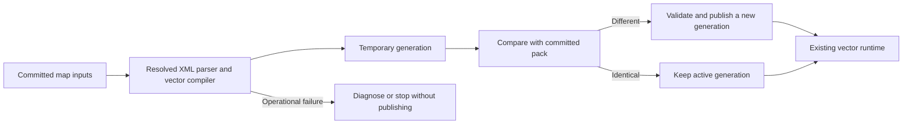

# Design

## Triage

| Trigger | Applies? | Evidence |
|---|---|---|
| T1 Components | no | No new component or connection. The CLI tasks still run the same map code (`mise.toml:70-76`). |
| T2 State | no | No change to the generation or runtime state model. A changed pack would use the existing publication transaction (`tool/maps/pack.dart:3445-3454`). |
| T3 Concurrency | no | The upgrade adds no new worker, async stage or retry. The current check awaits one candidate (`tool/maps/pack.dart:2754-2761`). |
| T4 Boundaries | yes | The new parser and compiler can change bytes at the existing frozen-generation and vector runtime boundaries (`tool/maps/pack.dart:2696-2698`, `2727-2734`; `test/maps/vector_format_test.dart:19-37`). |
| T5 Volume | no | The check still uses the committed generation as its input (`tool/maps/pack.dart:2696-2698`); this change adds no collection or queue. |
| T6 Risk | no | The check builds in a temporary directory and writes no player data (`tool/maps/pack.dart:2737-2744`, `2751-2759`). |

TIER: FULL

## Context

See [proposal.md](proposal.md) for versions and scope. The map tool parses SVGs with `XmlDocument.parse` (`tool/maps/svg.dart:1-15`, `83`), and ADR-0033 makes the committed pack the reproduction baseline. Two existing tests inspect `href` by namespace, one with a wildcard and one with an exact URI (`test/maps/map_preparation_test.dart:1340-1347`; `test/maps/map_preparation_qualification_test.dart:559-565`). Migrate both from `namespace:` to `namespaceUri:` and verify A2 without changing the wildcard, URI or expected value. Update the two selected-version rows and compare the upstream license files with the notices (`THIRD_PARTY_NOTICES.md:1082-1087`, `1110-1116`, `1175-1181`). The codec test encodes a small SVG, checks its header and decodes it (`test/maps/vector_format_test.dart:19-37`).

The app-icon build calls `compileSources` on the normal and optional small source before rendering (`tool/app_icon/build.dart:99-117`). The shared app-icon compile step delegates to `compileIconSvg` and reports compiler exceptions by filename (`tool/app_icon/render.dart:65-68`, `85-93`); `compileIconSvg` treats warnings as errors (`tool/markers/icon_set.dart:474-483`). The marker icon set has a separate closed allowlist that excludes filters (ADR-0023, `docs/adr/0023-project-authored-map-marker-icons.md:13-17`). The test fixture shared with the icon sheet currently uses `<filter>` as the rejected element (`test/tool/app_icon/support/icon_fixture.dart:12-15`, `test/tool/app_icon/build_test.dart:70-105`, `test/tool/app_icon/sheet_test.dart:143`).

## Decisions

### D1: Keep app-icon acceptance tied to the compiler

- **Choice:** App-icon sources may use filters the compiler accepts. Keep the existing compile and render checks and the marker set's separate filter ban. Use `<foreignObject>` for the rejection fixture, subject to the offline proof in A1.
- **Rejected:** Add an app-icon filter allowlist or copy the marker ban. That would add an admission policy beyond the app-icon compiler and render checks.
- **Reversal cost:** low.
- **Important:** yes. It sets the admission boundary for future app-icon sources.
- **Chosen by:** user. The owner answered "Allow them" on 2026-11-26.

### D2: Use reproduction to decide whether to rebuild

- **Choice:** Run `maps:check` once with the upgraded dependencies. Keep the generation if it reproduces. If output differs, use `maps:rebuild` with its existing validation and report, and commit the generation, pointer and asset list together. An operational failure does not establish artwork drift.
- **Rejected:** Rebuild on every dependency upgrade. That would replace a generation whose bytes still reproduce and rewrite accurate historical provenance.
- **Reversal cost:** low.
- **Important:** no. ADR-0033 already defines the contract and outcome for each case.
- **Chosen by:** user.

### Decision summary

| # | Decision | Choice | Rejected | Reversal cost | Important | Chosen by |
|---|---|---|---|---|---|---|
| S1 | Upgrade scope | Compiler and XML only | Include the Flutter SDK and test tools | low | no | user |
| D1 | App-icon filters | Accept what compiles and renders | Apply a new ban | low | yes | user |
| D2 | Pack rebuild | Rebuild only on output differences | Rebuild on version change | low | no | user |

## Assumptions

- **A1:** The resolved pair rejects an SVG with `<foreignObject>` when compiler warnings are errors. That result is not established by the tracked wrapper, which only sets the flag (`tool/markers/icon_set.dart:474-483`). Verify it in the existing normal-source and small-source build tests and the vector-candidate sheet test before accepting the fixture. Those tests must still name the bad file and confirm failure happens before rendering or replacing outputs. D1 relies on this proof for fixture selection, not for the owner policy.
- **A2:** With resolved `xml` 7.0.1, `namespaceUri:` preserves the existing wildcard and exact xlink URI matches. The tracked tests still use the old argument. Verify the wildcard assertion in the pinned fast suite and the exact URI assertion in the hosted qualification suite; the fast suite excludes qualification (`mise.toml:8-17`). The XML test migration depends on both assertions keeping their existing expected values.

## Carried constraints

- **C1:** App-icon SVG admission follows the existing compiler and render checks. Kind: invariant. Destination: spec: specs/app-icon/spec.md → Requirement: The icon build also writes the in-app vector.
- **C2:** A pack that reproduces keeps its original generation and build provenance. Kind: invariant. Destination: ADR 0033.
- **C3:** The marker icon set forbids filters independently of available compiler features. Kind: invariant. Destination: spec: specs/map-marker-icons/spec.md → Requirement: Icon files use the restricted single-tint vector form.
- **C4:** The operator serializes pack publication writers. Kind: invariant. Destination: spec: specs/prepared-map-packs/spec.md → Requirement: Explicit publication uses the staged candidate.
- **C5:** Non-provenance differences in a rebuilt pack require the owner's check of the maps named in the report before merge. Kind: invariant. Destination: spec: specs/prepared-map-packs/spec.md → Requirement: One command rebuilds and promotes the committed pack.

## Diagrams (FULL)

## State & Ownership (FULL)

| State | Owner (sole writer) | Lifetime | Invalidation / rebuild | Authoritative copy |
|---|---|---|---|---|
| Dependency constraints and resolution | `pubspec.yaml` for constraints, Pub for the lock | Until the next upgrade | Resolve only the two pins and keep unrelated versions locked | `pubspec.yaml` and `pubspec.lock` for their respective roles |
| Active pack and asset block | Existing map publication transaction | Until a validated replacement | `maps:rebuild` publishes the pointer, asset block and generation inventory in separate steps; a failed publication needs the consistency check below | `assets/maps/active.json` selects the generation; the pubspec asset block must agree |
| Candidate for reproduction | `checkActive` | One check | `finally` attempts cleanup; an error leaves the named temp path for inspection | Temporary data only; never loaded by the app |

## Failure & Visibility (FULL)

| Component | Failure | Recovery | Retry safe? | Who finds out |
|---|---|---|---|---|
| Dependency resolution | Solver fails or changes an unrelated pin | Stop before committing and resolve within the approved scope | Yes, with the same pins | PR author |
| Offline verification | Test or analyzer failure | Run pinned `mise run analyze` and `mise run test`; keep the existing failures visible. Scope exceptions are listed below | After a fix | Test output and CI |
| Pack check | Reproduction or operational failure | Keep the pack on the success line. Rebuild only on the difference report with the `maps:rebuild` instruction; diagnose other failures without publishing | Read-only, retry only after correcting an operational fault | Command output and CI |
| Pack publication | Validation fails, or transaction fails or is interrupted | Stop and check the consistency of the pointer, generated asset block and generation inventory before committing | Only after checking the actual publication phase and leftovers | Command output and PR |

## Resource Bounds (FULL)

The change adds no queue, cache, timeout or parallel job. `checkActive` allocates at most one temporary directory, after its leftover guard passes, and attempts removal in `finally`. A guard refusal names a pack leftover, not a new check directory. A cleanup error prints the remaining temporary path to stderr without changing the comparison result, even on success (`tool/maps/pack.dart:2750-2775`). Inspect that warning; it does not indicate artwork drift. Work follows the frozen inventory. A 10× or 100× larger pack would consume more disk and time within the existing builder; this upgrade does not add inputs or change that algorithm.

## Flow & State Gaps (FULL)

`maps:check` does not read the pubspec (`tool/maps/prepare.dart:251-257`). Both an operational failure and a comparison failure can exit 1 (`tool/maps/prepare.dart:148-159`). The reproduced line means retain the pack; the per-map difference report with the `maps:rebuild` instruction follows a successful candidate build (`tool/maps/pack.dart:2754-2768`). Run the initial check once, separately from the hosted CI gate on the final commit (`.github/workflows/gates.yml:74-84`). Check the gaming gate before heavy work and use hosted CI while the owner is gaming.

Do not overlap pack writers. The leftover guard checks `active.next.json` and `.staging` (`tool/maps/pack.dart:2224-2248`), but promotion can clear those before pubspec replacement and pruning (`tool/maps/pack.dart:2130-2182`, `3034-3053`). After an interrupted or failed rebuild, stop and inspect the pointer, the generated asset block, remaining generation directories and reported leftovers. Use the transaction's phase-specific recovery (`tool/maps/pack.dart:3064-3105`). A passing reproduction check or absent leftovers does not establish complete publication; commit only when the pointer, declarations and inventory agree. Keep the original report through recovery. Rebuild can compare against an already switched pointer and say no review is needed (`tool/maps/pack.dart:3434-3444`), which does not cancel the original owner check.

If rebuild emits `Artwork changed`, put `artwork changed: owner check` and the per-map report in the PR. That covers manifest-only changes as well as changed files (`tool/maps/pack.dart:2396-2414`, `3434-3444`). The check remains unverified until the owner reports it.

## Mechanism Ledger (FULL)

| Mechanism | Built? | Why | Evidence that would change the call |
|---|---|---|---|
| Compiler or XML pin in the pack loader | no | The codec test and reproduction check already cover the runtime format and frozen output | None in this change; it would supersede ADR-0033 |
| App-icon filter policy in code | no | The owner chose to keep compiler-based acceptance | A future owner decision to narrow app-icon source admission |
| New map rebuild path | no | The existing path checks, reports and publishes a validated generation | A separate failure of the existing transaction contract |

## Risks / Trade-offs

Retain the existing SVG namespace assertions and run the hosted offline gates. Require `test/maps/vector_format_test.dart` to pass with the resolved pair, on its own or in the pinned fast suite, before any `maps:rebuild` publication. Stop on a header mismatch or decode failure. A genuine format mismatch needs an owner scope decision; an approved format change must update `preparedVectorCodecFormat` before `maps:rebuild`. A decode failure is not a reason to change the constant. If the committed app icon no longer recompiles to the same bytes, or compiled marker assets fail the bundle check, stop for a scope decision rather than changing artwork or weakening checks (`test/tool/app_icon/committed_icon_test.dart:113-134`; `tool/vision/check_bundle.dart:620-669`).

## ADRs

- In force: ADR-0023 (marker icon admission), ADR-0028 (compiled app icon), ADR-0033 (reproduction and conditional rebuild).
- To record during apply: none. The approval keeps the existing app-icon contract instead of changing the architecture.

## Branch gate

The dispatch named the existing Orca branch and authorized a manual gate check if the standard clean-main gate refused that worktree. The repository already had the pinned `sw` 0.39.1 (interface 3), so no install was needed. Before scaffolding, `openspec list --json` and both Git root checks reported a repo-local change. The `sw vcs state` result was `branch: feat/update-map-toolchain`, `main: main`, `clean: true`, `on_main: false`. That last value refused the standard gate; the matching base does not change it. The initial ref check put both mains at `aca849b56df461b3b94a92ec50fe604693c9b181`. `sw vcs fetch-main --login KintsugiBot` returned that same commit for `origin/main`, and `HEAD^` matched it after the single requested roadmap commit (`80617d57a0`). The archive listing at the shared main commit had no `update-map-toolchain` entry.
