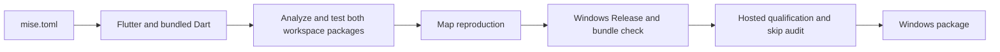
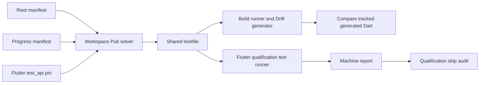

# Design

## Triage

| Trigger | Applies? | Evidence |
|---|---|---|
| T1 Components | Yes | One SDK pin feeds the Dart workspace resolver, Flutter tests, the Windows Release build, and the qualification consumer of that build (`mise.toml:1-21,98-104`, `.github/workflows/gates.yml:74-103`). |
| T2 State | No | Pub regenerates the single root lockfile, not app state (`pubspec.lock:1-11`, `pubspec.yaml:6-11`, `packages/blackgrid_progress/pubspec.yaml:1-7`, `docs/adr/0042-progress-catalog-package.md:12-16`). This change adds no cache or migration. |
| T3 Concurrency | No | The change preserves the shared workflow's sequential install, analysis, test, build, qualification and package steps (`.github/workflows/gates.yml:45-46,74-103`). |
| T4 Boundaries | Yes | The workspace depends on `flutter_test` and `build_runner` (`pubspec.yaml:25-39`). Flutter builds the Windows runtime bundle (`tool/release/src/build_step.dart:51-66`), and qualification runs its test runner and reads its machine report (`tool/ci/qualification.dart:56-76`). |
| T5 Volume | No | No new input, history or growing collection. Map reproduction still uses the prepared pack (`mise.toml:70-72`); qualification receives the same bundle, OCR runtime and CMake paths (`.github/workflows/gates.yml:92-100`). |
| T6 Risk | Yes | The SDK runs in CI and ships in the Windows build (`.github/workflows/gates.yml:45-46`, `tool/release/src/build_step.dart:51-66`). Preserve the hosted-only no-game confirmation and skip audit (`.github/workflows/gates.yml:92-100`, `tool/ci/qualification.dart:50-52,70-96`, `tool/ci/qualification_skips.yaml:11-13`). |

TIER: FULL

## Context

`mise.toml:1-2` is the SDK source of truth. CI installs tools from it via `jdx/mise-action` (`.github/workflows/gates.yml:45-46`). The PR and tag workflows both call the gates (`.github/workflows/ci.yml:15-17`, `.github/workflows/release.yml:83-90`). Neither supplies another Flutter pin.

The root owns the workspace and its Pub lockfile (`pubspec.yaml:6-10`, `pubspec.lock:1-11`, `docs/adr/0042-progress-catalog-package.md:12-14`). The progress member declares `resolution: workspace` and has its own test constraint (`packages/blackgrid_progress/pubspec.yaml:1-11`). The database developer workflow invokes `build_runner build` before the separate Drift schema commands (`README.md:440-447`). Exercise the generator without running schema commands.

The Windows workflow runs `maps:check`, builds the Release bundle, gives the bundle and OCR runtime to qualification, and packages only after qualification passes (`.github/workflows/gates.yml:80-103`). The runner passes a JSON reporter path to Flutter and audits the resulting report (`tool/ci/qualification.dart:7,50-76,83-96`) using the committed allowlist (`tool/ci/qualification_skips.yaml:14-42`).

On a pull request, the gates use the default full-history checkout for the PR event, which is GitHub's merge commit, not the PR branch tip (`.github/workflows/ci.yml:3-6,15-17`, `.github/workflows/gates.yml:31-37`). The build stamps the actual checkout SHA and commit count; packaging checks that SHA and writes the count to the installer file version (`tool/release/src/build_step.dart:35-39,59-65,84-87`, `tool/release/src/package_step.dart:97-111,171-178`). Only tagged release runs upload the installer (`.github/workflows/gates.yml:113-126`). Before a release, the owner can use the documented build and package tasks on a clean, full-history checkout of the intended source SHA to make a separate installer candidate (`README.md:476-483`).

Flutter 3.50.1 marks the legacy Material library deprecated and names `package:material_ui/material_ui.dart` as the replacement ([SDK source](https://github.com/flutter/flutter/blob/3.50.1/packages/flutter/lib/material.dart)). The apply run of the existing `flutter analyze` command (`mise.toml:4-6`) failed on that deprecation. Blackgrid's root app, widgets, offline tests, Windows smoke test and map tool use the legacy import (`lib/main.dart:1-3`, `lib/ui/evidence_panels.dart:1-2`, `test/widget_test.dart:1-4`, `integration_test/m1_windows_smoke_test.dart:8-10`, `tool/maps/qualify_native.dart:4-6`).

The generator imports old Material for generated `ThemeExtension` tokens (`brand/tools/build.mjs:83-91,149-152`). The app uses a byte-identical copy of that output (`brand/flutter/ember_tokens.dart:1-9`, `lib/ui/ember/ember_tokens.dart:1-9`, `test/ui/ember_theme_test.dart:10-14`), as ADR-0037 requires (`docs/adr/0037-interface-colours-come-from-the-ember-theme.md:13-16`). The analyzer excludes the kit path, not the app copy (`analysis_options.yaml:3-8`). The app copy must migrate without diverging from the kit.

## Decisions

### D1: Use a targeted workspace resolution

- **Choice:** Keep the shared mise and workspace layout. Resolve the requested test and generator changes, and the approved Material migration, with only their required transitive updates. Vet candidate versions before accepting the resolution. Keep the package SDK minimums unless the scoped upgrades require a change.
- **Rejected:** Upgrade the entire graph or add permanent dependency overrides. Pub uses one root lockfile across both manifests (ADR-0042, `docs/adr/0042-progress-catalog-package.md:12-14`); unrelated upgrades make regressions harder to attribute.
- **Reversal cost:** low. The two manifests and lockfile can be reverted together.
- **Important:** no. This preserves the existing workspace and does not introduce a contract or a config key.
- **Chosen by:** agent.

### D2: Keep the complete Windows qualification on hosted CI

- **Choice:** The hosted job is the proof for Windows Release, bundle integrity, audited qualification and packaging. Check for gaming before any heavy local work. If the owner is gaming, use hosted CI rather than the local full suite or build. The optional local checks never supply the hosted no-game confirmation. The owner alone checks installation and app startup with the game closed.
- **Rejected:** Run hosted-only capture qualification or the install check on the developer machine as an agent. That violates the repository safety policy and would not substitute for the owner's install check.
- **Reversal cost:** low for how the upgrade is verified, but the existing safety boundary remains in force.
- **Important:** yes. Qualification touches the native capture library and installation is a user-only boundary.
- **Chosen by:** user.

### D3: Import the official Material library directly

- **Choice:** Add a vetted `material_ui` version to the root manifest only. Replace `package:flutter/material.dart` in active sources with `package:material_ui/material_ui.dart`; the generated Ember file moves through D4. Use an explicit Flutter library import where the official replacement does not export a previously available name. Drop an import only if the resulting analyzer proves it is redundant. Preserve widget construction, assets and assertions.
- **Rejected:** Add a Blackgrid forwarding library or downgrade analyzer severity. Direct imports avoid a local compatibility layer; keeping the analyzer command unchanged exposes missing imports and API differences.
- **Reversal cost:** medium across the app, tests and tools. Revert the imports and the Material dependency together.
- **Important:** yes. The replacement is a shipped dependency and the owner limited the work to mechanical changes.
- **Chosen by:** user.

### D4: Migrate the Ember generator and refresh both copies

- **Choice:** The owner said, "Yes, change the kit's import." Change only the import emitted by `brand/tools/build.mjs` to `package:material_ui/material_ui.dart`. Regenerate the kit output, run the pinned Dart formatter on that generated Dart file only, and copy its formatted bytes to the app. Verify that both copies match byte for byte, only the import differs from each baseline, and token inputs and CSS are unchanged. Stop if formatting or generation introduces any other tracked difference. Keep every token value and the existing equality test.
- **Rejected:** Edit the app copy alone or edit only the two generated files. The first fails the equality test; the second lets the next generation restore the deprecated import.
- **Reversal cost:** low. Revert the matching generator and output lines together.
- **Important:** yes. This amends the owner's earlier restriction against changing the kit and preserves its established app-copy contract.
- **Chosen by:** user.

### Decision summary

| # | Decision | Choice | Rejected | Reversal cost | Important | Chosen by |
|---|---|---|---|---|---|---|
| S1 | Toolchain-only scope | M10 pins, offline gates and owner install | Unrelated updates or `test` 1.33.0 | medium | yes | user |
| S2 | Material migration scope | Migrate imports, including the generated Ember pair, without changing widgets or gates | A separate migration or muted diagnostics | medium | yes | user |
| D1 | Workspace resolution | Targeted update with the existing lockfile | Broad upgrade or permanent overrides | low | no | agent |
| D2 | Windows qualification | Hosted gates and owner-only install check | Agent-run local install or hosted-only capture qualification | low | yes | user |
| D3 | Material import | Direct imports of the official package | Local compatibility library or weaker analysis | medium | yes | user |
| D4 | Ember generation | Change the emitted import and refresh both identical copies | Edit outputs without their generator | low | yes | user |

## Assumptions

- **A1:** Pub can add Material and its localization dependencies without changing unrelated versions. The SDK-only solve preserved all unrelated packages (task 1.1). D1 and D3 depend on an additional dry-run diff before accepting the Material graph.
- **A2:** The Flutter test reporter, generated Drift output, rendered widgets and Windows runner keep their existing Blackgrid contracts. The upgraded toolchain must prove this with the existing tests, a separate generator comparison and hosted CI. The hosted qualification log must show the applicable accepted skips from `tool/ci/qualification_skips.yaml` and an unskipped native capture qualification run. A green exit or a test with synthetic report lines does not prove the upgraded reporter preserved skip handling.
- **A3:** Direct imports and any necessary explicit Flutter imports are enough to preserve Blackgrid's widget behaviour. The package is Flutter's official replacement, but name resolution and Blackgrid's asserted layouts have not been checked under it. D3 requires the unmodified analyzer and existing widget tests.

## Carried constraints

Existing invariants and their authoritative destinations:

- **C1:** Keep the progress member portable and use one Pub workspace lockfile. Kind: invariant. Destination: ADR 0042.
- **C2:** CI takes the SDK version only from mise. Kind: invariant. Destination: `spec: specs/continuous-integration/spec.md → Requirement: CI uses the pinned toolchain`.
- **C3:** Qualification uses the Release bundle from that hosted run. Kind: invariant. Destination: `spec: specs/continuous-integration/spec.md → Requirement: Qualification runs against the CI-built bundle`.
- **C4:** Preserve the committed qualification skip rules. Kind: invariant. Destination: `spec: specs/continuous-integration/spec.md → Requirement: Qualification skips are audited against a committed allowlist`.
- **C5:** Never supply the hosted no-game confirmation on a developer machine. Kind: invariant. Destination: `spec: specs/continuous-integration/spec.md → Requirement: The no-games confirmation is scoped to the hosted runner`.
- **C6:** Retain the sequential hosted job and its deadline. Kind: invariant. Destination: ADR 0024.
- **C7:** Package only after qualification. Kind: invariant. Destination: ADR 0025.
- **C8:** Keep byte-identical map reproduction. Kind: invariant. Destination: ADR 0033.
- **C9:** Database schema changes require the versioned migration path; this upgrade only exercises generation. Kind: invariant. Destination: ADR 0003.
- **C10:** Keep the app's generated Ember tokens byte-identical to the brand kit output. Kind: invariant. Destination: ADR 0037.

Change-specific limits belong to M10's `upgrade-flutter-3-50` roadmap entry and S1/S2, not to a new durable spec. Keep `test` 1.33.0 out, do not use dependency overrides or update unrelated packages, and keep install and first launch owner-only with the game closed. The generator verification task compares tracked output without changing the schema or historical snapshots. Stop for an owner scope decision if the Material migration needs a widget or behaviour change beyond the import move, or if a map-toolchain change is needed.

## Diagrams (FULL)

T1, components and build order:

T4, tool and artifact contracts:

## State & Ownership (FULL)

| State | Owner (sole writer) | Lifetime | Invalidation / rebuild | Authoritative copy |
|---|---|---|---|---|
| SDK version | Repository maintainer | Commit | Change the mise pin | `mise.toml` |
| Resolved workspace graph | Pub | Commit | Resolve both manifests against the pinned SDK | `pubspec.lock` |
| Generated Drift Dart | Existing generator | Commit | Compare the upgraded generator's output; update only if changed and equivalent | Tracked generated files |
| Release bundle and qualification report | Hosted gates job, with one producer per artifact | Job; machine report is temporary | Rebuild on a clean checkout and audit the report from that run | Job build output and check result |

## Failure & Visibility (FULL)

| Component | Fails or stops mid-operation | Recovery | Retry safe? | Who finds out |
|---|---|---|---|---|
| Mise or Pub | The pin will not install or the graph cannot resolve | Diagnose the exact candidate, constraint or download; do not substitute another SDK or an override | A fresh tool download or resolution is safe after correcting the cause | Worker and CI |
| Analyzer or tests | A diagnostic or failing assertion | Prove whether it is attributable to the upgrade; fix the cause or stop on a scope change | Rerun the affected check after a fix, never to turn a flaky test green | Worker and CI |
| Generator | `mise exec -- dart run build_runner build` fails or changes tracked output | Run the command separately with the accepted lockfile and compare generated Dart with the baseline; record no diff or explain equivalent changes. The hosted workflow does not run this command (`.github/workflows/gates.yml:74-103`) | Safe after correcting the cause; do not claim proof from a green CI gate alone | Worker |
| Map, Release, qualification or packaging | A gate fails before the next gate | Preserve the failure and fix its cause without weakening the reproduction check or allowlist | The next clean CI run rebuilds and audits its own output | PR check |
| Installed app | Setup or first launch fails on the owner's machine | Record the exact failure for the owner; do not claim installation passed based on packaging | The owner decides whether to retry | Owner |

## Resource Bounds (FULL)

The change adds no queues, buffers, timing thresholds or caches. The dependency resolution starts from the existing lockfile and the fixed target manifests. The hosted job keeps the 120-minute timeout (`.github/workflows/gates.yml:23-27`). Its work does not scale with player data. Qualification creates one JSON report per run and removes its temporary directory on exit (`tool/ci/qualification.dart:54-65,95-99`). At ten or a hundred times today's duration, CI times out visibly; the design neither loosens the limit nor adds retries.

## Flow & State Gaps (FULL)

- A dry-run resolution is not proof of execution. Check the selected versions against the proposal and record the actual lockfile changes in the SDK and Material evidence. Analyze, generate and test using the final graph. If a required dependency would expand the scope, pause for the owner and review the amended plan first.
- A failed build cannot qualify a previous bundle. CI uses the current checkout and the build output from the same job (`.github/workflows/gates.yml:31-37,83-100`). Packaging runs only after those steps pass.
- Wait for the check reported on the final archived PR head. Record both that head SHA and the actual checkout SHA shown by the successful hosted run. Check the qualification log for the applicable `Accepted skip:` entries and the unskipped native capture test (A2).
- Leave installation unverified until the owner reports it. Record the source SHA, displayed build number, installer SHA-256, and setup and first-launch results. A local PR-head installer proves that candidate only, not a hosted artifact or a later tag. If testing the same source as CI, build from the actual qualified checkout SHA with full history and label the installer a rebuild. Do not add an upload or start a release for this check.

## Mechanism Ledger (FULL)

| Mechanism | Built? | Why | Evidence that would change the call |
|---|---|---|---|
| Scoped version changes and lockfile comparison | Yes; use existing Pub tools | A broad solve can bring unrelated packages into this upgrade | A required change that cannot resolve without expanding scope goes to the owner |
| Extra CI Flutter pin or additional qualification gate | No | Mise and the existing hosted job already own the version and prove the whole offline path | Evidence that the workflow bypasses mise or skips one of the required offline gates |
| New skip or longer test deadline | No | A passing run after weakening a test would not prove the upgraded contract | A real host limitation must meet ADR-0024 and be reviewed by the owner |

## Risks / Trade-offs

- Flutter may alter a widget or render result without an analyzer error. Keep the existing UI assertions and assess the smallest failing test before changing a golden or layout expectation.
- The standalone Material package may behave differently despite equivalent exports. The analyzer must show no new diagnostics and the existing widget tests must pass without weakening assertions. Verify any apparent layout change before treating it as a regression; a fix beyond imports needs an owner decision.
- Build runner 2.17.1 uses `build` 5. Run the documented generator and inspect its tracked output for semantic changes; do not change the database schema or regenerate historical snapshots solely for this bump.
- The map compiler and codec pins are not part of this change. CI still proves byte-identical map output. Do not refresh or replace artwork to make the SDK bump green.

## ADRs

- **In force, constraining this change:** [0003](../../../docs/adr/0003-single-drift-sqlite-store.md), [0024](../../../docs/adr/0024-hosted-ci-runs-every-offline-gate.md), [0025](../../../docs/adr/0025-release-packaging.md), [0029](../../../docs/adr/0029-release-notes-come-from-each-proposal.md), [0033](../../../docs/adr/0033-map-packs-proven-by-reproduction.md), [0037](../../../docs/adr/0037-interface-colours-come-from-the-ember-theme.md), [0042](../../../docs/adr/0042-progress-catalog-package.md).
- **To record during apply:** None. This does not change an architectural boundary or policy.
